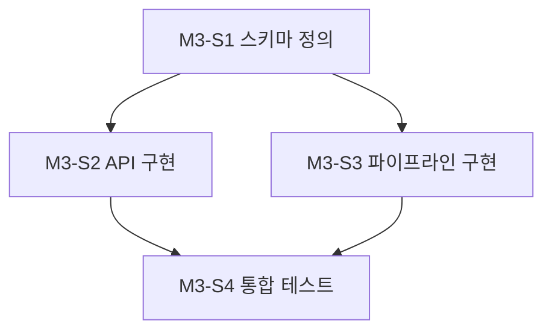

# Workflow: Work Planning

This workflow governs how an implementation or improvement plan is produced from an existing issue and stored under `docs/records/1_plans/`.

Read this file completely before creating any plan.

---

## 1. Trigger

Follow this workflow when the user requests a plan (implementation design, improvement design, execution procedure) for an issue that already exists under `docs/records/0_issues/`.

If no issue exists for the work, follow `issue-creation.md` first. A plan without a source issue is not allowed.

---

## 2. Preconditions

Before writing the plan, read:

1. the source issue in `docs/records/0_issues/`;
2. every existing decision under `docs/records/3_decisions/` relevant to the affected area — a plan MUST NOT silently contradict an accepted ADR;
3. the `README.md` of every affected component;
4. prior plans and logs related to the same issue or components;
5. the active session `STATUS.md` if a session exists.

If a required component `README.md` is empty or lacks information the plan depends on (runtime, commands, test framework, interfaces), the plan MUST include authoring or completing that README as an early Slice of the first milestone touching that component, committed separately per `how-to-work.md` section 5.1. Do not silently plan against an empty README.

---

## 3. File Naming

```text
docs/records/1_plans/VOIC-<TYPE>-<NNN>-plan.md
```

The plan inherits the source issue ID. If a plan is rejected or superseded and a new plan is written for the same issue, append a sequence suffix:

```text
VOIC-<TYPE>-<NNN>-plan-02.md
```

The superseded plan file is never deleted or rewritten; set its status to `superseded` and cross-link both plans.

---

## 4. Plan Status Lifecycle

Every plan carries exactly one status in its metadata table:

```text
proposed → approved → executed
          ↘ rejected / superseded
```

| Status | Meaning | Who may set it |
| --- | --- | --- |
| `proposed` | Drafted, awaiting human review | agent (at creation) |
| `approved` | Human explicitly approved execution in conversation | agent, ONLY after explicit human approval |
| `executed` | Execution completed and evidence logged | agent, after `how-to-work.md` completion |
| `rejected` | Human declined the plan | agent, after explicit human rejection |
| `superseded` | Replaced by a newer plan | agent, when the replacement plan is created |

Hard rules:

* An agent MUST NOT set `approved` on its own judgment. Approval exists only when the human explicitly approves in conversation.
* When setting `approved`, record `승인자` (the human) and `승인 일시` in the metadata table.
* A plan file merely existing in `docs/records/1_plans/` means nothing about approval.
* Execution of any plan requires status `approved` and MUST follow `how-to-work.md`.

---

## 5. Creation Steps

1. Copy `.agents/templates/plan.md` as the document skeleton.
2. Write the document in Korean. Code, commands, identifiers, and raw logs may remain unchanged.
3. Fill the metadata table (plan ID, source issue link, status `proposed`, creation time, authoring agent).
4. The plan MUST address, as applicable:
   * objective and scope (including explicit non-goals);
   * affected components — this means **application-layer modification targets ONLY** (`apps/*`, `deploy/`, `tests/`). Documents and governance files (`docs/`, `AGENTS.md`, `.agents/`) are NEVER listed as affected components even when the plan modifies them; record those in the scope and the WBS instead;
   * work breakdown per section 6 (Milestone / Slice / Task);
   * dependencies (internal and external);
   * risks and mitigations;
   * validation criteria and test strategy (unit vs integration, per AGENTS.md section 10) — the plan MUST review whether integration tests are needed and obtain the user's prior approval for them (Gate 1 of `create-testcase.md` section 4); integration tests additionally require final approval immediately before execution (Gate 2);
   * rollout or migration requirements;
   * completion gates.
5. If designing the plan involves choosing between meaningful architectural alternatives, ALSO follow `arch-decision-record.md` and link the resulting ADR from the plan.

---

## 6. Work Breakdown Structure (Milestone / Slice / Task)

Every plan MUST decompose its work into exactly this three-level hierarchy:

```text
Milestone  M<n>            — major verifiable stage of the plan
└─ Slice   M<n>-S<m>       — independently deliverable piece of a milestone
   └─ Task M<n>-S<m>-T<k>  — smallest execution unit of a slice
```

### 6.1 Numbering

* **Milestone numbers are PROJECT-GLOBAL and cumulative.** They never reset per plan. Before allocating, scan every plan in `docs/records/1_plans/` for the highest existing milestone number and continue from `max + 1`. (Example: if a previous plan ended at `M4`, the next plan's first milestone is `M5`.)
* **Slice numbers are unique only within their parent milestone.** Each milestone restarts at `S1`.
* **Task numbers are unique only within their parent slice.** Each slice restarts at `T1`.

### 6.2 Required Fields Per Work Item

EVERY Milestone, Slice, and Task MUST directly and explicitly state, visible in the document itself (not implied, not merged into prose):

* **진행 배경** — why this work item exists now;
* **진행 목적** — what it is trying to achieve;
* **AS-IS & TO-BE** — current state vs target state after completion;
* **작업 종료조건** — the concrete, checkable condition under which the item is done.

A work item missing any of these fields is an incomplete plan and MUST NOT be submitted for approval.

### 6.3 Ordering Diagrams (mermaid)

* Every **Milestone** MUST include a mermaid diagram showing the execution order and dependencies of its child **Slices**.
* Every **Slice** MUST include a mermaid diagram showing the execution order and dependencies of its child **Tasks**.
* The diagrams MUST make two things visually identifiable: (a) the required sequential order, and (b) which items can run in parallel — draw parallelizable items as parallel branches.

Example (Slices of `M3`; `S2` and `S3` are parallelizable after `S1`):



---

## 7. Approval Handling

1. Present a Korean summary of the plan to the user and explicitly request approval.
2. Do not begin any implementation while the status is `proposed`.
3. On explicit approval: update status to `approved`, fill `승인자` and `승인 일시`, update the session `STATUS.md`, then transition to `how-to-work.md` when execution is requested.
4. On rejection or requested changes: revise the plan (still `proposed`), or mark it `rejected` and create a successor plan per section 3.

---

## 8. Postconditions

* The plan file exists with correct ID, links to its source issue, and an accurate status.
* Work is decomposed into Milestone/Slice/Task with correct numbering, all required fields per item, and mermaid ordering diagrams (section 6).
* Relevant ADRs are linked (or created via `arch-decision-record.md`).
* The active session `STATUS.md` references the plan and its status.
