# 0. 계획 정보

|key|value|
|---|---|
|계획 ID|VOIC-FEAT-001-plan-02|
|원본 이슈|[VOIC-FEAT-001](../0_issues/VOIC-FEAT-001.md)|
|상태|approved|
|작성 시간|2026-09-24 08:28:10 UTC|
|작성 에이전트|Codex|
|승인자|사용자 (M4만 우선 진행)|
|승인 일시|2026-09-24 08:42:35 UTC|
|최초 승인 범위|M4만 실행 승인; M5·M6은 후속 대화에서 각각 실행 지시됨. M6 Gate 1 범위는 아래 기록; Gate 2는 미승인|
|후속 실행 지시|사용자가 M5는 이전 세션, M6는 `20260924-ht813-m6` 대화에서 각각 명시적으로 지시|
|M6 변경 승인|2026-09-24 15:14 UTC 사용자 "M6 변경안 승인" — 다중 턴·전체 FXO 착신·30일 보존의 S1-T3~T6, S2/S3 및 완료 게이트 변경|
|M6-S3 구체 지시|2026-10-07 사용자 명시 지시: STT/TTS 모델별 컨테이너, STT 준비 후 TTS 30초 지연, 백엔드 모델 상태 검사, Tempo/Grafana 단계 지연·GPU 가시화. [ADR-011](../3_decisions/ADR-011-warm-model-services-observability.md) 참조|
|M6 Gate 1·2|기존 웹·작업 API·FXO 발신, 추가 다중 턴 FXO 발신, 신규 전체 FXO 착신 및 보존·삭제 파일 경계 시나리오를 사용자가 각각 명시 승인. [구체 시나리오](../../../.agents/sessions/20260924-ht813-m6/GATE-PROPOSAL.md). 2026-09-24 후속 지시에서 승인된 M6 범위의 각 Gate 승인을 지시자 권한으로 포괄 승인. FXS 실장은 이번 Phase 미승인·전화기 연결 전 보류|
|대체 계획|[VOIC-FEAT-001-plan](VOIC-FEAT-001-plan.md) (M1-S1 완료, M1-S2 일부 수행; 나머지는 미수행)|

---

# 1. 개요

## A. 목표

기존 한국어 STT/TTS와 `llm.example.test` 작업 처리 백엔드를 Python/FastAPI 공통 코어에 연결한다. 웹 음성 채널과 HT813 FXO 직접 SIP/RTP 피어링을 통한 **에이전트의 외부 발신 및 모든 외부 착신의 에이전트 연결**을 제공한다. FXS 전화기에서 누르는 번호의 외부 발신은 물리 전화기 연결 후 검증 대상으로 남긴다.

이 계획은 처음에 [ADR-004](../3_decisions/ADR-004-ht813-direct-outbound-telephony.md)에 따른 대체안으로 승인됐으며, M6 전화 착신 경계는 [ADR-009](../3_decisions/ADR-009-ht813-all-inbound-agent.md)에 따라 변경됐다. 이전 계획의 M1-S1과 M1-S2에서 이미 확인한 사실은 유지한다. M4부터는 **실제 완료되지 않은 작업만** 수행한다.

## B. 범위

- HT813 직접 SIP/RTP 발신의 연결 방식, 번호 정책, 오디오·DTMF·통화 종료 계약 검증
- 발신자 Caller ID 제한 없는 FXO 외부 착신의 에이전트 SIP 수신·다중 턴·상대 종료 검증; FXS의 PSTN 발신은 전화기 연결 후 검증
- 기존 모델·GPU 환경 조사, STT/TTS 후보 선정, 음성 계약, 코어·어댑터·웹 채널 구현
- HT813 발신·착신 채널 구현, 설정·운영 문서 및 `.env.example` 갱신; 비밀은 로컬 `.env` 또는 런타임 주입
- PRD/SRS 작성 및 요구사항 추적, 단위·승인된 통합 검증, 로컬 배포
- 기존 단일 활성 세션 제한과 음성·원문 30일 보존·삭제 정책 유지

## C. 제외 범위 (Non-goals)

- Asterisk 서버 설치·운영 또는 Asterisk 전용 채널 구현
- 초기 단계의 `FXS → 에이전트`, Caller ID별 에이전트/FXS 착신 분기, 다중 PSTN 회선 및 동시 전화 통화
- FXS 전화기 미연결 상태에서 FXS 발신을 검증 완료로 처리하는 것
- STT/TTS 신규 학습, 별도 웹 UI 제작, 대규모 분산 배포

## D. 실행 전제

최초 승인 당시에는 M4만 실행 범위였고 M5·M6은 후속 대화에서 각각 명시 지시됐다. 실전화 설정 변경·발신 및 통합 테스트 실행에는 사전에 대상 번호·영향 범위를 확정하고 `create-testcase.md`의 Gate 2를 별도로 받는다. 새로운 HT813 통합 시나리오의 Gate 1은 이 계획 승인과 별도로 명시 승인됐다. 물리 FXS 전화기가 준비되지 않으면 해당 검증 결과는 보류로 기록하고 완료로 표시하지 않는다.

2026-09-24 후속 대화에서 사용자가 M6 실행을 명시 지시했고, 별도 메시지로 Gate 1 진행을 승인했다. 이 승인은 [제안된 웹·작업 API·HT813 FXO 시나리오](../../../.agents/sessions/20260924-ht813-m6/GATE-PROPOSAL.md)의 사전 범위로 기록한다. 사용자는 본인 소유 착신 번호 시험과 FXO 회선 점유를 허용했고 시험은 세션 중 준비되는 대로 가능하다고 답했다. 번호 전체 값은 저장소에 남기지 않는다. HT813 설정 백업과 구체 변경 전/후 값은 아직 미확정이다. 통합 테스트 생성·실행과 장비 변경·실전화 직전의 Gate 2는 각각 별도로 받는다. FXS 전화기는 미연결이고 이번 Phase 검증도 사용자가 승인하지 않았다.

2026-09-24 M6 후속 대화에서 사용자는 발신자 번호별 착신 분기를 철회하고 **모든 FXO 외부 착신을 에이전트에 연결**하도록 정정했다. [M6 변경안](../../../.agents/sessions/20260924-ht813-m6/PLAN-AMENDMENT-PROPOSAL.md)과 [ADR-009](../3_decisions/ADR-009-ht813-all-inbound-agent.md)의 직접 SIP 방식은 사용자 승인을 받았고 아래 WBS·완료 게이트에 반영했다. 에이전트 외부 발신 허용 번호 정책은 유지한다. [ADR-008](../3_decisions/ADR-008-local-encrypted-retention.md)의 암호화 보존 방식도 사용자 승인을 받았다.

M6-S1에서 발견한 전화 연결 공백에 대한 ADR-006은 사용자의 후속 정정으로 대체됐다. 현재 수락된 결정은 한 통화의 연속 대화와 상대 종료를 정한 [ADR-007](../3_decisions/ADR-007-ht813-multiturn-call-lifecycle.md)이다. [M6 다중 턴·전체 착신·보존 변경안](../../../.agents/sessions/20260924-ht813-m6/PLAN-AMENDMENT-PROPOSAL.md)은 2026-09-24 15:14 UTC 사용자에게 명시 승인됐고 아래 M6 WBS에 반영했다.

## E. 기존 마일스톤과의 대응

기존 계획의 M2·M3은 **착수되지 않았다**. 기존 계획이 `superseded`가 되면서 그 번호는 실행에 사용하지 않지만, 아래 작업은 새 계획으로 이어진다. 마일스톤 번호가 M4부터 시작하는 이유는 저장소의 `work-planning.md`가 프로젝트 전체에서 번호를 누적하도록 정하기 때문이다.

|기존 계획의 작업|현재까지의 상태|대체 계획의 작업|
|---|---|---|
|M1-S1 컴포넌트 골격|완료, 결과 유지|재실행하지 않음|
|M1-S2 환경·모델 검증|전화 장비 조사만 일부 수행|M4-S1 환경 정합, M4-S2 모델 검증|
|M1-S3 계약, M1-S4 PRD/SRS|미착수|M4-S2 계약, M4-S3 PRD/SRS|
|M2-S1 코어|미착수|M5-S1 코어|
|M2-S2 STT, M2-S4 TTS|미착수|M5-S2 STT/TTS 어댑터|
|M2-S3 작업 처리|미착수|M5-S3 작업 처리 어댑터|
|M2-S5 웹 채널|미착수|M5-S4 웹 음성 채널|
|M2-S6 Asterisk 채널|미착수; Asterisk 전제는 폐기|M5-S5 HT813 FXO 직접 발신 채널|
|M3-S1 조립·스모크|미착수|M6-S1 조립·스모크|
|M3-S2 웹 경계 통합|미착수|M6-S2 웹 경계 검증|
|M3-S3 Asterisk 경계 통합|미착수; Asterisk 대상은 폐기|M6-S2 HT813 FXO 발신·전체 착신 경계 검증|
|M3-S4 성능·복구, M3-S5 배포|미착수|M6-S3 성능·복구·배포|

---

# 2. 영향 컴포넌트

- [ ] `apps/orchestrator/`
- [ ] `apps/model-serving/` (2026-10-07 M6-S3 사용자 지시로 추가)
- [ ] `deploy/`
- [ ] `tests/units/orchestrator/` 및 `tests/integrations/`

---

# 3. 작업 분해 구조 (Milestone / Slice / Task)

## M4. 환경·전화 경계·계약 기준선 확정

- 진행 배경: 기존 M1-S1은 완료되었지만 M1-S2 이후는 미완료이며, Asterisk 전제가 HT813 현황과 충돌한다.
- 진행 목적: 모델·런타임과 직접 발신의 실행 가능성을 확인하고 모듈 계약 및 사용자 요구사항을 동결한다.
- AS-IS: HT813 웹 화면과 공식 자료만 확인했고 SIP/RTP 통화, FXS 로컬 통화, 모델 성능 및 계약은 검증되지 않았다.
- TO-BE: 확인된 장비·모델 제약을 반영한 계약, 테스트 기준, PRD/SRS가 존재한다.
- 작업 종료조건: M4의 세 Slice 결과와 추적표가 기록되고, 실장에 필요한 미확인 조건이 명시된다. 미확인 조건이 발신 가능성을 막으면 M5 전화 채널을 시작하기 전에 ADR을 재검토한다.

### Slice 진행 순서

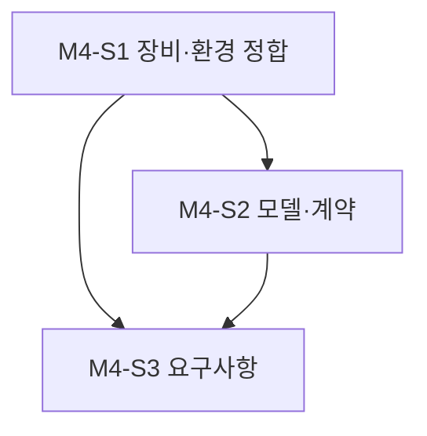

### M4-S1. 컴포넌트 문서와 전화·환경 정합

- 진행 배경: `apps/orchestrator/README.md`와 설정 설명은 아직 Asterisk를 가리킨다.
- 진행 목적: 문서를 새 경계에 맞추고 HT813·GPU 호스트의 관찰값과 미확인값을 분리한다.
- AS-IS: 기존 README/설정에 Asterisk 주소·인터페이스가 필수처럼 적혀 있고, HT813 화면에서는 두 포트가 미등록이다.
- TO-BE: `channels/ht813` 계약과 전화번호·포트·비밀 설정 원칙이 문서화되고 실제 접속 조건이 기록된다.
- 작업 종료조건: README를 먼저 독립 커밋하고 설정 양식·환경 조사 로그를 갱신한다. 비밀은 기록하지 않는다.

#### Task 진행 순서

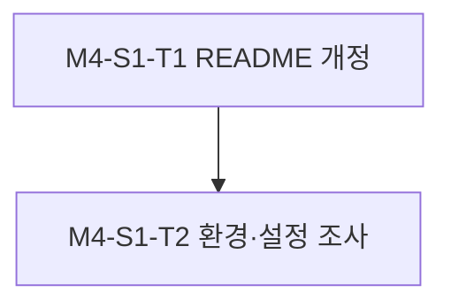

#### M4-S1-T1. 컴포넌트 README 개정

- 진행 배경: 기존 문서의 `channels/asterisk` 책임이 ADR-004와 충돌한다.
- 진행 목적: 런타임·인터페이스·개발 명령·테스트 규칙·전화 경계를 HT813 발신 범위로 고친다.
- AS-IS: README가 Asterisk 채널과 ARI/AMI 후보를 기술한다.
- TO-BE: README가 HT813 직접 SIP/RTP와 FXS 로컬 회선의 책임을 정확히 기술한다.
- 작업 종료조건: 필수 컴포넌트 항목을 채우고 README 변경만 별도 커밋한다.

#### M4-S1-T2. 환경·설정 조사

- 진행 배경: `192.0.2.17`의 웹 화면 외 실제 SIP/RTP 경로, GPU 호스트, 비밀 설정은 미확인이다.
- 진행 목적: 로컬 네트워크, 포트, 인증, 허용 번호와 GPU 제약을 확인한다.
- AS-IS: `.env`의 Asterisk 값은 비어 있고 FXO/FXS 화면 값은 과거 서버 `192.0.2.18`을 가리킨다.
- TO-BE: 확인된 HT813 설정 키만 `.env.example`과 로컬 `.env`에 반영하고 나머지는 미확인으로 기록한다.
- 작업 종료조건: 설정 검증 결과와 미확인 항목을 로그에 남기며 장비 변경과 실전화는 Gate 2 전 수행하지 않는다.

### M4-S2. 모델 검증과 모듈 계약

- 진행 배경: STT/TTS 후보와 오디오·세션 계약이 아직 확정되지 않았다.
- 진행 목적: GTX 1080 Ti 제약에서 모델을 선정하고 웹·HT813가 공유할 계약을 고정한다.
- AS-IS: 모델 벤치마크와 프로토콜 계약 테스트가 없다.
- TO-BE: 모델 선택 근거, 오디오 포맷·DTMF·통화 상태·취소·타임아웃 계약 및 단위 검증이 있다.
- 작업 종료조건: 후보 측정과 계약 테스트 결과를 기록하고 M5 구현 입력을 확정한다.

#### Task 진행 순서

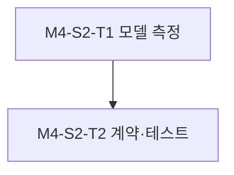

#### M4-S2-T1. STT/TTS 후보 측정

- 진행 배경: GPU 메모리·한국어 품질·지연·라이선스의 실측 근거가 없다.
- 진행 목적: 기존 모델 후보를 동일한 샘플과 자원 한도로 비교한다.
- AS-IS: 구체 모델과 목표 성능은 미결정이다.
- TO-BE: 재현 가능한 측정 로그와 모델 선택 또는 선택 보류 사유가 있다.
- 작업 종료조건: 모델별 실행 조건, 메모리, 지연, 품질 및 라이선스를 기록한다.

#### M4-S2-T2. 계약과 계약 테스트 작성

- 진행 배경: 웹·전화 채널이 서로 다른 오디오·오류 규약을 만들 위험이 있다.
- 진행 목적: 공통 타입, 단일 세션, 역압·취소, 발신 번호·상태 이벤트 규약을 구현한다.
- AS-IS: `contracts/`의 확정된 구현과 단위 테스트가 없다.
- TO-BE: 채널 독립 계약과 결정론적 테스트가 있다.
- 작업 종료조건: `create-testcase.md`에 따라 단위 테스트를 작성하고 계약·의존 방향 검증을 통과시킨다.

### M4-S3. PRD/SRS와 요구 추적

- 진행 배경: 기존 PRD/SRS가 없고 HT813 초기 범위가 대화에서 새로 확정되었다.
- 진행 목적: 사용자 관점 요구와 검증 가능한 전화 시나리오를 기록한다.
- AS-IS: 통합 테스트를 연결할 요구사항 ID가 없다.
- TO-BE: 웹, 에이전트 발신, FXS 로컬 통화 및 후속 제외 범위가 문서화된다.
- 작업 종료조건: PRD와 SRS를 각각 **독립 커밋**으로 기록하고 요구사항·계약 추적표를 동결한다.

#### Task 진행 순서

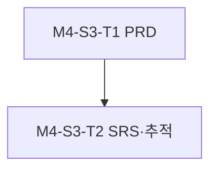

#### M4-S3-T1. PRD 작성

- 진행 배경: 사용자가 기대하는 전화·웹 동작이 지속 문서에 없다.
- 진행 목적: 초기 기능, 허용 번호, 실패 시 표시와 보류 조건을 사용자 관점에서 정의한다.
- AS-IS: 요구 범위가 이슈와 대화에 분산되어 있다.
- TO-BE: 현재 개발 버전의 한국어 PRD가 있다.
- 작업 종료조건: PRD만 포함한 독립 커밋이 있고 사용자가 정의한 세 통화 흐름을 반영한다.

#### M4-S3-T2. SRS와 추적표 작성

- 진행 배경: 기능별 입력·출력·검증 기준이 없다.
- 진행 목적: 웹/HT813 경계와 회선 점유·실패·권한 기준을 명시한다.
- AS-IS: SRS와 요구사항 ID가 없다.
- TO-BE: 한국어 SRS와 계약·테스트 추적표가 있다.
- 작업 종료조건: SRS만 포함한 독립 커밋을 만들고 추적성 검토를 기록한다.

## M5. 공통 음성 흐름과 채널 구현

- 진행 배경: M4 계약에 맞춘 동작 구현이 없다.
- 진행 목적: 코어·모델·작업 처리·웹·직접 HT813 발신 채널을 조립 가능한 단위로 만든다.
- AS-IS: 패키지 골격 외 실제 에이전트 흐름과 전화 채널이 없다.
- TO-BE: 모듈별 구현과 외부 경계를 fake로 격리한 단위 검증이 있다.
- 작업 종료조건: 각 Slice의 기능·오류 테스트가 통과하고 통합 단계의 미확인 경계가 기록된다.

### Slice 진행 순서

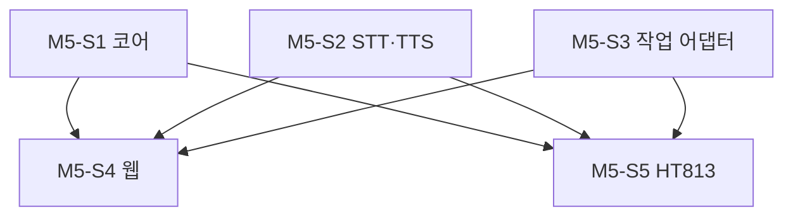

### M5-S1. 코어 및 세션 제어

- 진행 배경: 계약을 실행할 오케스트레이터가 없다.
- 진행 목적: STT → 작업 처리 → TTS와 한 세션 제한, 취소·실패 복구를 구현한다.
- AS-IS: 세션 상태 전이와 오디오 큐 구현이 없다.
- TO-BE: 채널 독립 코어와 단위 검증이 있다.
- 작업 종료조건: 정상·취소·시간 초과·중복 세션 테스트가 통과한다.

#### Task 진행 순서

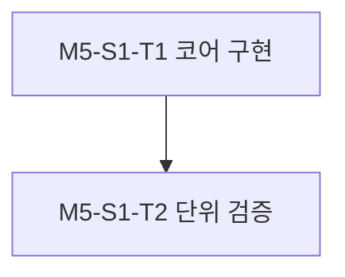

#### M5-S1-T1. 오케스트레이터 구현

- 진행 배경: 계약을 실제 흐름으로 연결하는 코드가 없다.
- 진행 목적: 제한 큐와 명확한 상태 전이·자원 정리를 구현한다.
- AS-IS: 패키지 골격만 있다.
- TO-BE: 채널 구현을 import하지 않는 코어가 있다.
- 작업 종료조건: 계약 인터페이스만 사용하며 시작·종료와 실패 경로가 구현된다.

#### M5-S1-T2. 코어 단위 검증

- 진행 배경: 비동기 오류가 누수나 중복 세션으로 이어질 수 있다.
- 진행 목적: 역압·취소·시간 제한·정리 동작을 확인한다.
- AS-IS: 해당 동작의 회귀 테스트가 없다.
- TO-BE: 결정론적 fake 기반 테스트와 실행 기록이 있다.
- 작업 종료조건: 관련 테스트가 통과하고 결과가 기록된다.

### M5-S2. STT/TTS 어댑터

- 진행 배경: 선정 모델은 아직 공통 계약과 연결되지 않았다.
- 진행 목적: 입력 전사와 응답 합성을 같은 오디오 계약으로 제공한다.
- AS-IS: 추론 어댑터가 없다.
- TO-BE: STT/TTS 어댑터와 단위 검증이 있다.
- 작업 종료조건: 포맷·순서·오류·취소 검증이 통과한다.

#### Task 진행 순서

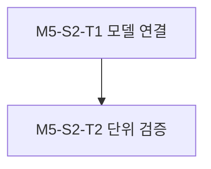

#### M5-S2-T1. 모델 어댑터 구현

- 진행 배경: 기존 모델 API가 공통 계약과 다르다.
- 진행 목적: 샘플레이트·청크·전사·합성 출력을 정규화한다.
- AS-IS: 모델의 직접 사용만 가능하거나 실행 미확인이다.
- TO-BE: 모델 교체가 가능한 어댑터가 있다.
- 작업 종료조건: 선정 모델과 계약 사이의 변환 및 예외 처리가 구현된다.

#### M5-S2-T2. 모델 어댑터 단위 검증

- 진행 배경: 오디오 포맷과 종료 이벤트가 채널 품질을 좌우한다.
- 진행 목적: 가짜 모델을 써 변환·오류·취소를 검증한다.
- AS-IS: 해당 테스트가 없다.
- TO-BE: 모델 경계를 격리한 재현 가능한 테스트가 있다.
- 작업 종료조건: 테스트 통과 및 실행 결과 기록이 완료된다.

### M5-S3. 작업 처리 어댑터

- 진행 배경: `llm.example.test` 연결이 공통 계약 뒤에 없다.
- 진행 목적: 응답·인증·시간 제한·오류 처리를 분리한다.
- AS-IS: 작업 처리 API 연결과 비밀 주입이 구현되지 않았다.
- TO-BE: 교체 가능한 작업 처리 어댑터가 있다.
- 작업 종료조건: 실패·성공 경로의 단위 검증이 통과한다.

#### Task 진행 순서

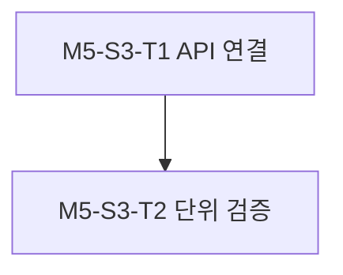

#### M5-S3-T1. API 어댑터 구현

- 진행 배경: 외부 API 사양을 확인해 계약으로 변환해야 한다.
- 진행 목적: 설정 기반 인증과 타임아웃·오류 매핑을 구현한다.
- AS-IS: 고정된 작업 처리 응답 경로가 없다.
- TO-BE: 비밀을 로그에 남기지 않는 API 어댑터가 있다.
- 작업 종료조건: 응답·오류·재시도 정책이 계약에 맞게 구현된다.

#### M5-S3-T2. API 어댑터 단위 검증

- 진행 배경: 네트워크 장애와 비밀 노출을 예방해야 한다.
- 진행 목적: fake HTTP 응답으로 성공·인증 실패·타임아웃을 확인한다.
- AS-IS: 경계 테스트가 없다.
- TO-BE: 비밀 비노출을 포함한 단위 결과가 있다.
- 작업 종료조건: 테스트 통과 및 실행 결과 기록이 완료된다.

### M5-S4. 웹 음성 채널

- 진행 배경: 웹 접근 경로가 없다.
- 진행 목적: HTTP/WebSocket 입력과 음성 스트림을 코어 계약으로 연결한다.
- AS-IS: 웹 음성 채널 구현이 없다.
- TO-BE: 웹 채널과 격리된 단위 검증이 있다.
- 작업 종료조건: 연결·취소·오류 테스트가 통과한다.

#### Task 진행 순서

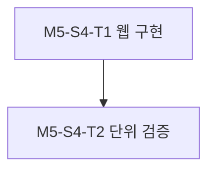

#### M5-S4-T1. 웹 입출력 구현

- 진행 배경: 코어 계약을 브라우저 전송과 연결해야 한다.
- 진행 목적: 세션 이벤트와 오디오 청크를 양방향으로 전달한다.
- AS-IS: 웹 인터페이스는 골격 상태다.
- TO-BE: 인증·오류·종료 의미가 명확한 채널이 있다.
- 작업 종료조건: 계약 스키마와 수명 주기를 따르는 엔드포인트가 구현된다.

#### M5-S4-T2. 웹 채널 단위 검증

- 진행 배경: 연결 종료 시 세션 정리가 필요하다.
- 진행 목적: 순서·역압·연결 해제 경로를 확인한다.
- AS-IS: 웹 채널 회귀 테스트가 없다.
- TO-BE: fake 코어 기반 테스트가 있다.
- 작업 종료조건: 테스트 통과 및 실행 결과 기록이 완료된다.

### M5-S5. HT813 FXO 직접 발신 채널

- 진행 배경: 사용자의 초기 전화 기능은 서버 없는 FXO 발신이다.
- 진행 목적: 허용 번호로만 SIP 발신하고 RTP 음성을 코어와 교환한다.
- AS-IS: `channels/asterisk` 계획만 있으며 실제 전화 채널 구현은 없다.
- TO-BE: `channels/ht813`가 번호 정책, 통화 상태, RTP·DTMF 및 종료를 관리한다.
- 작업 종료조건: fake SIP/RTP 피어 대상의 단위 검증이 통과하고 실장 검증 전제·미확인 사항이 기록된다.

#### Task 진행 순서

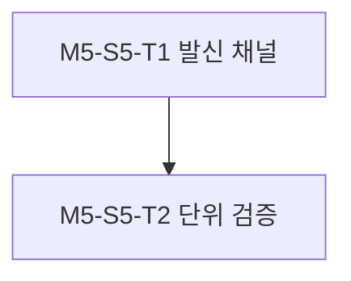

#### M5-S5-T1. SIP/RTP 발신 채널 구현

- 진행 배경: HT813 FXO의 직접 피어링은 공식 자료에 있으나 프로젝트 구현은 없다.
- 진행 목적: 발신 대상 제한, INVITE·응답·BYE, 미디어·DTMF 및 회선 점유 오류를 다룬다.
- AS-IS: 전화번호 검증과 SIP/RTP 세션 코드가 없다.
- TO-BE: 외부 착신을 받지 않는 발신 전용 채널이 있다.
- 작업 종료조건: 허용 대상만 호출하고 정리·실패·동시 세션 정책이 코드에 반영된다.

#### M5-S5-T2. 발신 채널 단위 검증

- 진행 배경: 실장 통화 전에 오발신과 세션 누수를 줄여야 한다.
- 진행 목적: 번호 거부, SIP 실패, RTP 중단, BYE, 회선 사용 중 처리 등을 검증한다.
- AS-IS: 전화 채널 테스트가 없다.
- TO-BE: 외부 통화를 일으키지 않는 결정론적 테스트가 있다.
- 작업 종료조건: 관련 테스트가 통과하고 실행 결과가 기록된다.

## M6. 조립·실장 검증·로컬 배포 (2026-09-24 변경 승인)

- 진행 배경: M5의 모듈별 단위 구현만으로 웹·실제 전화·보존 경계의 동작을 확인할 수 없다. 사용자는 한 통화의 연속 대화와 모든 FXO 외부 착신의 에이전트 연결을 M6 요구로 확정했다.
- 진행 목적: 웹, HT813 FXO 외부 발신·전체 착신의 음성 작업을 조립하고 승인된 시나리오를 검증하며 30일 보존·삭제와 배포·운영 절차를 확정한다.
- AS-IS: 실제 FXO 발신·착신, 웹 전체 흐름과 녹취·원문 만료는 미검증이다. FXS 전화기는 연결되지 않았다.
- TO-BE: 검증 가능한 웹·FXO 발신·착신·보존 경계에는 실행 증거가 있고, FXS→외부 발신 등 장비 미준비 항목은 보류로 분명히 기록된다.
- 작업 종료조건: Gate 1/2가 허용한 웹·FXO 발신·착신·보존 경계 시험 및 성능·복구 검증을 마치고 배포 결과를 기록한다. 요구 기능 미검증은 완료로 표시하지 않는다. 실장 장애로 직접 SIP 방식이 작동하지 않으면 ADR-009 재검토 조건을 적용한다.

### Slice 진행 순서

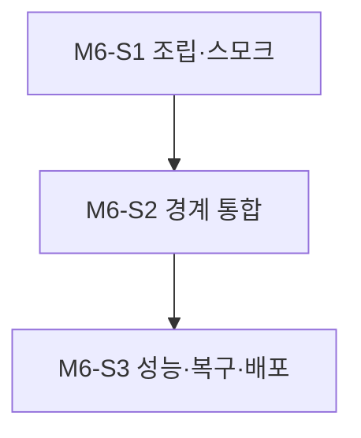

### M6-S1. 조립과 스모크

- 진행 배경: 기존 조립은 웹과 HT813 발신 객체 생성·health까지이고 한 통화의 다중 턴, 전체 착신 SIP 수신, 30일 보존 실행 경로가 없다.
- 진행 목적: 설정 검증, 공통 코어·발신/착신 통화·보존의 객체 수명 주기 조립을 완료한다.
- AS-IS: 전화 채널과 코어 연결·착신 수신·녹취 저장·삭제가 없다.
- TO-BE: 개발 환경에서 웹과 양방향 전화 경계의 설정·시작·상태 확인·종료가 가능하고, 한 통화의 여러 턴과 30일 기록 수명 주기가 조립된다.
- 작업 종료조건: T1/T2의 기존 로컬 스모크에 더해 T3~T6의 격리 단위 검증, 비밀 비노출·설정 오류·장비 없는 기동·정상 종료 스모크 결과가 기록된다.

#### Task 진행 순서

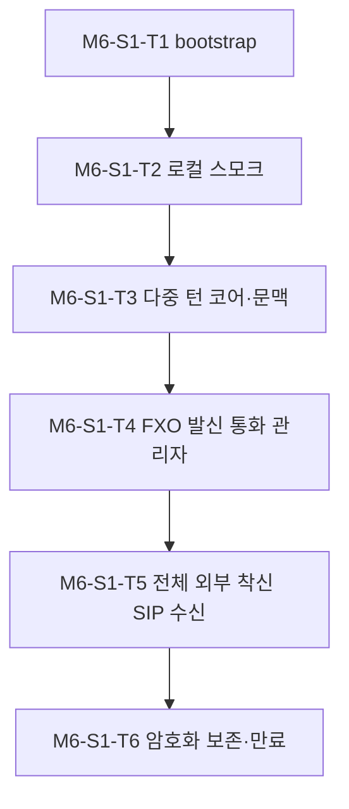

#### M6-S1-T1. bootstrap·설정 조립

- 진행 배경: M5 구현 모듈이 분리돼 있다.
- 진행 목적: 모델·코어·웹·HT813를 설정 기반으로 선택한다.
- AS-IS: M5 종료 시 서비스 조립 코드가 없었다.
- TO-BE: 시작 시 설정을 검증하는 단일 실행 경로가 있다.
- 작업 종료조건: 유효·누락·오류 설정과 자원 정리가 구현된다. 최초 결과는 log-13에 기록됐다.

#### M6-S1-T2. 로컬 스모크

- 진행 배경: 시작·종료 동작은 실제 조립으로 확인해야 한다.
- 진행 목적: 장비 통화 없이 health와 수명 주기를 확인한다.
- AS-IS: M5 종료 시 조립 실행 기록이 없었다.
- TO-BE: 재현 가능한 실행 로그가 있다.
- 작업 종료조건: 시작·health·종료가 통과하고 실행 조건이 기록된다. 최초 결과는 log-13에 기록됐다.

#### M6-S1-T3. 다중 턴 코어·문맥 계약

- 진행 배경: 현재 코어는 한 발화 처리마다 전역 세션 점유를 해제하고 작업 API는 현재 전사 한 개만 전송한다.
- 진행 목적: 전화 통화가 전역 점유를 보유한 채 여러 발화를 순차 처리하고 승인된 같은 통화 문맥만 작업 API에 전송한다.
- AS-IS: 한 턴 뒤 점유가 풀리고 이전 최종 전사·응답 전달 계약이 없다.
- TO-BE: 웹의 기존 한 요청 경로를 유지하면서 전화의 여러 턴을 같은 통화 세션 안에서 처리한다. 최종 전사·응답만 같은 통화 메모리에 순서대로 보유하고 chat messages에 현재 전사와 같은 통화의 이전 최종 전사·응답만 보낸다. 다른 통화·부분 전사·음성 원본은 보내지 않고 종료 시 메모리를 정리한다. Bearer 인증·자동 재시도 0회·본문 비로깅을 유지한다.
- 작업 종료조건: 웹 단위 회귀 검증과 가짜 모델·HTTP 단위 검증에서 2회 이상 순차 턴, 문맥 순서·격리·종료 후 삭제, 턴별 오류·취소, 통화 전체 점유와 다른 세션 busy가 통과하고 실행 로그가 있다.

#### M6-S1-T4. FXO 발신 다중 턴 통화 관리자·운영 진입점

- 진행 배경: HT813 발신 객체와 코어가 연결되지 않아 통화 중 발화의 끝과 다음 턴을 판정할 수 없다.
- 진행 목적: 허용 번호 발신, RTP 발화 경계, 음성 응답, 다음 발화 대기 및 상대 종료·취소·장애 정리를 한 통화 수명으로 연결한다.
- AS-IS: 발신 객체는 생성만 되고 코어를 호출하지 않는다.
- TO-BE: 인증된 로컬 운영 진입점에서 런타임 허용 목록의 정확한 번호만 발신한다. 설정 가능한 에너지/무음·최대 발화 길이로 턴 입력을 끝내되 통화는 유지한다. 응답 재생 중 들어온 오디오는 다음 질문으로 재사용하지 않는다. RTP·이벤트 순서와 전역 단일 점유는 발신부터 상대 종료·정리까지 유지된다.
- 작업 종료조건: 가짜 SIP/RTP·코어 단위 테스트에서 미허용 번호의 패킷 0개, 같은 통화의 2회 이상 질의·음성 응답, 자동 BYE 없음, 원격 BYE 중 처리·송출 취소와 점유/문맥 해제, 취소·오류·시간 초과 뒤 회수, DTMF 보존이 통과한다. 장비 없는 운영 진입점 스모크를 기록한다.

#### M6-S1-T5. 모든 FXO 외부 착신의 직접 SIP 수신

- 진행 배경: 사용자가 모든 외부 착신을 Caller ID 제한 없이 에이전트로 연결하도록 M6 범위를 정정했으며, 현 앱은 발신 SIP 클라이언트만 있다.
- 진행 목적: ADR-009의 전체 PSTN→VoIP 직접 피어링에서 HT813 착신 INVITE·RTP를 받아 발신과 같은 다중 턴 코어에 연결한다.
- AS-IS: SIP INVITE 수신·SDP 응답·착신 RTP·원격 BYE·busy 응답 경로가 없다.
- TO-BE: 설정된 내부 주소의 앱 착신 포트로 보낸 INVITE를 수신한다. 발신/착신 SIP 포트·소켓 충돌을 방지한다. 설정된 HT813 피어 외 출처와 잘못된 SIP/SDP는 추론 전에 거부한다. Caller ID는 접근 필터가 아니다. 정상 착신은 여러 음성 턴을 처리하고 BYE·CANCEL·장애·세션 점유 충돌을 명시 응답·정리로 처리한다. 외부 발신 허용 목적지 정책은 유지한다.
- 작업 종료조건: 가짜 SIP/RTP·코어 단위 테스트에서 다른/미표시 Caller ID가 동일하게 수락되고, 타 출처·잘못된 SIP/SDP는 추론 전 거부되며, 같은 통화의 최소 두 질의·음성 답변 후 상대 종료로 점유가 해제된다. 발신/착신 포트 충돌 없음, 중복 착신 busy·CANCEL·BYE·미디어 실패 정리가 통과한다. 실제 착신 성공은 Gate 뒤 S2에서 판정한다.

#### M6-S1-T6. 녹취·원문 암호화 보존과 만료 삭제

- 진행 배경: ADR-003/PRD-06/SRS-O01의 30일 정책이 설정 양식에만 있고 실제 저장·삭제 코드가 없다.
- 진행 목적: ADR-008에 따라 로컬 암호화 저장, 만료 스케줄러 및 본문 없는 삭제 감사를 웹·전화 실행 경로에 연결한다.
- AS-IS: 녹취·최종 전사·응답의 저장, 30일 만료 삭제, 삭제 감사가 없다.
- TO-BE: 유한 턴의 입출력 음성과 최종 전사·응답을 생성 시각 기준 암호화 파일로 기록한다. 키는 런타임에서만 주입하고 기록 경로가 준비되지 않으면 서비스를 준비 완료로 표시하지 않는다. UTC 생성 시각+30일 만료, 시작/주기 스윕, 본문·번호 없는 삭제 감사를 적용한다.
- 작업 종료조건: fake 시계·임시 저장소 단위 검증에서 암호문 비노출, 정확한 30일 경계, 시작/주기 스윕, 삭제 실패 재시도, 키 누락 기동 차단, 비밀·본문 비로깅이 통과한다. 실제 파일 경계 통합 검증은 별도 Gate 1/2 뒤에만 실행한다.

### M6-S2. 웹·HT813 발신/착신·보존 경계 검증

- 진행 배경: 직접 SIP/RTP와 외부 API·파일 경계의 실제 동작은 단위 테스트만으로 확정할 수 없다.
- 진행 목적: 승인된 범위에서 웹, FXO 발신, 전체 FXO 착신 및 저장·삭제의 사용자 결과와 실패 경로를 확인한다.
- AS-IS: 실제 전화 양방향 경로·웹 전체 흐름·보존 파일 경계는 미검증이며 FXS 전화기도 없다.
- TO-BE: 웹·FXO 발신·전체 착신·보존 경계의 성공·실패·보류가 증거와 구분되고, FXS→외부 발신은 장비 준비 전 미검증으로 남는다.
- 작업 종료조건: 각 대상 Gate 1/2와 시험 번호·시간·회선 영향·설정 백업/복구를 확인하고 승인된 테스트만 실행·기록한다. 외부 착신→FXS는 대체됐으며 FXS 전화기 미연결 상태에서 FXS→외부 발신을 실행하거나 완료로 표시하지 않는다.

#### Task 진행 순서

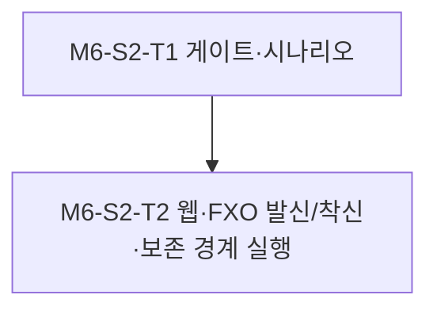

#### M6-S2-T1. 승인 게이트와 시나리오 확정

- 진행 배경: 외부 회선과 실제 데이터 경계 시험은 사용 중 통화와 로컬 파일에 영향을 줄 수 있다.
- 진행 목적: PRD/SRS 시나리오, 기존·신규 Gate 1, 각 실행 직전 Gate 2, 시험 번호·시간·장비 설정 백업·복구를 확정한다.
- AS-IS: 웹·FXO 발신/다중 턴 Gate 1은 승인됐고 전체 착신·보존 경계 Gate 1은 별도 승인 대상이었다.
- TO-BE: 웹·FXO 발신/착신·보존 각 시나리오의 승인 범위와 명령·영향·복구 절차가 구분된다.
- 작업 종료조건: 승인 없는 통합 테스트 생성·실행 또는 장비 변경·실전화를 하지 않고 승인과 보류 상태를 기록한다.

#### M6-S2-T2. 웹·FXO 발신/착신·보존 경계 검증 실행

- 진행 배경: 로컬 모듈 테스트와 관리 화면 값만으로 실제 사용자 통화·브라우저·작업 API·만료 삭제를 판단할 수 없다.
- 진행 목적: 승인된 웹 흐름, 허용 번호의 에이전트 외부 발신, 전체 외부 착신, 파일 보존·만료를 관찰한다.
- AS-IS: 실제 브라우저/API/전화/보존 경계의 실측 근거가 없다.
- TO-BE: 각 경로의 성공·실패·보류와 PRD/SRS 추적 실행 로그가 있다.
- 작업 종료조건: 허용된 테스트를 실행해 실제 결과와 실패 원인·보류 조건을 기록한다. 양쪽 전화 방향에서 한 통화의 최소 두 질의·음성 답변·상대 종료를 확인한다. 발신 목적지 허용 정책과 착신 Caller ID 비필터를 분리해 판정한다. 한 실제 착신 번호만으로 모든 Caller ID의 현장 성공을 단정하지 않는다.

### M6-S3. 성능·복구·배포

2026-10-07 사용자의 구체 실행 지시에 따라 이 Slice의 성능·배포 대상은 STT/TTS 상주 모델 서버, 30초 순차 시작, 백엔드 준비 검사 및 Tempo/Prometheus/Grafana 관측 스택을 포함한다. 기존 완료 조건인 실제 GPU 자원·실통화 지연 측정, 서비스 배포 스모크와 잔여 위험 기록은 유지한다. 컨테이너 런타임과 GPU 접근이 없는 상태의 구문·단위 시험은 실배포 검증을 대체하지 않는다. S2 종료 전 코드·패키지 준비가 선행된 순서 이탈은 실행 로그에 기록하고 S3 완료로 판정하지 않는다.

- 진행 배경: 개발 환경 성공만으로 GPU·회선·저장소 운영 가능성을 확인할 수 없다.
- 진행 목적: 발신/착신 턴별 지연·메모리, 장애 복구, 30일 보존·삭제 및 로컬 배포를 검증한다.
- AS-IS: 장기 반복 호출의 자원 회수, 실통화 복구, 만료 저장·삭제 및 배포 패키지가 없다.
- TO-BE: 재현 가능한 측정·복구·배포 패키지와 한국어 운영 문서·실행 로그가 있다.
- 작업 종료조건: 준비된 장비에서 승인된 성능·복구·30일 삭제 정책의 실제 결과와 잔여 위험을 기록하고 로컬 배포 스모크를 통과한다.

#### Task 진행 순서

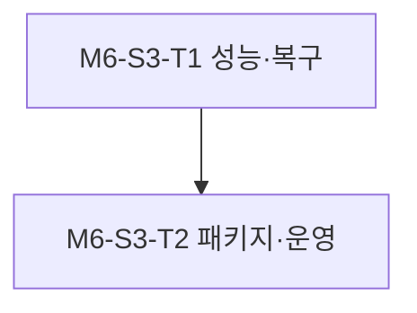

#### M6-S3-T1. 성능·복구 검증

- 진행 배경: GPU와 전화 회선의 실제 다중 턴 지연·메모리·오류 상태가 불명확하다.
- 진행 목적: 발신/착신 턴별 지연·GPU/RAM/swap·취소·네트워크 장애·데이터 삭제를 측정한다.
- AS-IS: 정량 결과와 반복 회수·복구 증거가 없다.
- TO-BE: 환경 조건이 붙은 측정·복구 로그가 있다.
- 작업 종료조건: 준비된 장비에서 승인된 시나리오의 수치·결과를 기록하고 미준비 항목을 명시한다. 실제 회선 장애 주입은 별도 Gate 2 범위에서만 한다.

#### M6-S3-T2. 배포·운영 문서와 완료 판정

- 진행 배경: 재현 가능한 시작·착신/발신 장비 설정·키/보존 복구 절차가 없다.
- 진행 목적: deploy/, scripts/, 한국어 운영 가이드와 실행 기록을 완성한다.
- AS-IS: HT813 직접 양방향 배포 경로와 30일 보존 운영 절차가 없다.
- TO-BE: 설정 백업·원복, 키 주입, 보존·삭제 감사, 서비스 시작·종료를 포함한 패키지·운영 문서가 있다.
- 작업 종료조건: 로컬 배포 스모크 결과를 남기고 미검증 기능을 완료로 표시하지 않는다.

---

# 4. 의존성

## A. 내부 의존성

- M4 계약·PRD/SRS가 M5 구현보다 앞서야 한다. M5 단위 검증이 M6 통합보다 앞서야 한다.
- `apps/orchestrator/README.md`를 해당 컴포넌트 코드 변경 전에 갱신하고 별도 커밋한다.
- 신규·수정 테스트는 `create-testcase.md`를 따른다. PRD/SRS는 각각 코드·다른 문서와 섞지 않은 독립 커밋으로 만든다.
- 완료된 기존 M1-S1은 재실행하지 않으며, 현저히 달라진 사실은 새 로그로 기록한다.

## B. 외부 의존성

- HT813 관리자 접근·설정 백업, 통화 영향이 허용된 FXO 회선, 외부 발신 허용 목적지 및 외부 착신 시험 출처 번호·시간대
- FXS 전화기 및 물리 연결: FXS 외부 발신 검증에 필수. 이번 Phase 실장 시험은 미승인
- GTX 1080 Ti 호스트 및 모델 파일 접근, `llm.example.test` API 사양·자격 정보
- 실제 통합 테스트와 장비 설정 변경에 대한 실행 직전 Gate 2 승인

---

# 5. 리스크 및 대응

|리스크|영향|대응 방안|
|---|---|---|
|HT813 직접 SIP/RTP 피어링이 프로젝트 미디어와 맞지 않음|에이전트 발신·착신 실패|M4에서 코덱·SIP 상호 운용성을 조사하고 M6에서 제한된 통화로 검증; 실패 시 ADR 재검토|
|FXS 로컬 PSTN 경로 설정이 에이전트 FXO 발신·착신과 충돌|한쪽 통화 불가|`Life Line Mode=Always Connected`를 가정하지 않고 링스루·다이얼플랜 조합과 회선 점유를 시험|
|FXS 전화기 미준비|FXS 외부 발신 검증 지연|M6에서 FXS 발신을 명시적으로 보류하고 실제 연결 후 검증|
|외부 회선 오발신 또는 운영 통화 방해|요금·업무 영향|허용 번호 정책, 테스트 대상·시간 명시, Gate 2 및 설정 백업·복구|
|GPU 메모리 부족 또는 모델 지연|응답 지연·실패|M4 후보 측정 후 모델 선택, 단일 세션 제한 유지|
|Asterisk 전제 잔존|잘못된 배포·설정|M4 README·설정 갱신과 정적 검색, M6 배포 스모크|

---

# 6. 검증 전략

## A. 단위 테스트 (`tests/units/`)

코어의 상태 전이·역압·취소, 모델·작업 어댑터의 변환과 오류, 웹 세션 종료, HT813 허용 번호·SIP 실패·RTP 중단을 외부 호출 없는 fake로 검증한다. 테스트 파일과 실행 기록은 `create-testcase.md` 및 컴포넌트 README 규칙을 따른다.

## B. 통합 테스트 (`tests/integrations/`)

- 통합 테스트 필요 여부 검토 결과: 필요. 웹·모델·코어, SIP/RTP·HT813 및 FXS·PSTN 경계는 단위 테스트로 대체할 수 없다.
- 사전승인 (Gate 1): **2026-09-24 M6 대화에서 별도 승인**. 최초 웹·작업 API·FXO 발신, 후속 다중 턴 FXO 발신, 신규 전체 외부 착신과 30일 보존·삭제 파일 경계를 [구체 검증안](../../../.agents/sessions/20260924-ht813-m6/GATE-PROPOSAL.md)에 따라 각각 사용자에게 명시 승인받았다. FXS 발신 실장은 이번 Phase 미승인이며 물리 연결 전에도 보류한다.
- 실행 직전 승인 (Gate 2): 2026-09-24 사용자가 **M6 범위의 Gate별 승인을 포함하는 포괄 승인**을 명시했다. 이전 개별 승인과 추가 포괄 승인을 [실행 로그](../2_logs/VOIC-FEAT-001-log-27.md)에 기록했다. 범위를 벗어나는 FXS 실장이나 미확정 장비 값의 추측 적용은 포함하지 않는다. 실전화 전 대상·시간·회선 영향·설정 백업/복구와 실제 설정값은 여전히 구체화해야 한다.
- 대상 시나리오: 웹 음성 왕복; 에이전트 FXO 외부 발신·전체 외부 착신의 다중 턴 양방향 미디어·상대 종료; 잘못된 발신 목적지 차단과 착신 Caller ID 비필터; 회선 사용 중·상대방 실패; 암호화 보존·30일 삭제; 승인된 장비 복구. FXS 외부 발신은 전화기 연결 전 미실행.
- 외부 착신→FXS는 최신 요구로 대체되어 작성·실행하지 않는다. FXS→외부 발신은 전화기 물리 연결 및 별도 승인 후에만 작성·실행한다. PRD/SRS 요구사항 ID와 연결하고 실제 결과를 실행 로그에 남긴다.

---

# 7. 롤아웃 / 마이그레이션

1. 현재 장비 설정을 백업하고 SIP 서버 `192.0.2.18` 등 과거 값이 현재 동작을 의미하지 않음을 문서화한다.
2. 장비 설정 변경 전 사용 중인 외부 회선의 영향과 복구 절차를 검토하고 Gate 2 범위 안에서만 적용한다.
3. 에이전트 외부 발신을 먼저 검증하고, 전체 외부 착신의 에이전트 연결을 승인된 시험 회선으로 검증한다. FXS 외부 발신은 전화기 연결 및 별도 승인 뒤 확인한다. 한 회선의 동시 사용 제한을 사용자 동작에 반영한다.
4. 로컬 `.env` 비밀은 Git에 넣지 않는다. 기존 Asterisk 키는 실제 서버 부재로 비워 두고, HT813 키만 확인된 값부터 반영한다.

---

# 8. 완료 게이트

- [x] 계획 자체와 새 통합 테스트 Gate 1을 각각 명시적으로 승인받음 (계획 승인 및 M6 실행 지시, 2026-09-24 별도 Gate 1 승인)
- [ ] M4·M5·M6의 해당 검증 통과 및 결과 기록
- [ ] 에이전트의 외부 발신과 모든 외부 착신 경로에서 통화 설정·한 통화의 최소 두 음성 턴·양방향 오디오·상대 종료 확인. 단일 실착신 번호가 모든 Caller ID의 실장 성공을 증명하지 않음을 기록
- [ ] FXS 전화기 연결 후 FXS 외부 발신 확인; 연결 전에는 미검증 상태 유지
- [ ] 외부 발신 허용 목적지·착신 Caller ID 비필터·단일 세션·회선 사용 중·비밀 비노출·30일 암호화 보존·만료 정책 확인
- [ ] 필요한 통합 테스트에 Gate 2 승인과 실행 로그가 있음
- [ ] README, `.env.example`, 운영 가이드, 배포 자원 및 세션 상태 갱신

---

# 9. 참고자료

- [원본 이슈](../0_issues/VOIC-FEAT-001.md)
- [ADR-004](../3_decisions/ADR-004-ht813-direct-outbound-telephony.md)
- [ADR-005](../3_decisions/ADR-005-web-voice-transport-and-access.md)
- [ADR-006](../3_decisions/ADR-006-ht813-voice-turn-boundary.md) (ADR-007로 대체됨)
- [ADR-007](../3_decisions/ADR-007-ht813-multiturn-call-lifecycle.md) (수락됨)
- [ADR-008](../3_decisions/ADR-008-local-encrypted-retention.md) (수락됨)
- [ADR-009](../3_decisions/ADR-009-ht813-all-inbound-agent.md) (구현 가능 조건으로 수락됨; ADR-004 대체)
- [M6 변경 승인안](../../../.agents/sessions/20260924-ht813-m6/PLAN-AMENDMENT-PROPOSAL.md) (2026-09-24 사용자 승인)
- [ADR-003](../3_decisions/ADR-003-initial-task-backend-and-operating-constraints.md)
- [기존 계획](VOIC-FEAT-001-plan.md)
- [전화 장비 조사 로그](../2_logs/VOIC-FEAT-001-log-03.md)
- [Grandstream HT813 직접 피어링 가이드](https://documentation.grandstream.com/knowledge-base/peering-ht8xx-with-ht813/)
- [Grandstream HT813 관리 가이드](https://documentation.grandstream.com/knowledge-base/ht813-administration-guide/)

- [ADR-010 배포 경로 제안](../3_decisions/ADR-010-gpu-vm-direct-telephony-lan.md) (2026-10-06 proposed; 환경 제언이며 승인된 실행 범위 변경 아님)
