# 0. 계획 정보

|key|value
|---|---
|계획 ID|VOIC-FEAT-001-plan
|원본 이슈|[VOIC-FEAT-001](../0_issues/VOIC-FEAT-001.md)
|상태|superseded
|작성 시간|2026-09-22 16:32:50
|작성 에이전트|Codex
|승인자|사용자
|승인 일시|2026-09-22 16:55:03
|대체 계획|[VOIC-FEAT-001-plan-02](VOIC-FEAT-001-plan-02.md) (2026-09-24 제안; 실행 승인 전)

---

# 1. 개요

## A. 목표

기존 한국어 STT/TTS 모델을 GTX 1080 Ti 로컬 환경에서 실행하고, Python/FastAPI 메인 코어가 STT → 작업 처리 → TTS 흐름을 제어하도록 구현한다. 웹 프론트엔드와 Asterisk 전화 채널은 공통 코어에 연결되는 확장 모듈로 개발한다.

모든 모듈은 구현 전에 확정된 계약을 따르며, 계약 확정 후 코어·모델 어댑터·채널 모듈과 대응 단위 테스트를 병렬로 개발한다.

## B. 범위

- apps/orchestrator 단일 FastAPI 컴포넌트와 내부 모듈 구조 생성
- 오디오, 세션, 이벤트, 오류, STT, 작업 처리, TTS 계약 정의
- 로컬 GTX 1080 Ti 환경과 Asterisk 환경 조사
- 한국어 STT/TTS 기존 모델 후보의 라이선스·품질·성능 검증 및 선정
- FastAPI 코어 오케스트레이터 및 세션 제어 구현
- STT, 작업 처리, TTS 어댑터 구현
- 웹 HTTP/WebSocket 채널 모듈 구현
- Asterisk 통화·양방향 미디어 연동 모듈 구현
- 모듈별 단위 테스트 병렬 작성 및 실행 증거 기록
- 웹/Asterisk 경계 통합 테스트와 성능·복구 검증
- 로컬 배포 패키지와 운영 문서 작성
- 통합 테스트 근거가 되는 PRD/SRS 작성
- 초기 동시 세션 1개 제한 적용
- 녹취 및 원문 데이터의 30일 보존 후 삭제 정책 적용
- llm.example.test 작업 처리 백엔드 어댑터 연동

## C. 제외 범위 (Non-goals)

- STT/TTS 기반 모델의 신규 학습 또는 파인튜닝
- 별도 프론트엔드 UI 애플리케이션 제작
- Asterisk 장비·전화 회선 자체의 구축 또는 교체
- 초기 버전에서의 다중 노드 분산 추론 및 Kubernetes 운영
- 녹취·통화 원문을 30일을 초과해 보존하는 기능
- 요구사항으로 확정되지 않은 임의의 LLM 또는 작업 자동화 기능

## D. 실행 진입 전 아키텍처 게이트

첫 구현 마일스톤 M1은 다음 조건이 모두 충족된 뒤에만 시작한다.

1. 이 계획이 사용자에 의해 approved 상태가 된다.
2. [ADR-002](../3_decisions/ADR-002-python-modular-monolith-directory-contracts.md)가 사용자에 의해 accepted 상태가 된다.
3. apps/orchestrator, tests/units/orchestrator, tests/integrations 및 deploy/orchestrator의 디렉터리 배치가 ADR-002와 일치함을 확인한다.
4. 변경이 필요하면 구현 전에 계획과 ADR을 먼저 수정하고 다시 승인받는다.
5. 통합 테스트 Gate 1의 승인 여부를 계획에 기록한다.

이 게이트는 사용자가 요구한 “승인 후 첫 마일스톤 진입 전에 디렉터리 구조 결정” 조건을 보장한다. M1은 디렉터리 구조를 새로 설계하는 단계가 아니라 승인된 구조를 실제로 생성하고 계약을 고정하는 단계다.

---

# 2. 영향 컴포넌트

- [ ] apps/orchestrator (신규)
- [ ] deploy/
- [ ] tests/

---

# 3. 작업 분해 구조 (Milestone / Slice / Task)

## M1. 기반 생성 및 모듈 계약 확정

- 진행 배경: 애플리케이션 코드와 테스트가 없으며, 병렬 개발 전에 런타임·모델·Asterisk 환경 및 모듈 계약을 확정해야 한다.
- 진행 목적: 승인된 디렉터리를 생성하고 컴포넌트 문서, 실행 환경, 교체 가능한 계약, 계약 테스트, 사용자 관점 요구사항을 구현 전 기준선으로 고정한다.
- AS-IS: 저장소에 애플리케이션 컴포넌트, 테스트 프레임워크, 모델 선정 결과, PRD/SRS 및 모듈 계약이 없다.
- TO-BE: apps/orchestrator의 골격과 README가 존재하고, 환경 검증 결과·모델 선택·모듈 계약·계약 테스트·PRD/SRS가 완료되어 병렬 구현이 가능하다.
- 작업 종료조건: M1의 모든 Slice가 완료되고, 계약 테스트가 통과하며, 계약과 요구사항의 추적표가 승인된 상태로 고정된다. M2는 이 조건 전에는 시작하지 않는다.

### Slice 진행 순서

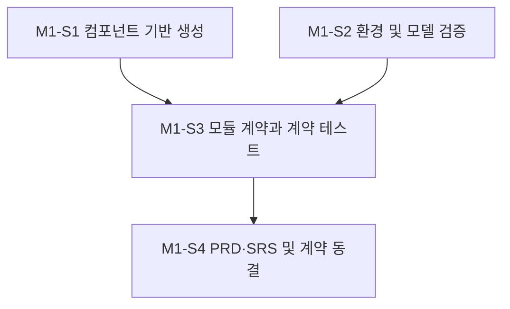

### M1-S1. 컴포넌트 문서와 실행 골격 생성

- 진행 배경: 신규 컴포넌트는 수정 전에 책임·런타임·명령·인터페이스·테스트 규칙을 README로 정의해야 한다.
- 진행 목적: ADR-002의 디렉터리를 실제 생성하고 Python/FastAPI 및 테스트 도구의 최소 실행 기반을 마련한다.
- AS-IS: apps/orchestrator와 대응 단위 테스트 디렉터리가 없다.
- TO-BE: README, pyproject.toml, 패키지 골격과 tests/units/orchestrator 구조가 존재하며 빈 플레이스홀더 없이 수집 검증이 가능하다.
- 작업 종료조건: README가 컴포넌트 계약을 설명하고, 패키지 import와 pytest 수집 명령이 성공하며, README 변경은 별도 커밋으로 기록된다.

#### Task 진행 순서

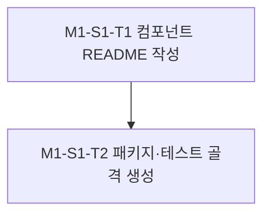

#### M1-S1-T1. 컴포넌트 README 작성

- 진행 배경: 신규 컴포넌트의 책임과 개발 규칙이 문서화되지 않았다.
- 진행 목적: orchestrator의 책임, 런타임, 설정, 인터페이스, 개발·테스트 명령 및 제약을 구현 전에 정의한다.
- AS-IS: apps/orchestrator/README.md가 없다.
- TO-BE: ADR-001/002와 일치하는 README가 존재한다.
- 작업 종료조건: 필수 항목이 채워지고 독립 문서 커밋으로 기록된다.

#### M1-S1-T2. 패키지와 테스트 골격 생성

- 진행 배경: 승인된 구조를 구현 파일과 테스트 디렉터리에 반영해야 한다.
- 진행 목적: Python 패키지, FastAPI 진입점 배치, pytest/pytest-asyncio 설정 및 *.test.py 수집 규칙을 구성한다.
- AS-IS: import 가능한 패키지와 테스트 실행 설정이 없다.
- TO-BE: ADR-002 구조가 생성되고 import 및 테스트 수집 검사가 성공한다.
- 작업 종료조건: 빈 성공 테스트나 미구현 API 없이 구조·설정 검증이 통과한다.

### M1-S2. 로컬 환경, Asterisk 및 모델 후보 검증

- 진행 배경: GTX 1080 Ti 호환성, Asterisk 인터페이스, 작업 처리 백엔드 및 성능 목표가 확정되지 않았다.
- 진행 목적: 구현 계약에 영향을 주는 실행 환경과 외부 연동 조건을 측정하고 기존 STT/TTS 모델을 선정한다.
- AS-IS: 하드웨어·드라이버·CUDA·Asterisk 버전·사용 가능 인터페이스·모델 성능에 대한 검증 기록이 없다.
- TO-BE: 환경 인벤토리, 목표 지표, 모델 비교 결과, Asterisk 연동 방식 및 작업 처리 백엔드 범위가 기록된다.
- 작업 종료조건: 선택 근거와 측정 결과가 실행 로그에 남고, 아키텍처에 영향을 주는 선택은 별도 ADR로 승인된다.

#### Task 진행 순서

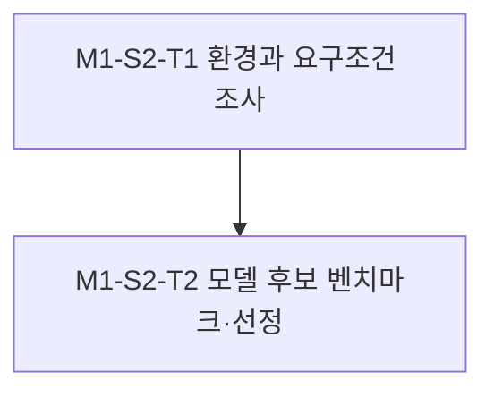

#### M1-S2-T1. 환경과 요구조건 조사

- 진행 배경: 실제 로컬 및 전화 환경을 모르면 호환 가능한 런타임과 미디어 계약을 정할 수 없다.
- 진행 목적: OS, Python, NVIDIA 드라이버/CUDA, VRAM, Asterisk 버전·인터페이스·코덱, 동시 세션, 지연 목표 및 작업 처리 백엔드를 확인한다.
- AS-IS: 환경 값이 이슈의 미확정 사항으로 남아 있다.
- TO-BE: 확인된 값과 사용자 확인이 필요한 잔여 항목이 실행 로그에 구분되어 있다.
- 작업 종료조건: 계약과 모델 선정을 진행할 수 있는 필수 환경 정보가 확보된다.

#### M1-S2-T2. STT/TTS 후보 벤치마크 및 선정

- 진행 배경: 모델은 새로 만들지 않지만 GTX 1080 Ti에서 한국어 품질과 지연을 만족하는 기존 모델을 골라야 한다.
- 진행 목적: 후보별 라이선스, VRAM, 로딩 시간, 실시간 계수, 한국어 품질, 스트리밍 및 오프라인 동작을 동일 조건에서 비교한다.
- AS-IS: 선정된 STT/TTS 모델과 근거가 없다.
- TO-BE: 기본 모델과 대체 모델, 런타임, 정밀도 및 자원 한도가 결정된다.
- 작업 종료조건: 재현 가능한 벤치마크 결과와 선택 근거가 기록되고 필요한 ADR이 승인된다.

### M1-S3. 모듈 연계 계약과 계약 테스트 확정

- 진행 배경: 병렬 구현 전에 모듈 간 데이터·오류·취소·수명 주기 규칙을 하나로 고정해야 한다.
- 진행 목적: STT, 작업 처리, TTS, 채널 및 코어가 독립적으로 구현 가능한 타입 계약과 자동 검증을 제공한다.
- AS-IS: 모듈마다 사용할 Python 인터페이스와 스트리밍 규칙이 없다.
- TO-BE: contracts 패키지와 계약 테스트가 오디오·세션·이벤트·오류·역압·취소 규칙을 명시한다.
- 작업 종료조건: 계약 테스트가 통과하고 bootstrap 외의 금지된 구체 구현 참조를 검사할 수 있다.

#### Task 진행 순서

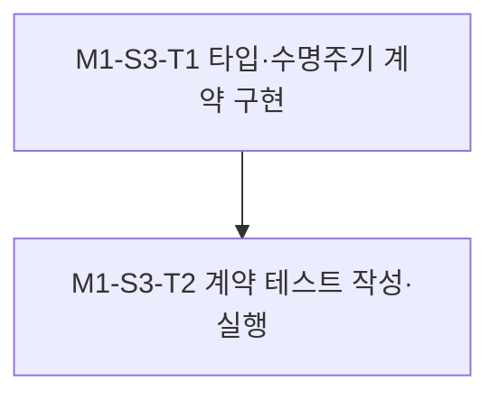

#### M1-S3-T1. 타입 및 수명 주기 계약 구현

- 진행 배경: 각 모듈이 독립 구현될 기준 인터페이스가 없다.
- 진행 목적: AudioChunk/AudioFormat, SessionContext, 이벤트 봉투, STT/Task/TTS Protocol, 표준 오류와 취소 규칙을 구현한다.
- AS-IS: Python 타입과 프로토콜이 정의되지 않았다.
- TO-BE: 구체 구현을 import하지 않는 비동기 계약이 contracts에 존재한다.
- 작업 종료조건: 각 계약의 입력·출력·오류·취소·종료 의미가 코드와 README에 일치하게 정의된다.

#### M1-S3-T2. 계약 및 의존 방향 테스트 작성·실행

- 진행 배경: 문서만으로는 병렬 구현 중 계약 위반을 조기에 발견하기 어렵다.
- 진행 목적: 테스트용 fake를 사용해 계약 준수와 계층 의존 방향을 자동 검증한다.
- AS-IS: 계약 테스트와 실행 증거가 없다.
- TO-BE: 정상·오류·취소·순서·역압 사례와 금지 import 검사가 존재한다.
- 작업 종료조건: 관련 테스트가 통과하고 tests/units/orchestrator/logs에 실행 로그가 남는다.

### M1-S4. 사용자 요구사항 기준선과 계약 동결

- 진행 배경: 통합 테스트는 PRD/SRS의 사용자 관점 요구사항을 근거로 작성해야 하며, 병렬 구현 전에 계약 변경 절차도 고정해야 한다.
- 진행 목적: PRD와 SRS를 독립적으로 작성하고 요구사항-계약-테스트 추적성을 확립한다.
- AS-IS: docs/ideas에 이 기능을 설명하는 PRD/SRS가 없다.
- TO-BE: 버전이 지정된 PRD/SRS와 추적표가 존재하고 M2에서 사용할 계약 기준선이 동결된다.
- 작업 종료조건: PRD와 SRS가 각각 독립 커밋으로 기록되고, 통합 테스트 시나리오가 요구사항 ID와 연결되며 계약 변경 절차가 문서화된다.

#### Task 진행 순서

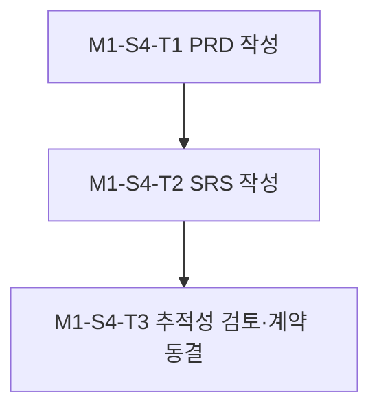

#### M1-S4-T1. PRD 작성

- 진행 배경: 사용자 관점 기능과 성공 기준이 영속 문서로 존재하지 않는다.
- 진행 목적: 웹 및 전화 음성 에이전트의 사용자 여정, 범위와 성공 조건을 정의한다.
- AS-IS: 관련 PRD가 없다.
- TO-BE: 개발 버전에 맞는 한국어 PRD가 존재한다.
- 작업 종료조건: PRD가 독립 커밋으로 기록되고 이슈와 연결된다.

#### M1-S4-T2. SRS 작성

- 진행 배경: 기능·성능·인터페이스·보안 요구사항이 검증 가능한 형태로 정리되지 않았다.
- 진행 목적: PRD를 시스템 요구사항과 수용 기준으로 구체화한다.
- AS-IS: 관련 SRS가 없다.
- TO-BE: 요구사항 ID와 검증 기준을 포함하는 한국어 SRS가 존재한다.
- 작업 종료조건: SRS가 PRD와 분리된 독립 커밋으로 기록된다.

#### M1-S4-T3. 요구사항 추적성 검토 및 계약 동결

- 진행 배경: 병렬 구현이 서로 다른 계약 버전을 사용하면 통합이 실패한다.
- 진행 목적: 이슈, PRD/SRS, 계약, 단위·통합 테스트 시나리오의 연결을 검토하고 M2 기준선을 선언한다.
- AS-IS: 요구사항과 계약의 대응 관계 및 변경 절차가 없다.
- TO-BE: 추적표와 계약 버전, 변경 승인 절차가 문서화된다.
- 작업 종료조건: 누락된 요구사항이 없고 M2 진입 게이트가 충족된다.

---

## M2. 모듈별 병렬 구현 및 단위 검증

- 진행 배경: M1에서 디렉터리와 계약이 고정되면 모듈은 서로의 구체 구현을 기다리지 않고 개발할 수 있다.
- 진행 목적: 코어, STT, 작업 처리, TTS, 웹 및 Asterisk 모듈을 파일 소유권이 겹치지 않는 병렬 Slice로 구현하고 단위 테스트를 동시에 작성한다.
- AS-IS: 계약과 골격만 존재하고 실제 음성 처리 및 채널 기능이 없다.
- TO-BE: 여섯 모듈이 계약을 준수하는 실제 구현과 단위 테스트를 보유한다.
- 작업 종료조건: 모든 Slice의 단위 테스트와 계약 검사가 통과하고 모듈별 테스트 실행 로그가 남는다.

### Slice 진행 순서

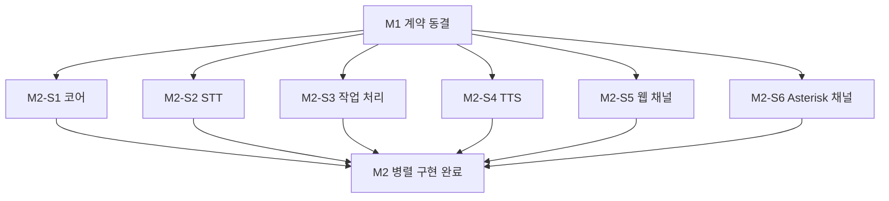

### M2-S1. 코어 오케스트레이터

- 진행 배경: 공통 STT → 작업 처리 → TTS 흐름과 세션 상태를 소유할 코어가 필요하다.
- 진행 목적: 구체 어댑터를 모르는 비동기 오케스트레이터, 세션 관리자, 취소·오류 전파를 구현한다.
- AS-IS: contracts만 있고 실행 흐름이 없다.
- TO-BE: 주입된 포트를 통해 전체 흐름을 제어하는 core 모듈이 존재한다.
- 작업 종료조건: 정상·오류·취소·자원 정리 단위 테스트가 통과한다.

#### Task 진행 순서

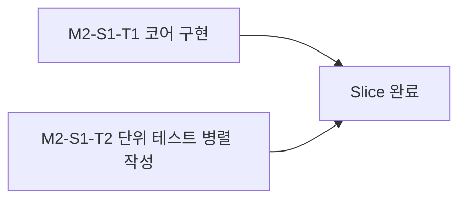

#### M2-S1-T1. 코어 흐름 및 세션 제어 구현

- 진행 배경: 계약을 실제 처리 순서와 상태 전이로 연결해야 한다.
- 진행 목적: 오케스트레이터, 세션 상태 머신, 제한 큐, 시간 제한과 취소 전파를 구현한다.
- AS-IS: 실행 가능한 코어가 없다.
- TO-BE: fake 또는 주입된 포트로 독립 실행 가능한 코어가 있다.
- 작업 종료조건: core가 adapters/channels를 직접 import하지 않고 정의된 상태 전이를 수행한다.

#### M2-S1-T2. 코어 단위 테스트 병렬 작성 및 실행

- 진행 배경: 비동기 흐름의 순서·취소·오류는 구현과 동시에 검증해야 한다.
- 진행 목적: 코어 구현과 병렬로 결정론적 단위 테스트를 작성한다.
- AS-IS: core 대응 테스트가 없다.
- TO-BE: 소스 파일별 테스트가 정상·실패·취소·역압 경로를 검증한다.
- 작업 종료조건: 테스트가 통과하고 해당 Task 실행 로그가 보존된다.

### M2-S2. STT 어댑터

- 진행 배경: 선정된 기존 한국어 STT 모델을 공통 계약으로 감싸야 한다.
- 진행 목적: 모델 로딩, 오디오 입력, 부분·최종 전사, 취소 및 GPU 자원 처리를 구현한다.
- AS-IS: 모델별 API와 core 계약 사이 연결이 없다.
- TO-BE: 선정 STT 모델이 STT 계약을 준수하며 로컬 GPU에서 동작한다.
- 작업 종료조건: 한국어 샘플 전사, 오류·취소 및 자원 해제 단위 테스트가 통과한다.

#### Task 진행 순서

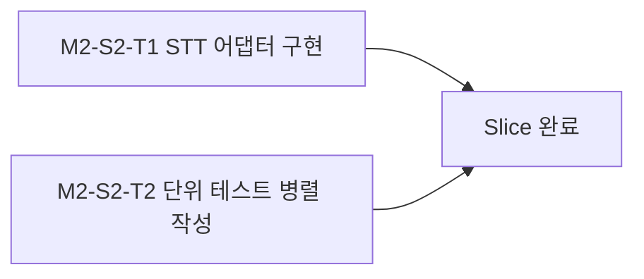

#### M2-S2-T1. STT 모델 어댑터 구현

- 진행 배경: 모델 런타임을 core와 격리해야 한다.
- 진행 목적: M1에서 선정한 STT 모델의 로딩·추론·스트리밍 결과를 STT 계약으로 변환한다.
- AS-IS: 모델을 호출하는 애플리케이션 코드가 없다.
- TO-BE: 설정으로 모델과 장치를 선택할 수 있는 STT 어댑터가 있다.
- 작업 종료조건: 지원 오디오 형식과 오류가 표준 계약으로 변환된다.

#### M2-S2-T2. STT 단위 테스트 병렬 작성 및 실행

- 진행 배경: 모델 외부 의존성과 계약 변환을 분리 검증해야 한다.
- 진행 목적: 모델 런타임을 격리한 단위 테스트와 소규모 로컬 추론 검사를 작성한다.
- AS-IS: STT 회귀 테스트가 없다.
- TO-BE: 입력 검증, 전사 매핑, 취소 및 실패 정리 테스트가 있다.
- 작업 종료조건: 테스트와 허용된 로컬 추론 검사가 통과하고 로그가 기록된다.

### M2-S3. 작업 처리 어댑터

- 진행 배경: STT 텍스트를 실제 작업 처리 백엔드에 전달하고 결과를 TTS 입력으로 표준화해야 한다.
- 진행 목적: M1에서 확정된 작업 처리 범위와 백엔드를 Task 계약에 연결한다.
- AS-IS: 전사 텍스트 이후 수행할 작업 처리 구현이 없다.
- TO-BE: 세션 문맥·오류·취소를 보존하는 Task 어댑터가 존재한다.
- 작업 종료조건: 정상 결과, 도구 오류, 시간 제한 및 취소 단위 테스트가 통과한다.

#### Task 진행 순서

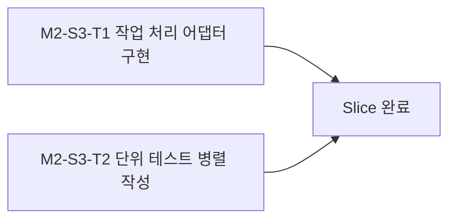

#### M2-S3-T1. 작업 처리 백엔드 어댑터 구현

- 진행 배경: 특정 작업 엔진을 core에 직접 결합하면 교체와 테스트가 어렵다.
- 진행 목적: 확정된 백엔드를 Task 계약으로 감싸고 세션 문맥과 구조화된 결과를 전달한다.
- AS-IS: 작업 처리 연결부가 없다.
- TO-BE: 설정으로 주입 가능한 Task 어댑터가 있다.
- 작업 종료조건: core가 백엔드 세부 API를 알지 않고 작업을 수행한다.

#### M2-S3-T2. 작업 처리 단위 테스트 병렬 작성 및 실행

- 진행 배경: 작업 실패와 장시간 실행이 음성 세션을 손상시키지 않아야 한다.
- 진행 목적: 성공·실패·시간 제한·취소·결과 정규화를 검증한다.
- AS-IS: Task 계약 구현 검증이 없다.
- TO-BE: 결정론적 fake 백엔드를 사용한 소스 대응 테스트가 있다.
- 작업 종료조건: 모든 테스트가 통과하고 실행 로그가 보존된다.

### M2-S4. TTS 어댑터

- 진행 배경: 작업 결과 텍스트를 선정된 기존 한국어 TTS 모델로 합성해야 한다.
- 진행 목적: 모델 로딩, 음성 합성, 청크 출력, 취소 및 GPU 자원 처리를 구현한다.
- AS-IS: TTS 모델과 공통 계약 사이 연결이 없다.
- TO-BE: 선정 TTS 모델이 TTS 계약을 준수하며 로컬 GPU에서 동작한다.
- 작업 종료조건: 한국어 합성, 청크 순서, 오류·취소 및 자원 해제 단위 테스트가 통과한다.

#### Task 진행 순서

#### M2-S4-T1. TTS 모델 어댑터 구현

- 진행 배경: 모델별 출력 형식과 수명 주기를 core에서 격리해야 한다.
- 진행 목적: 선정 TTS 모델의 로딩·합성·스트리밍 출력을 TTS 계약으로 변환한다.
- AS-IS: 합성 모델을 호출하는 애플리케이션 코드가 없다.
- TO-BE: 설정 가능한 음성·장치·출력 형식을 지원하는 어댑터가 있다.
- 작업 종료조건: 결과 오디오와 표준 오류가 계약에 맞게 반환된다.

#### M2-S4-T2. TTS 단위 테스트 병렬 작성 및 실행

- 진행 배경: 텍스트 정규화, 청크 출력 및 취소 동작을 구현과 동시에 검증해야 한다.
- 진행 목적: 모델 런타임을 격리한 단위 테스트와 소규모 합성 검사를 작성한다.
- AS-IS: TTS 회귀 테스트가 없다.
- TO-BE: 입력·출력·순서·취소·실패 정리 테스트가 있다.
- 작업 종료조건: 테스트와 허용된 로컬 합성 검사가 통과하고 로그가 기록된다.

### M2-S5. 웹 채널 모듈

- 진행 배경: 프론트엔드가 코어를 사용할 HTTP/WebSocket 경계가 필요하다.
- 진행 목적: 세션 생성·종료, 오디오 업로드·스트림, 이벤트 및 오류 응답을 제공한다.
- AS-IS: 외부 웹 API가 없다.
- TO-BE: channels/web 모듈이 계약을 통해 core와 통신한다.
- 작업 종료조건: 요청 검증, 스트리밍, 연결 종료 및 오류 매핑 단위 테스트가 통과한다.

#### Task 진행 순서

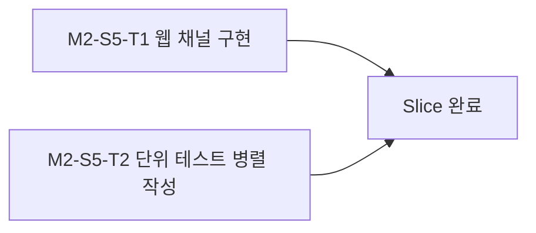

#### M2-S5-T1. 웹 엔드포인트 및 스트림 구현

- 진행 배경: 프론트엔드 연결을 위한 공개 경계가 없다.
- 진행 목적: SRS에서 확정한 HTTP/WebSocket 엔드포인트와 메시지 검증을 구현한다.
- AS-IS: FastAPI 라우터와 웹 세션 연결이 없다.
- TO-BE: 채널 형식을 공통 계약으로 변환하는 웹 모듈이 있다.
- 작업 종료조건: channels/web가 모델 어댑터를 직접 호출하지 않고 API 계약을 제공한다.

#### M2-S5-T2. 웹 채널 단위 테스트 병렬 작성 및 실행

- 진행 배경: 네트워크 경계의 유효성 검사와 연결 종료를 자동 검증해야 한다.
- 진행 목적: 인증 정책, 스키마, 메시지 순서, 취소 및 오류 응답을 테스트한다.
- AS-IS: 웹 API 테스트가 없다.
- TO-BE: 라우터와 스트림 핸들러의 소스 대응 테스트가 있다.
- 작업 종료조건: 테스트가 통과하고 실행 로그가 기록된다.

### M2-S6. Asterisk 채널 모듈

- 진행 배경: 기존 전화 장비의 통화 제어와 양방향 오디오를 공통 코어에 연결해야 한다.
- 진행 목적: M1에서 선택된 Asterisk 인터페이스를 채널 계약으로 변환한다.
- AS-IS: Asterisk 제어·미디어 연결 코드가 없다.
- TO-BE: 통화 수명 주기, 오디오 입출력, 끊김 및 재연결을 처리하는 채널 모듈이 있다.
- 작업 종료조건: Asterisk를 모사한 단위 테스트에서 통화·미디어·취소·오류 경로가 통과한다.

#### Task 진행 순서

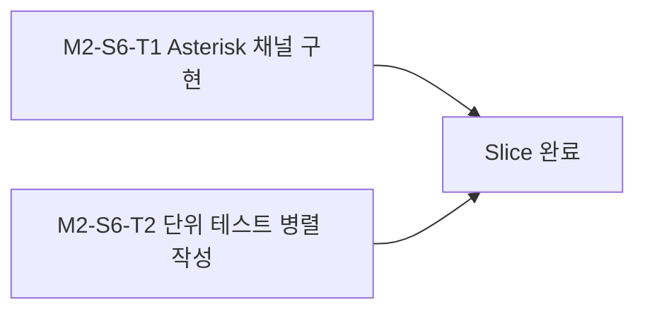

#### M2-S6-T1. Asterisk 통화·미디어 어댑터 구현

- 진행 배경: 전화 채널의 신호와 코덱은 웹 채널과 다르다.
- 진행 목적: 선택된 ARI/AMI/AGI/AudioSocket/SIP-RTP 조합을 공통 세션·오디오 계약으로 변환한다.
- AS-IS: 전화 이벤트와 코어 세션의 매핑이 없다.
- TO-BE: 채널별 코덱과 통화 상태를 격리하는 Asterisk 모듈이 있다.
- 작업 종료조건: core가 Asterisk 세부 프로토콜을 알지 않고 통화 세션을 처리한다.

#### M2-S6-T2. Asterisk 단위 테스트 병렬 작성 및 실행

- 진행 배경: 실제 전화 장비 없이도 통화 이벤트와 실패 처리를 반복 검증해야 한다.
- 진행 목적: 연결·응답·오디오·종료·재연결·비정상 이벤트를 모사한다.
- AS-IS: Asterisk 채널 테스트가 없다.
- TO-BE: 프로토콜 클라이언트를 격리한 소스 대응 테스트가 있다.
- 작업 종료조건: 모든 테스트가 통과하고 실행 로그가 기록된다.

---

## M3. 조립, 경계 통합 검증 및 로컬 배포

- 진행 배경: 독립 모듈의 단위 검증만으로는 웹·Asterisk에서 실제 STT → 작업 처리 → TTS 경로가 동작함을 보장할 수 없다.
- 진행 목적: bootstrap에서 모듈을 조립하고 실제 경계 시나리오, GPU 성능, 장애 복구 및 배포 절차를 검증한다.
- AS-IS: 모듈별 구현은 있으나 전체 시스템 실행과 경계 검증 증거가 없다.
- TO-BE: 웹과 전화 경로가 동일 코어를 통해 동작하고, 성능 한계·복구 동작·운영 절차가 기록된다.
- 작업 종료조건: 승인된 통합 테스트, 성능 검증, 배포 스모크 테스트, 문서 및 실행 로그가 모두 완료된다.

### Slice 진행 순서

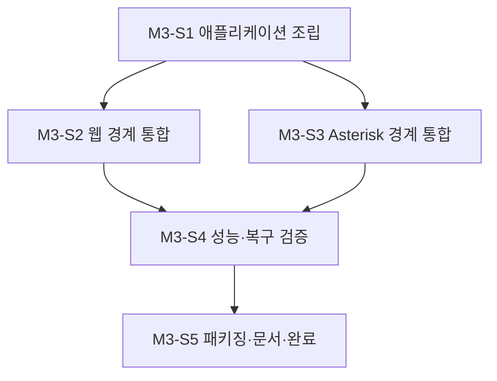

### M3-S1. 애플리케이션 조립 및 스모크 검증

- 진행 배경: bootstrap만 구체 모듈을 조립하도록 한 아키텍처 규칙을 실제로 적용해야 한다.
- 진행 목적: 설정 로딩, 의존성 주입, 모델 수명 주기, FastAPI 시작·종료와 상태 확인을 연결한다.
- AS-IS: 모듈을 함께 실행하는 애플리케이션이 없다.
- TO-BE: 한 명령으로 시작되고 준비 상태를 보고하는 로컬 애플리케이션이 있다.
- 작업 종료조건: 실제 구성의 시작·종료·상태 확인 스모크 테스트가 통과한다.

#### Task 진행 순서

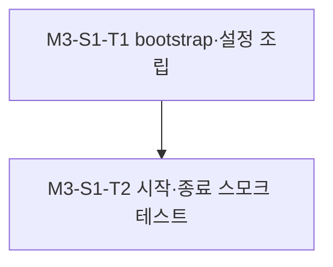

#### M3-S1-T1. bootstrap 및 설정 조립

- 진행 배경: 모듈이 독립적으로만 존재하고 실제 객체 그래프가 구성되지 않았다.
- 진행 목적: 설정 검증, 어댑터 선택, GPU 자원 및 FastAPI 수명 주기를 bootstrap에서 조립한다.
- AS-IS: 실행 진입점이 완성되지 않았다.
- TO-BE: 환경별 설정으로 전체 애플리케이션을 구성할 수 있다.
- 작업 종료조건: 구체 구현 참조가 bootstrap과 허용된 API 조립부에만 존재한다.

#### M3-S1-T2. 시작·종료 및 상태 확인 스모크 테스트

- 진행 배경: 모델 로딩 실패나 종료 시 자원 누수가 운영 장애로 이어질 수 있다.
- 진행 목적: 정상 시작, 준비 상태, 부분 실패, 정상 종료 및 GPU 자원 해제를 검증한다.
- AS-IS: 전체 프로세스 수명 주기 증거가 없다.
- TO-BE: 반복 가능한 스모크 검증과 로그가 있다.
- 작업 종료조건: 모든 경로가 통과하고 실패 시 진단 가능한 상태를 반환한다.

### M3-S2. 웹 음성 경계 통합 검증

- 진행 배경: 웹 채널부터 실제 모델까지의 경계 동작은 단위 테스트로 대체할 수 없다.
- 진행 목적: PRD/SRS에 근거해 웹 오디오 입력부터 합성 오디오 응답까지 검증한다.
- AS-IS: 전체 웹 음성 시나리오의 실행 증거가 없다.
- TO-BE: 승인된 통합 테스트가 세션·스트림·오류·취소를 검증한다.
- 작업 종료조건: Gate 2 승인 후 모든 웹 통합 테스트가 통과하고 결과가 기록된다.

#### Task 진행 순서

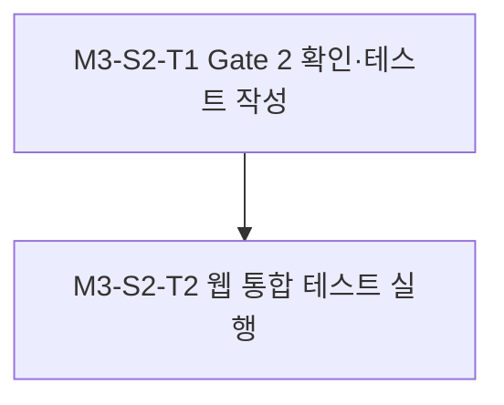

#### M3-S2-T1. Gate 2 확인 및 웹 통합 테스트 작성

- 진행 배경: 통합 테스트 생성·실행 직전 최종 사용자 승인이 필요하다.
- 진행 목적: Gate 2를 받고 PRD/SRS 요구사항 ID에 연결된 웹 시나리오를 작성한다.
- AS-IS: Gate 2와 통합 테스트 코드가 없다.
- TO-BE: 승인 정보와 추적 가능한 테스트가 존재한다.
- 작업 종료조건: 명시적 Gate 2 승인 없이는 다음 Task로 진행하지 않는다.

#### M3-S2-T2. 웹 통합 테스트 실행 및 기록

- 진행 배경: 실제 경계와 모델을 포함한 결과를 확인해야 한다.
- 진행 목적: 음성 입력, 전사, 작업 결과, 합성 음성, 취소 및 오류 흐름을 실행한다.
- AS-IS: 웹 전체 경로의 검증 결과가 없다.
- TO-BE: 재현 가능한 실행 결과와 실패 분석이 있다.
- 작업 종료조건: 대상 시나리오가 통과하고 실행 로그가 저장된다.

### M3-S3. Asterisk 음성 경계 통합 검증

- 진행 배경: 실제 Asterisk의 통화 이벤트·코덱·미디어 타이밍은 모사 테스트만으로 보장할 수 없다.
- 진행 목적: 테스트 내선 또는 격리된 통화 환경에서 전체 전화 음성 흐름을 검증한다.
- AS-IS: 실제 장비와 코어 사이 검증 증거가 없다.
- TO-BE: 승인된 통합 테스트가 통화 수명 주기와 양방향 미디어를 검증한다.
- 작업 종료조건: Gate 2 승인 후 모든 Asterisk 통합 테스트가 통과하고 결과가 기록된다.

#### Task 진행 순서

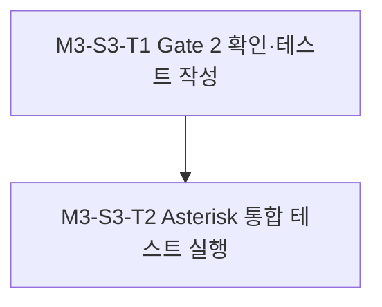

#### M3-S3-T1. Gate 2 확인 및 Asterisk 통합 테스트 작성

- 진행 배경: 실제 전화 장비를 사용하는 테스트는 최종 승인과 안전한 대상 확인이 필요하다.
- 진행 목적: Gate 2, 테스트 내선, 허용 통화 범위 및 PRD/SRS 추적성을 확인한다.
- AS-IS: 실행 승인과 장비 대상이 확정되지 않았다.
- TO-BE: 승인된 테스트 시나리오와 안전한 대상이 명시된다.
- 작업 종료조건: 명시적 Gate 2 승인과 격리된 대상 확인 없이는 다음 Task로 진행하지 않는다.

#### M3-S3-T2. Asterisk 통합 테스트 실행 및 기록

- 진행 배경: 통화 연결부터 음성 응답까지 실제 동작을 검증해야 한다.
- 진행 목적: 연결·오디오 입력·전사·작업·합성·재생·종료 및 비정상 연결 해제를 실행한다.
- AS-IS: 전화 전체 경로의 검증 결과가 없다.
- TO-BE: 재현 가능한 실행 결과와 실패 분석이 있다.
- 작업 종료조건: 대상 시나리오가 통과하고 실행 로그가 저장된다.

### M3-S4. 성능, 동시성 및 장애 복구 검증

- 진행 배경: GTX 1080 Ti 단일 자원에서 지연과 동시성 한계를 측정해야 운영 범위를 정할 수 있다.
- 진행 목적: 실시간 계수, 첫 응답 지연, VRAM, 큐 대기, 동시 세션 및 실패 복구를 측정한다.
- AS-IS: 운영 한계와 자원 초과 시 동작이 알려지지 않았다.
- TO-BE: 지원 가능한 동시성·지연 기준과 초과 시 거부·대기 정책이 문서화된다.
- 작업 종료조건: 목표 충족 여부와 병목, 한계, 대응 정책이 로그와 가이드에 기록된다.

#### Task 진행 순서

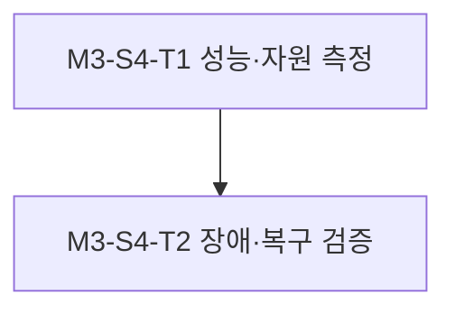

#### M3-S4-T1. 성능 및 GPU 자원 측정

- 진행 배경: 선택 모델과 전체 파이프라인의 실제 비용을 알아야 한다.
- 진행 목적: 대표 한국어 음성과 웹/전화 포맷으로 지연, 처리율, VRAM 및 큐 대기를 측정한다.
- AS-IS: 수치 기반 용량 정보가 없다.
- TO-BE: 재현 가능한 측정치와 권장 동시 세션 수가 있다.
- 작업 종료조건: 명령·환경·입력·결과가 실행 로그에 기록된다.

#### M3-S4-T2. 장애 및 복구 동작 검증

- 진행 배경: 모델 오류, 클라이언트 이탈 및 Asterisk 연결 종료가 자원 누수로 이어질 수 있다.
- 진행 목적: 타임아웃, 취소, 모델 실패, 연결 중단 및 재시작 후 복구를 검증한다.
- AS-IS: 장애 시 세션·GPU 자원 정리 보장이 없다.
- TO-BE: 정의된 오류와 복구 정책이 실제 구성에서 검증된다.
- 작업 종료조건: 세션·큐·GPU 자원이 정리되고 다음 요청을 처리할 수 있다.

### M3-S5. 배포 패키징, 운영 문서 및 완료 기록

- 진행 배경: 검증된 애플리케이션을 반복 실행하고 다음 작업자가 운영할 수 있어야 한다.
- 진행 목적: 로컬 배포 설정, 시작·중지·구성·문제 해결 문서와 최종 실행 증거를 완성한다.
- AS-IS: 배포 패키지와 운영 가이드가 없다.
- TO-BE: GTX 호스트와 Asterisk 환경에서 재현 가능한 배포 절차가 존재한다.
- 작업 종료조건: 깨끗한 환경 스모크 테스트가 통과하고 계획 상태·로그·문서가 실제 결과와 일치한다.

#### Task 진행 순서

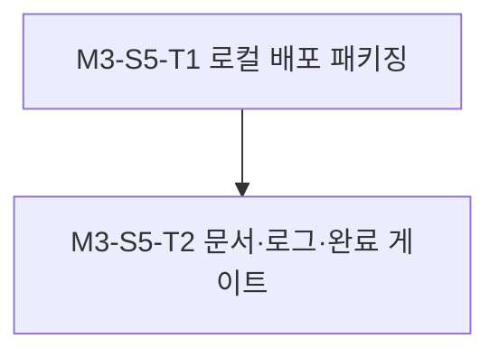

#### M3-S5-T1. 로컬 배포 패키징 및 스모크 실행

- 진행 배경: 개발 환경에만 의존하면 재현 가능한 운영이 어렵다.
- 진행 목적: NVIDIA 런타임, 모델 경로, 설정 비밀 및 Asterisk 연결 값을 외부화한 배포 구성을 만든다.
- AS-IS: 표준 시작·중지 방식이 없다.
- TO-BE: deploy/orchestrator와 실행 명령으로 애플리케이션을 재현할 수 있다.
- 작업 종료조건: 새 로컬 환경에서 상태 확인과 제한된 음성 스모크 흐름이 성공한다.

#### M3-S5-T2. 운영 문서, 실행 로그 및 계획 완료 처리

- 진행 배경: 구현과 검증 결과를 영속 기록으로 남겨야 한다.
- 진행 목적: README, 운영 가이드, 실행 로그, 잔여 제한과 후속 이슈를 정리한다.
- AS-IS: 최종 상태와 증거가 여러 작업 결과에 분산되어 있다.
- TO-BE: 문서와 기록이 실제 구현·검증 상태를 정확히 반영한다.
- 작업 종료조건: 완료 게이트 체크리스트가 충족되고 계획이 executed로 갱신된다.

---

# 4. 의존성

## A. 내부 의존성

- VOIC-FEAT-001 요구사항
- ADR-001의 FastAPI 확장형 코어 결정
- ADR-002의 디렉터리 및 모듈 계약 결정
- M1에서 작성할 PRD/SRS와 계약 기준선
- M1 완료 후에만 M2 병렬 구현 시작
- 모든 M2 Slice 완료 후 M3 조립 시작
- 통합 테스트 Gate 2 승인 후에만 M3-S2/M3-S3 테스트 생성·실행

## B. 외부 의존성

- Python, FastAPI, Uvicorn, Pydantic 계열 런타임
- pytest, pytest-asyncio 및 HTTP/WebSocket 테스트 클라이언트
- NVIDIA GeForce GTX 1080 Ti, 호환 드라이버 및 선택 모델 런타임
- 선정할 한국어 STT/TTS 모델 가중치와 라이선스
- 오디오 변환 도구 또는 라이브러리
- 사용자 환경의 Asterisk 장비, 버전, 접근 자격과 허용 인터페이스
- 작업 처리 API 기본 주소: https://llm.example.test (인증 비밀은 저장소 외부에서 주입)

---

# 5. 리스크 및 대응

|리스크|영향|대응 방안
|---|---|---
|GTX 1080 Ti에서 후보 모델이 목표 지연·VRAM을 충족하지 못함|실시간 응답 또는 동시 세션 불가|M1에서 후보를 동일 조건으로 벤치마크하고 경량·양자화·CPU 분담 대안을 기록한다.
|NVIDIA 드라이버/CUDA와 모델 런타임 비호환|애플리케이션 시작 또는 GPU 추론 실패|M1에서 실제 호스트 버전을 확인하고 호환 조합을 잠근다.
|Asterisk 버전 또는 인터페이스 제약|계획한 미디어 방식 사용 불가|M1에서 ARI/AMI/AGI/AudioSocket/SIP-RTP 가용성을 조사하고 어댑터 방식을 확정한다.
|전화 8 kHz 오디오와 STT/TTS 모델 형식 차이|인식률 저하, 왜곡, 지연 증가|채널 경계에서 명시적으로 변환하고 웹·전화 포맷별 품질과 지연을 측정한다.
|모듈이 계약을 우회해 직접 결합됨|병렬 개발 충돌과 교체성 저하|금지 import 검사, contract Protocol, bootstrap 단일 조립 규칙을 적용한다.
|스트리밍 역압·취소 누락|메모리 증가, 세션 누수, 늦은 응답|제한 큐, 시간 제한, 취소 토큰, 자원 정리 테스트를 계약에 포함한다.
|작업 처리 API 규격·모델 미확정|M2-S3 지연 또는 재설계|M1-S2에서 llm.example.test의 지원 API·모델·오류 규약을 비밀값 노출 없이 확인한다.
|모델 또는 음성 데이터 라이선스 문제|배포·상업 사용 제한|후보 선정 시 사용·재배포·파생물 조건을 필수 비교한다.
|통화·녹취 개인정보 노출|법적·운영 위험|비밀 외부화, 로그 비식별화, 접근 통제 및 30일 후 자동 삭제를 적용한다.
|실제 Asterisk 테스트가 운영 통화에 영향|사용자 통화 장애|격리된 테스트 내선과 Gate 2 승인 후 제한된 시나리오만 실행한다.

---

# 6. 검증 전략

## A. 단위 테스트 (tests/units/)

- create-testcase.md의 디렉터리·명명·추적성 규칙을 따른다.
- tests/units/orchestrator/testcodes가 apps/orchestrator/src/voice_agent의 모듈 구조를 반영한다.
- 각 테스트는 VOIC-FEAT-001과 해당 M/S/T를 참조하고 given/when/then 의도를 명시한다.
- pytest 수집 규칙에 *.test.py를 등록한다.
- 각 M2 Slice에서 구현과 단위 테스트 작성을 병렬로 진행하되, Slice 종료 전 실제 테스트 실행과 로그 기록을 완료한다.
- 외부 모델, Asterisk 및 작업 백엔드는 단위 테스트에서 결정론적 fake로 격리하고 실제 경계 검증은 통합 테스트에서 수행한다.
- 모든 실행은 tests/units/orchestrator/logs의 Mxxx_Sxxx_Txxx-TRYn.md에 기록한다.

## B. 통합 테스트 (tests/integrations/)

- 통합 테스트 필요 여부 검토 결과: 필요
- 검토 사유: 웹/Asterisk ↔ FastAPI ↔ STT/작업 처리/TTS ↔ GPU는 단위 테스트로 대체할 수 없는 외부 경계와 전체 스트리밍 흐름을 포함한다.
- 사전승인 (Gate 1): 승인 — 사용자, 2026-09-22 16:55:03
- 대상 시나리오:
  - web_voice: 웹 음성 입력부터 한국어 전사·작업 처리·합성 음성 반환까지
  - web_voice: 연결 취소, 잘못된 오디오, 모델 오류 및 세션 정리
  - asterisk_voice: 테스트 내선 연결, 양방향 오디오, 합성 음성 재생 및 정상 종료
  - asterisk_voice: 원격 종료, 미디어 끊김, 타임아웃 및 자원 정리
  - voice_pipeline: 동일 입력이 채널과 무관하게 공통 코어 계약을 통과함
  - voice_pipeline: 단일 GPU의 큐·동시성 한도와 초과 정책
- 전제: M1에서 관련 PRD/SRS를 먼저 작성하며 각 테스트는 요구사항 ID에 추적된다.
- Gate 2: M3-S2/M3-S3 실행 직전에 사용자에게 다시 요청한다.
- Gate 1 또는 Gate 2가 승인되지 않으면 통합 테스트를 생성·실행하지 않고 경계 검증 공백을 실행 로그에 명시한다.

---

# 7. 롤아웃 / 마이그레이션

- 신규 시스템이므로 기존 데이터 마이그레이션은 없다.
- 로컬 개발 설정에서 계약과 모듈 단위 검증을 먼저 수행한다.
- 실제 STT/TTS 모델을 한 세션으로 검증한 뒤 측정 결과에 따라 동시성 한도를 설정한다.
- 웹 채널을 제한된 개발 클라이언트에 먼저 연결한다.
- Asterisk는 운영 회선과 분리된 테스트 내선에서 먼저 검증한다.
- 전화 연결은 통화 종료·오류·자원 정리 기준을 충족한 뒤 제한적으로 확대한다.
- 녹취와 원문 데이터는 생성 시점을 기준으로 30일 보존 후 자동 삭제하고 삭제 결과를 감사 가능하게 기록한다.
- 초기 동시 세션 수는 1개로 제한하고 성능 측정 후 확대 여부를 별도 결정한다.
- 설정 비밀, 모델 경로, GPU 장치 및 Asterisk 자격 정보는 코드와 분리한다.

---

# 8. 완료 게이트

- [ ] 계획이 approved이고 ADR-002가 accepted이다.
- [ ] 첫 마일스톤 시작 전에 디렉터리 구조가 결정되어 있다.
- [ ] M1 계약과 PRD/SRS가 완료되기 전에 M2 구현을 시작하지 않았다.
- [ ] 모든 M2 모듈과 대응 단위 테스트가 계약 기준으로 병렬 진행되었다.
- [ ] 모든 마일스톤 검증 통과
- [ ] 관련 단위 테스트 실행 및 통과
- [ ] 통합 테스트 Gate 1과 Gate 2가 승인된 경우 대상 테스트 실행 및 통과
- [ ] 승인되지 않은 통합 테스트 범위가 있다면 검증 공백을 명시
- [ ] 실행 로그 기록 (docs/records/2_logs/)
- [ ] 테스트 실행 로그 기록 (tests/units/orchestrator/logs/)
- [ ] 관련 README와 운영 가이드 갱신
- [ ] 모델·Asterisk·작업 처리 백엔드 선택의 근거와 제한 기록
- [ ] 개인정보·비밀·녹취 기본 정책 확인

---

# 9. 참고자료

- [VOIC-FEAT-001](../0_issues/VOIC-FEAT-001.md)
- [ADR-001: Python/FastAPI 기반 확장형 음성 에이전트 코어](../3_decisions/ADR-001-python-fastapi-extensible-core.md)
- [ADR-002: Python 모듈형 모놀리스 디렉터리 및 계약](../3_decisions/ADR-002-python-modular-monolith-directory-contracts.md)
- [ADR-003: 초기 작업 처리 및 운영 제약](../3_decisions/ADR-003-initial-task-backend-and-operating-constraints.md)
