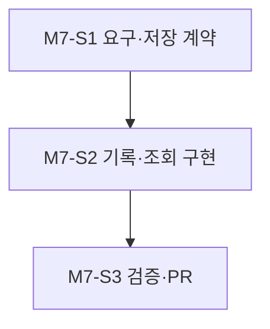
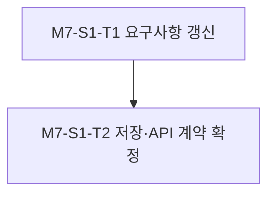
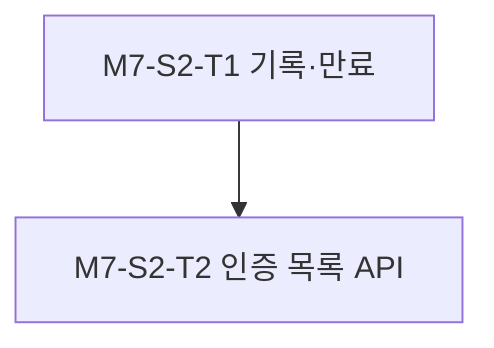
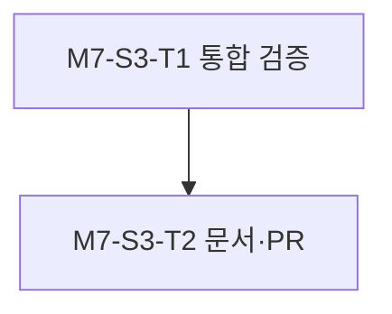

# 0. 계획 정보

|key|value|
|---|---|
|계획 ID|VOIC-FEAT-004-plan|
|원본 이슈|[VOIC-FEAT-004](../0_issues/VOIC-FEAT-004.md)|
|상태|approved|
|작성 시간|2026-10-11 08:11:06 UTC|
|작성 에이전트|Codex|
|승인자|사용자 — “나머지 작업들을 이어 진행하세요”|
|승인 일시|2026-10-11 10:29 UTC|

---

# 1. 개요

## A. 목표

운영자가 인증된 로컬 API `GET /operator/inbound-calls`에서 AI가 받은 착신 통화의 ID·시작/종료 시각·상태·발신자 번호 전체를 조회한다. 번호가 제공되지 않으면 `null`이다.

## B. 범위

새 착신부터 암호화된 통화 메타데이터를 기록하고, 30일 만료·권한·오류 처리와 제한된 목록 조회를 구현한다. PRD/SRS와 컴포넌트 설명·운영 가이드, 테스트와 실행 증거를 갱신한다. `dev/v0.0.1`에서 `feat/inbound-call-history`를 분기해 독립 PR을 낸다.

## C. 제외 범위 (Non-goals)

과거 통화의 발신자 번호 소급 복원, HT813·사업자의 Caller ID 진위 보증, 백엔드 중지 중의 부재중 전화 조회, 통화 녹음 다운로드, 상시 백엔드 배포는 제외한다.

---

# 2. 영향 컴포넌트

- [x] apps/orchestrator
- [ ] deploy/
- [x] tests/

---

# 3. 작업 분해 구조 (Milestone / Slice / Task)

## M7. 암호화 착신내역 조회

- 진행 배경: 현재 턴별 보존만 있고 착신 단위 목록이 없다.
- 진행 목적: 새 착신을 안전하게 기록하고 인증된 목록 API로 제공한다.
- AS-IS: 번호·통화 상태를 조회할 영속 기록과 API가 없다.
- TO-BE: 30일 암호화 메타데이터와 `GET /operator/inbound-calls`가 있다.
- 작업 종료조건: 번호 유무·상태·정렬·페이지·만료·인증·오류 경계가 검증되고 PR이 `dev/v0.0.1`을 대상으로 생성된다.

### Slice 진행 순서

### M7-S1. 요구·저장 계약

- 진행 배경: 기존 PRD/SRS에는 통화 이력 조회 요구가 없다.
- 진행 목적: API·민감정보·30일 정책을 명문화한다.
- AS-IS: ADR-008의 턴별 보존만 정의돼 있다.
- TO-BE: 조회 요구와 ADR-012의 저장·접근 결정이 승인돼 있다.
- 작업 종료조건: 기존 PRD/SRS를 각각 독립 커밋으로 갱신하고 ADR-012 승인 상태를 확인한다.

#### Task 진행 순서

#### M7-S1-T1. 요구사항 갱신

- 진행 배경: 새 운영 조회가 제품 문서에 없다.
- 진행 목적: 착신 이력·번호 전체·번호 미제공·30일 조회 제한을 PRD/SRS에 추가한다.
- AS-IS: 통화 종료 상태만 실시간 이벤트로 표시한다.
- TO-BE: 목록 조회의 사용자 관점 수용 기준이 있다.
- 작업 종료조건: PRD와 SRS 변경이 각각 다른 독립 커밋에 있다.

#### M7-S1-T2. 저장·API 계약 확정

- 진행 배경: 번호 전체 저장은 기존 턴별 보존보다 민감하다.
- 진행 목적: ADR-012와 목록 응답 필드·정렬·페이지 경계를 확정한다.
- AS-IS: 번호 영속 저장·조회 규칙이 없다.
- TO-BE: 승인된 암호화·인증·번호 없는 통화 처리 규칙이 있다.
- 작업 종료조건: ADR-012가 사용자 확인으로 accepted이며 API 계약이 문서화됐다.

### M7-S2. 착신 기록·목록 API

- 진행 배경: 수신 SIP 서비스가 종료 뒤 인덱스를 남기지 않는다.
- 진행 목적: 통화 메타데이터 기록과 목록 조회를 구현한다.
- AS-IS: 시작·종료 시각과 Caller ID를 묶은 영속 기록이 없다.
- TO-BE: 착신 시작 시 기록하고 종료 시 상태를 갱신하며 인증된 API가 읽는다.
- 작업 종료조건: 새 착신의 상태·번호가 암호화돼 저장되고 `GET /operator/inbound-calls`가 제한·정렬된 결과를 반환한다.

#### Task 진행 순서

#### M7-S2-T1. 기록·만료

- 진행 배경: 발화 없는 통화도 수신내역에 필요하다.
- 진행 목적: HT813의 `Caller ID Transport Type`에 맞는 SIP 헤더의 번호 또는 null과 통화 상태를 암호화 파일로 기록한다.
- AS-IS: 발화가 없으면 보존 파일이 없을 수 있다.
- TO-BE: 유효한 착신 시도는 통화별 메타데이터를 남긴다.
- 작업 종료조건: `From`·`P-Asserted-Identity`·`P-Preferred-Identity` 각 설정, SIP 계정 ID 오인 방지, 시작·정상 종료·조기 실패·번호 없음·30일 삭제 단위 테스트가 통과한다.

#### M7-S2-T2. 인증 목록 API

- 진행 배경: 운영 조회 경로가 없다.
- 진행 목적: localhost Bearer 인증 후 통화 ID·시각·상태·번호를 제한된 목록으로 제공한다.
- AS-IS: 운영 API는 발신 제어만 가능하다.
- TO-BE: 최신순 페이지 조회와 무권한 거부가 가능하다.
- 작업 종료조건: 인증·페이지·손상 파일·만료 경계 테스트가 통과하고 번호·토큰이 로그에 남지 않는다.

### M7-S3. 검증·PR

- 진행 배경: 파일 보존과 HTTP를 함께 써야 기능을 신뢰할 수 있다.
- 진행 목적: 합성 데이터 통합 시험과 문서·PR을 완료한다.
- AS-IS: 조회 API의 검증 증거가 없다.
- TO-BE: PR에서 수용 기준과 시험 결과를 검토할 수 있다.
- 작업 종료조건: Gate 1·2 승인 뒤 통합 시험이 통과하고 로그·README가 갱신되며 별도 PR이 생성됐다.

#### Task 진행 순서

#### M7-S3-T1. 통합 검증

- 진행 배경: 단위 테스트만으로 실제 암호화 파일·HTTP 경계를 증명할 수 없다.
- 진행 목적: 합성 Caller ID가 암호화 저장·API 조회·만료를 거치는지 확인한다.
- AS-IS: 경계 통합 시험이 없다.
- TO-BE: 승인된 합성 데이터 시험이 기록돼 있다.
- 작업 종료조건: PRD/SRS를 근거로 작성한 통합 시험 실행 로그가 있다.

#### M7-S3-T2. 문서·PR

- 진행 배경: 운영자가 조회 조건과 제한을 알아야 한다.
- 진행 목적: README·운영 가이드·실행 로그를 갱신하고 PR을 연다.
- AS-IS: 조회 API 설명이 없다.
- TO-BE: 요청·응답·인증·기존 기록 한계가 문서화됐다.
- 작업 종료조건: 검증 결과와 남은 한계를 담은 `feat/inbound-call-history` → `dev/v0.0.1` PR이 있다.

---

# 4. 의존성

## A. 내부 의존성

[ADR-008](../3_decisions/ADR-008-local-encrypted-retention.md), [ADR-012](../3_decisions/ADR-012-encrypted-call-index-for-history.md), 현재 SIP 착신과 AES-GCM 보존 구현.

## B. 외부 의존성

GitHub 저장소 생성·푸시 자격 증명과 PR 작성 권한. 실제 전화는 이 기능 검증에 필요하지 않다.

---

# 5. 리스크 및 대응

|리스크|영향|대응 방안|
|---|---|---|
|SIP 헤더별 번호 부재·위조|목록 식별이 불완전하거나 계정 ID를 잘못 표시|HT813 전송 방식과 맞는 헤더만 읽고 미제공은 null, 번호는 장비 표시값으로 설명|
|번호·토큰 노출|민감정보 유출|암호화 파일·localhost 인증, 로그·파일명 비식별|
|프로세스 중단|종료 상태 누락|시작 기록을 남기고 미완료 상태를 구분|
|오래된 기록|번호 복구 불가|새 기록부터 적용한다고 명시|

---

# 6. 검증 전략

## A. 단위 테스트 (tests/units/)

HT813 Caller ID 전송 방식별 파싱, 계정 ID 오인 방지, 메타데이터 보존·만료, 페이지·권한 거부, 파일 손상·번호 없음 경계를 테스트한다.

## B. 통합 테스트 (tests/integrations/)

- 통합 테스트 필요 여부 검토 결과: 필요
- 검토 사유: SIP 착신→암호화 파일→HTTP 목록 조회의 컴포넌트 경계가 핵심 기능이다.
- 사전승인 (Gate 1): 사용자 2026-10-11 계속 진행 지시로 승인. 합성 데이터 통합 시험 실행 직전 Gate 2는 별도로 확인한다.
- 대상 시나리오: 합성 SIP 착신의 번호·번호 없음·정상 종료를 기록하고 인증된 API에서 조회, 만료 뒤 제외한다. 실전화는 제외한다.

---

# 7. 롤아웃 / 마이그레이션

기존 번호를 복원하지 않는다. 새 코드 배포 이후 받은 통화부터 목록에 나타난다. 실제 백엔드의 상시 기동·키 주입은 별도 운영 승인 및 작업이다.

---

# 8. 완료 게이트

- [ ] 모든 마일스톤 검증 통과
- [ ] 관련 테스트 실행 및 통과
- [ ] 실행 로그 기록 (`docs/records/2_logs/`)
- [ ] 관련 문서(README/guides) 갱신
- [ ] `feat/inbound-call-history`의 PR 생성

---

# 9. 참고자료

- [관련 ADR](../3_decisions/ADR-012-encrypted-call-index-for-history.md)
- [원본 이슈](../0_issues/VOIC-FEAT-004.md)
