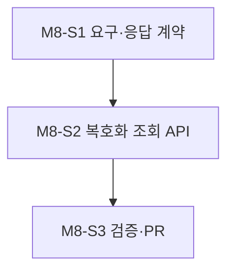
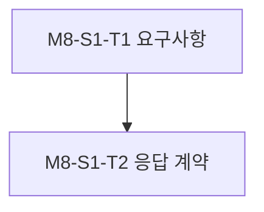
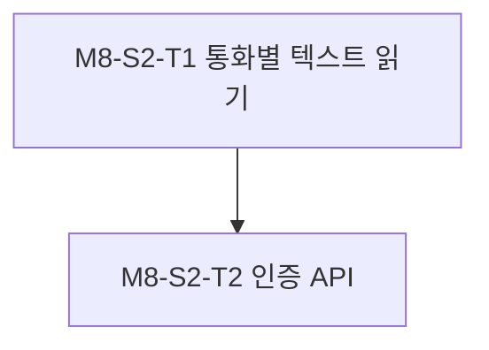
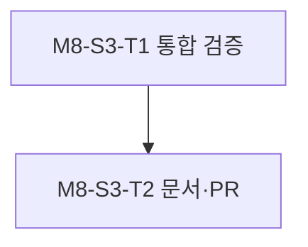

# 0. 계획 정보

|key|value|
|---|---|
|계획 ID|VOIC-FEAT-005-plan|
|원본 이슈|[VOIC-FEAT-005](../0_issues/VOIC-FEAT-005.md)|
|상태|approved|
|작성 시간|2026-10-11 08:11:06 UTC|
|작성 에이전트|Codex|
|승인자|사용자 — “나머지 작업들을 이어 진행하세요”|
|승인 일시|2026-10-11 10:29 UTC|

---

# 1. 개요

## A. 목표

운영자가 인증된 로컬 API `GET /operator/calls/{session_id}/conversation`으로 한 통화에서 보존된 사용자 최종 전사와 AI 최종 응답을 턴 번호·생성 시각 순서로 조회한다. 외부 착신과 AI 발신에 같은 형식을 쓴다.

## B. 범위

기존 암호화 텍스트 아티팩트의 안전한 읽기·통화별 조합, localhost Bearer 인증, 삭제·손상·부분 턴 처리, API·가이드·테스트를 포함한다. `dev/v0.0.1`에서 `feat/call-conversation-history`를 독립 분기해 별도 PR을 낸다. PRD/SRS 갱신은 코드·테스트와 별도 커밋으로 관리한다.

## C. 제외 범위 (Non-goals)

녹취·합성 음성 다운로드, 부분 전사, 오래된 통화 내용 복구, 전화번호로 검색, 이력을 다음 통화의 AI 문맥으로 재사용하는 일은 제외한다.

---

# 2. 영향 컴포넌트

- [x] apps/orchestrator
- [ ] deploy/
- [x] tests/

---

# 3. 작업 분해 구조 (Milestone / Slice / Task)

## M8. 통화별 대화내역 조회

- 진행 배경: 최종 전사·응답은 저장되지만 인증된 통화별 조회 경로가 없다.
- 진행 목적: 보존된 사용자·AI 텍스트를 통화 ID로 안전하게 제공한다.
- AS-IS: 운영자는 암호문 파일을 직접 다뤄야 한다.
- TO-BE: 인증된 API로 턴별 대화내역을 조회한다.
- 작업 종료조건: 실제 파일 경계·권한·만료·부분 턴 수용 기준이 검증되고 `dev/v0.0.1` 대상 PR이 생성된다.

### Slice 진행 순서

### M8-S1. 요구·응답 계약

- 진행 배경: PRD/SRS에 대화내역 조회가 없다.
- 진행 목적: 통화 ID·턴 순서·보존 범위·오류 계약을 정의한다.
- AS-IS: 턴별 아티팩트만 정의돼 있다.
- TO-BE: 사용자 관점 조회 수용 기준이 문서화됐다.
- 작업 종료조건: PRD/SRS 변경이 각각 독립 커밋에 있고 API 계약이 정해졌다.

#### Task 진행 순서

#### M8-S1-T1. 요구사항

- 진행 배경: 조회 가능 범위가 불명확하다.
- 진행 목적: 최종 전사·AI 응답만 보이는 요구를 PRD/SRS에 추가한다.
- AS-IS: 녹취·원문 보존만 문서화됐다.
- TO-BE: 대화 조회·30일 만료·인증 기준이 있다.
- 작업 종료조건: PRD와 SRS가 각각 독립 커밋으로 갱신됐다.

#### M8-S1-T2. 응답 계약

- 진행 배경: 무음·실패 통화에는 텍스트가 없거나 한쪽만 있을 수 있다.
- 진행 목적: `session_id`, `turn_index`, `speaker`, `text`, `created_at`과 빈 결과·404·손상 처리의 의미를 정한다.
- AS-IS: 외부에 공개된 대화 스키마가 없다.
- TO-BE: 부분 턴을 허위로 완성하지 않는 계약이 있다.
- 작업 종료조건: 계약이 README/가이드에 검토 가능하게 기록됐다.

### M8-S2. 복호화 조회 API

- 진행 배경: 텍스트 암호문은 저장되지만 통화 ID별 읽기 함수가 없다.
- 진행 목적: 인증과 안전한 복호화·정렬을 구현한다.
- AS-IS: 직접 파일 경로를 알아야 아티팩트를 읽는다.
- TO-BE: 통화 ID만으로 보존 기간 내 사용자·AI 텍스트를 가져온다.
- 작업 종료조건: 임의 경로 입력 불가, 인증·정렬·삭제·손상 경계 단위 테스트가 통과한다.

#### Task 진행 순서

#### M8-S2-T1. 통화별 텍스트 읽기

- 진행 배경: 파일명에 통화 ID가 없어 무작위 암호문을 분류해야 한다.
- 진행 목적: 안전한 읽기 함수로 보존 중인 최종 텍스트를 통화·턴별 정렬한다.
- AS-IS: 단일 파일 복호화만 제공한다.
- TO-BE: 사용자 전사와 AI 응답이 원래 순서로 구분된다.
- 작업 종료조건: 통화 ID 불일치·부분 턴·만료·손상 파일 테스트가 통과한다.

#### M8-S2-T2. 인증 API

- 진행 배경: 운영 조회 엔드포인트가 없다.
- 진행 목적: localhost Bearer 인증 뒤 통화 ID별 텍스트를 응답한다.
- AS-IS: 운영 API는 발신 제어만 가능하다.
- TO-BE: 미인증·원격·잘못된 ID는 원문 없이 거부된다.
- 작업 종료조건: 성공·빈 결과·404·권한 거부·로그 비노출 단위 테스트가 통과한다.

### M8-S3. 검증·PR

- 진행 배경: 암호화 파일과 HTTP 응답 사이에 민감정보 경계가 있다.
- 진행 목적: 합성 데이터 경계 검증과 별도 PR을 완료한다.
- AS-IS: 조회 동작을 입증한 실행 기록이 없다.
- TO-BE: 요구사항에 연결된 테스트·문서·PR이 있다.
- 작업 종료조건: Gate 1·2 승인 뒤 통합 시험을 기록하고 `feat/call-conversation-history` PR을 연다.

#### Task 진행 순서

#### M8-S3-T1. 통합 검증

- 진행 배경: 단위 테스트가 실제 암호화 파일·HTTP 경계를 증명하지 않는다.
- 진행 목적: 합성 두 턴을 저장해 API 순서·인증·만료를 확인한다.
- AS-IS: 경계 실행 기록이 없다.
- TO-BE: 합성 파일 통합 시험 로그가 있다.
- 작업 종료조건: PRD/SRS를 근거로 한 통합 시험이 통과한다.

#### M8-S3-T2. 문서·PR

- 진행 배경: 운영자가 응답의 의미와 제한을 알아야 한다.
- 진행 목적: README·가이드·실행 로그를 갱신해 검토 가능한 PR을 낸다.
- AS-IS: 통화별 조회 설명이 없다.
- TO-BE: 요청·응답·인증·과거 기록 범위를 문서화했다.
- 작업 종료조건: `feat/call-conversation-history` → `dev/v0.0.1` PR이 생성됐다.

---

# 4. 의존성

## A. 내부 의존성

[ADR-008](../3_decisions/ADR-008-local-encrypted-retention.md)과 기존 암호화 텍스트 파일. 첫 번째 조회 PR의 통화 메타데이터는 없어도 기능을 구현할 수 있지만 두 PR을 합친 뒤에는 같은 통화 ID로 연결돼야 한다.

## B. 외부 의존성

GitHub 저장소 생성·푸시 자격 증명과 PR 작성 권한. 실제 전화는 이 기능 검증에 필요하지 않다.

---

# 5. 리스크 및 대응

|리스크|영향|대응 방안|
|---|---|---|
|파일 수 증가|조회 지연|통화 ID 필터와 bounded 조회, 필요 시 인덱스 재검토|
|부분 턴·파일 손상|불완전한 대화|원문을 꾸미지 않고 명시적 오류 또는 존재하는 턴만 반환|
|원문 노출|민감정보 유출|localhost Bearer 인증과 일반 로그·오류 원문 금지|
|30일 삭제|조회 결과 소실|404/빈 결과 의미를 명확히 하고 삭제 아티팩트를 복구하지 않음|

---

# 6. 검증 전략

## A. 단위 테스트 (tests/units/)

턴 정렬·화자 구분·부분 턴·무음·손상 암호문·인증·잘못된 UUID를 검증한다.

## B. 통합 테스트 (tests/integrations/)

- 통합 테스트 필요 여부 검토 결과: 필요
- 검토 사유: AES-GCM 파일 읽기와 HTTP 응답 경계가 기능의 핵심이다.
- 사전승인 (Gate 1): 사용자 2026-10-11 계속 진행 지시로 승인. 합성 데이터 통합 시험 실행 직전 Gate 2는 별도로 확인한다.
- 대상 시나리오: 합성 두 턴·단일 응답·무음 통화를 저장하고 인증된 API에서 조회한다. 실전화는 제외한다.

---

# 7. 롤아웃 / 마이그레이션

기존의 아직 만료되지 않은 암호화 전사·응답은 같은 키가 유지되는 한 조회 대상으로 삼을 수 있다. 기존 기록에 없는 대화·전화번호는 생성하지 않는다. 상시 배포는 별도 작업이다.

---

# 8. 완료 게이트

- [ ] 모든 마일스톤 검증 통과
- [ ] 관련 테스트 실행 및 통과
- [ ] 실행 로그 기록 (`docs/records/2_logs/`)
- [ ] 관련 문서(README/guides) 갱신
- [ ] `feat/call-conversation-history`의 PR 생성

---

# 9. 참고자료

- [관련 ADR](../3_decisions/ADR-012-encrypted-call-index-for-history.md)
- [원본 이슈](../0_issues/VOIC-FEAT-005.md)
