# 0. 계획 정보

|key|value|
|---|---|
|계획 ID|VOIC-FEAT-010-plan|
|원본 이슈|[VOIC-FEAT-010](../0_issues/VOIC-FEAT-010.md)|
|상태|approved|
|작성 시간|2026-10-31 01:27:24 KST|
|작성 에이전트|Codex|
|승인자|사용자 — “승인하빈다”|
|승인 일시|2026-10-31 12:34:44 KST (응답 수신 후 기록)|

---

# 1. 개요

## A. 목표

환경변수 하나로 `onprem`과 `openai_live` 음성 경로를 선택한다. 기본값은 기존 온프레미스다. Live 경로는 전화 상대가 말하는 동안에도 생성 음성을 송출하고 수신을 계속한다. 기존 한국어 STT → 작업 API → TTS 경로와 웹/전화 인증·단일 세션·종료·암호화 보존을 유지한다.

## B. 범위

설정·조립·대화 실행 계약, Live 어댑터, HT813 착신/발신·웹 스트리밍, 기존 작업 API 위임, 보존·조회 호환, 제공자별 배포·준비 상태·관측·롤백과 시험을 포함한다. `.env.example`, `scripts/`의 선택형 기동 진입점, 컴포넌트 README, 운영 가이드, PRD/SRS와 실행 기록도 갱신한다. 요구사항 문서는 실행 시 실제 개발 버전에 맞추며 다른 변경과 독립 커밋한다. 이번 계획 단계에서는 요구사항 파일·코드를 변경하지 않는다.

### 설정 계약 제안

|환경변수|기본값/필수 조건|동작|
|---|---|---|
|`VOICE_AGENT_VOICE_PROVIDER`|미지정 시 `onprem`|`onprem`, `openai_live`만 허용; 빈 문자열·오타는 기동 실패|
|`VOICE_AGENT_OPENAI_API_KEY` / `VOICE_AGENT_OPENAI_API_KEY_FILE`|Live에서 둘 중 하나 필수|기존 비밀 주입 계약 재사용; 동시 지정 오류, 값은 repr·로그에서 제외|
|`VOICE_AGENT_OPENAI_LIVE_MODEL`|Live 기본 `gpt-live-1`|빈 값 거부; 실제 계정 접근은 별도 검증|
|`VOICE_AGENT_OPENAI_LIVE_VOICE`|Live 기본 `marin`|기동 시 값 검증, API가 거부하면 공개 오류로 변환|
|`VOICE_AGENT_OPENAI_LIVE_CONNECT_TIMEOUT_SECONDS`|10, 양수|접속 및 session.started 수신 총 대기 상한|
|`VOICE_AGENT_OPENAI_LIVE_DRAIN_TIMEOUT_SECONDS`|5, 양수|웹 입력 end 이후 출력 정리 대기 상한|
|`VOICE_AGENT_LIVE_AUDIO_QUEUE_MAX_MS`|500, 40~2000|Live 입출력 각각의 유한 큐 상한; 미디어 시간 기준|
|기존 `VOICE_AGENT_STT_*`, `VOICE_AGENT_TTS_*`|onprem에서만 검증·사용|원격 모델 쌍 또는 기존 로컬 모델 경로 유지|
|기존 `VOICE_AGENT_TASK_*`|두 모드에서 필요|동일 작업 API 유지; Live는 client delegation으로 연결|
|기존 웹/전화/암호화·보존 설정|두 모드 공통|보안·통화 수명·보존 계약 유지|

위 변수들은 구현 예정이며 현재 런타임에서 동작하지 않는다. `.env` 파일은 직접 실행 시 기존 방식대로 환경에 주입한다. 새 기동 스크립트는 env-file과 명시적 프로세스 env의 우선순위를 문서화하고 양쪽 선택값을 일치시킨다. STT/TTS와 Live 양쪽 설정이 남아 있어도 선택된 제공자만 검증·생성·접속한다. 모드는 프로세스 시작 시 고정하며 통화 중 env 변경이나 자동 제공자 전환은 지원하지 않는다.

```dotenv
# 기존 경로
VOICE_AGENT_VOICE_PROVIDER=onprem
# 기존 STT/TTS 및 작업 API 설정 사용

# Live 경로로 바꾸어 재기동할 때
# VOICE_AGENT_VOICE_PROVIDER=openai_live
# VOICE_AGENT_OPENAI_API_KEY_FILE=/run/secrets/openai_api_key
# VOICE_AGENT_OPENAI_LIVE_MODEL=gpt-live-1
# VOICE_AGENT_OPENAI_LIVE_VOICE=marin
```

### 구조 및 책임

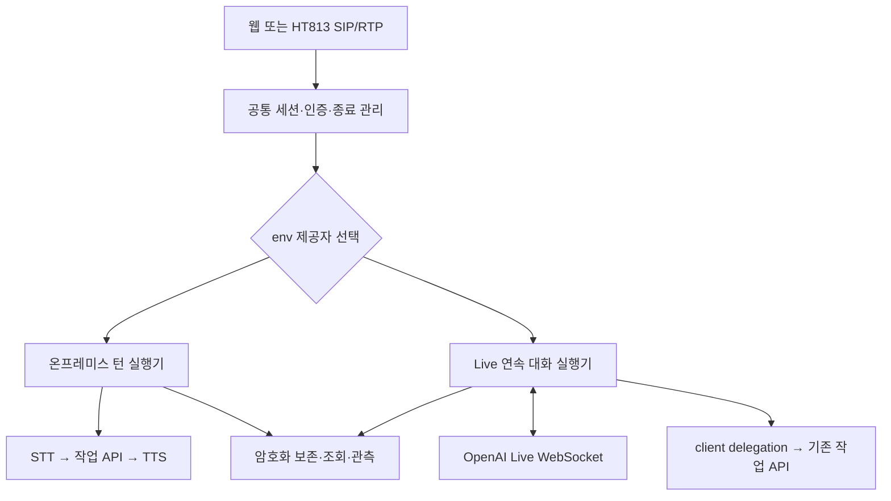

- `contracts`에 제공자 중립 대화 실행 계약과 기능 정보(연속 입력·전이중 지원)를 둔다. 기존 onprem 실행기를 감싸 동작을 보존하고 Live 실행기는 연속 스트림을 직접 소비한다. Live를 STT/TTS 세 개의 순차 포트에 끼워 넣지 않는다. 외부 프로토콜은 어댑터에서 변환하고 core는 contracts에 의존한다.
- HT813의 SIP/RTP·번호 허용·신뢰 피어·전역 점유 정책은 유지한다. Live에서만 `ready` 기반 입력 폐기와 로컬 턴 종료 대기를 우회한다. 입력 전달, API 이벤트 수신, 재생을 독립 작업으로 구동한다. 큐가 상한을 넘으면 무한 대기하거나 조용히 음성을 버리지 않고 관측 가능한 오류로 세션을 정리한다.
- 초기 Live 연결은 서버 WebSocket으로 제안한다. OpenAI가 WebRTC를 권장한다는 점을 인정하되 기존 서버 소유 PCM·보존·RTP 경계를 재사용하기 위한 선택이다. 브라우저→서버는 기존 인증 WebSocket을 유지한다. HT813를 OpenAI SIP로 직접 연결하지 않는다.
- 내부 16 kHz mono PCM16 계약을 유지하고 Live 경계에서 24 kHz PCM으로 상태를 유지하며 변환한다. RTP는 기존 8 kHz G.711 변환을 재사용한다. 20 ms 중심의 미디어 프레임으로 재분할하며 `send_audio` 호출마다 마지막 프레임을 패딩해 생기는 누적 무음·타임스탬프 드리프트를 방지한다. 실제 전송률에 맞춰 페이싱한다.
- API 연결은 `wss://api.openai.com/v1/live/sessions`로 제한하고 TLS 검증을 유지한다. session.start → session.started 뒤 입력을 보낸다. 연결 전 임의 오디오 업로드·health 점검용 과금 세션은 만들지 않는다. Live 이벤트와 Realtime의 response.output_audio.done 같은 이벤트를 혼용하지 않는다.
- Live에서는 API가 듣기/발화 시점을 정한다. 로컬 에너지 VAD만으로 입력을 막거나 매 발화에 출력을 강제 중단하지 않는다. 사용자 취소/BYE에는 재생 큐와 작업을 즉시 폐기한다. API의 출력 제어·중단 의미는 M13에서 정확한 이벤트 계약으로 고정한다. 실제 장비의 에코로 자기 발화에 반응하면 Live 전화 운영을 합격시키지 않는다.
- 웹의 기존 start·이진 프레임·end·cancel 인증 계약을 보존한다. onprem의 end는 한 요청 입력 완료다. Live는 end 전에도 송수신하며 end를 입력 종료 및 제한 시간 내 출력 정리 요청으로 처리하고 종료한다. end가 답변 완료 이벤트를 보장하지 않으므로 drain 상한과 취소 우선 처리를 구현·문서화한다. started 응답에 선택 제공자·기능 정보를 추가하고 기존 필드는 유지한다.
- client delegation 이벤트에는 작업 본문이 없으므로 전사 조각과 시간 정보를 수집해 해당 위임 시점의 문맥을 구성한다. 부분 전사를 최종 전사로 위장하지 않는다. 위임 ID별 중복 실행 방지, 문맥 크기 제한, 작업 API 시간 제한, 통화 종료 후 늦은 결과 폐기를 구현한다. 작업 API 응답은 검증 후 Live에 전달하며 Live가 이미 말한 내용과 작업 결과를 별도 취급한다. 작업 실패를 성공으로 말하지 않도록 한다.
- Live 원본 입력 음성과 같은 세션의 대화·작업 결과가 OpenAI로 전송된다. 기존 작업 API에는 원본 음성을 보내지 않는다. Live의 전사 조각 기반 요청은 기존 ‘최종 전사만 전송’ 계약과 차이가 있으므로 ADR-014 승인 범위를 명시한다. 다른 통화 이력은 자동 전송하지 않는다.
- 녹음은 입력 수신과 실제 송출 경로에서 수집하고 방향·샘플 오프셋·세션 ID를 유지한다. Live는 무한 통화 버퍼 대신 최대 10초 단위 암호화 오디오 세그먼트로 보존한다. 전사는 시간 범위와 불완전 여부를 보존하며 가상의 턴 완료를 만들지 않는다. 생성된 출력과 실제 송출된 출력을 구별한다. RTP 송출 성공은 상대 청취 증명이 아니다. AES-GCM·권한·30일 삭제와 실패 시 신규 음성 처리 중단을 계승한다. 구형 턴 기록 읽기 및 ADR-012의 통화 목록/대화 조회 호환을 검증한다.
- 배포는 공통 backend와 onprem 전용 모델/의존성, Live 전용 secret 주입을 분리한다. 선택 스크립트가 동일 provider env로 Compose 조합을 결정한다. Live에서 STT/TTS 컨테이너·GPU 또는 OpenAI 이외의 모델 readiness를 요구하지 않는다. onprem에서 OpenAI 키·접속을 요구하지 않는다. 미사용 관측 대상은 장애로 집계하지 않는다.
- `/health`는 선택 제공자·로컬 준비와 최근 원격 연결 실패를 구분한다. Live 세션 미개설을 원격 검증 완료로 표시하지 않는다. backend 기동 가능과 API 실제 가용성을 분리하며 선택하지 않은 모델 장애로 degraded가 되지 않게 한다.

## C. 제외 범위 (Non-goals)

온프레미스 모델의 네이티브 전이중화·모델 교체, 작업 LLM의 로컬화, 동시 통화 확대, 통화 중 자동 폴백, 직접 OpenAI SIP 연결, 새 PBX·새 프론트엔드 제품, 제공자별 음성 품질 동등 보장은 제외한다. Live에서 GPU를 요구하지 않게 하되 이번 계획은 운영 호스트 이전을 포함하지 않는다.

---

# 2. 영향 컴포넌트

- [ ] apps/orchestrator — 설정·조립·계약·Live 어댑터·전화/웹·보존·관측
- [ ] deploy/ — 제공자별 Compose·비밀 주입·모델 의존성·관측 대상
- [ ] tests/ — 기존 회귀·제공자 선택·승인된 실제 경계 시험

apps/model-serving의 추론 구현은 유지하고 기존 인터페이스를 회귀 검증한다. 해당 구현 변경이 필요해지면 범위 변경을 기록한다. 문서 및 scripts 작업은 범위와 WBS에서 관리한다.

---

# 3. 작업 분해 구조 (Milestone / Slice / Task)

기존 최대 M12 다음 M13~M15를 사용한다. 마일스톤 간 순차 진행하며 각 실행 대화/세션은 한 마일스톤만 맡고 종료 시 다음 세션 인계문을 작성한다. 아래 병렬 가지는 의존성만 표현하며 이번 계획 작성에서 별도 채팅/서브에이전트를 생성하지 않는다.

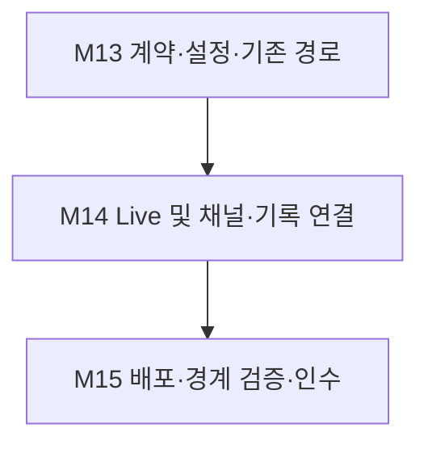

## M13. 계약·환경변수·기존 경로 보존

- 진행 배경: 현재 단일 음성 파이프라인과 새 모드가 충돌한다.
- 진행 목적: 구현 기준 및 선택 계약을 확정한다.
- AS-IS: STT 설정과 모델 생성이 항상 필요하다.
- TO-BE: 제공자별 검증/조립이 분리되고 onprem 회귀가 통과한다.
- 작업 종료조건: 요구사항 독립 커밋, ADR 승인 반영, 설정·조립·onprem 단위 시험 통과.

### Slice 진행 순서

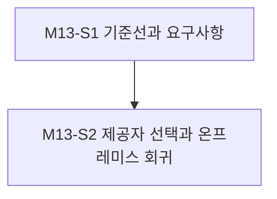

### M13-S1. 기준선과 요구사항

- 진행 배경: 현재 checkout과 운영 준비 기록의 기준이 다르다.
- 진행 목적: 실제 구현 대상과 요구사항을 고정한다.
- AS-IS: OPS-008 관리 checkout이며 신규 요구 미반영.
- TO-BE: 기준 SHA·관련 작업 상태·요구사항·ADR 계약이 명시됨.
- 작업 종료조건: 현재 기준과 승인 기록 및 개발 버전 PRD/SRS가 일치.

#### Task 진행 순서

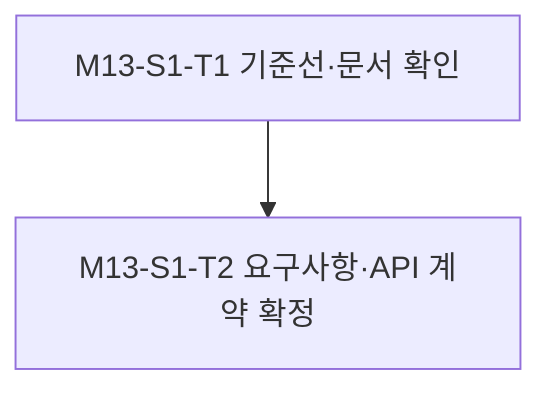

#### M13-S1-T1. 기준선·문서 확인

- 진행 배경: 병행 작업과 충돌할 수 있다.
- 진행 목적: OPS-008 결과와 착신/조회 구현을 확인한다.
- AS-IS: 별도 worktree 기록만 존재.
- TO-BE: 구현 기준 SHA와 충돌 목록·회귀 시험 목록 확보.
- 작업 종료조건: 기준선 보고 완료; 부족한 README는 코드보다 먼저 보완하고 별도 커밋.

#### M13-S1-T2. 요구사항·API 계약 확정

- 진행 배경: Live 전사·보존·전송 범위가 다르다.
- 진행 목적: 사용자 관점 수용 기준을 PRD/SRS와 ADR에 반영한다.
- AS-IS: 기존 순차 턴 요구만 있음.
- TO-BE: 새 제공자·전이중·오류·기록 요구와 공식 이벤트 표 작성.
- 작업 종료조건: PRD/SRS 독립 커밋 및 ADR 승인 반영; 출력 중단·전사 완결·위임 이벤트를 공식 스키마와 대조.

### M13-S2. 제공자 선택과 온프레미스 회귀

- 진행 배경: 공통 설정이 모든 모델을 강제한다.
- 진행 목적: 기존 동작을 보존하며 조건부 조립한다.
- AS-IS: bootstrap이 STT/TTS를 항상 생성.
- TO-BE: 공통 실행 계약과 provider별 factory·설정 검증.
- 작업 종료조건: 기존 모드 회귀와 미선택 의존성 격리 시험 통과.

#### Task 진행 순서

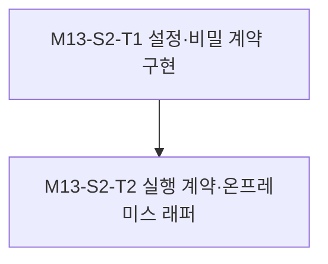

#### M13-S2-T1. 설정·비밀 계약 구현

- 진행 배경: env 분기가 없다.
- 진행 목적: 1절 설정 표를 구현한다.
- AS-IS: 기존 설정 필수 검증만 존재.
- TO-BE: provider별 필수값, 기본값, 상호배타 비밀 및 .env.example 반영.
- 작업 종료조건: 미지정·두 선택값·오타·빈 값·키 누락·키/FILE 충돌·미선택 설정 무시 시험 통과.

#### M13-S2-T2. 실행 계약·온프레미스 래퍼

- 진행 배경: 연속 대화를 기존 순차 포트로 표현할 수 없다.
- 진행 목적: 기존 실행기를 공통 계약에 연결한다.
- AS-IS: 채널이 기존 runner에 직접 결합.
- TO-BE: 기능 정보·세션 소유권·factory 분리, 기존 동작 유지.
- 작업 종료조건: onprem 웹/전화/취소/문맥 회귀 통과; OpenAI 접속 0, Live 선택 시 STT/TTS 생성·ready 호출 0을 확인.

## M14. Live 연속 대화와 채널·보존 연결

- 진행 배경: 전이중 API와 현재 유한 턴 경계가 다르다.
- 진행 목적: 웹·전화에서 Live를 끝까지 연결한다.
- AS-IS: 출력 중 입력 폐기 및 턴 기반 보존.
- TO-BE: 독립 송수신·위임·유한 보존·종료 정리.
- 작업 종료조건: 공식 계약 기반 fake 단위 시험과 전체 기존 회귀 통과; 실제 경계는 M15에서 판정.

### Slice 진행 순서

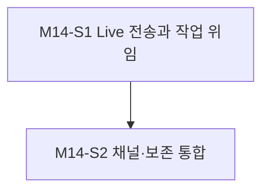

### M14-S1. Live 전송과 작업 위임

- 진행 배경: 신규 외부 프로토콜 어댑터가 필요하다.
- 진행 목적: 연속 음성과 기존 작업 API를 연결한다.
- AS-IS: Live 세션·이벤트 처리 없음.
- TO-BE: 서버 WebSocket과 client delegation을 구현.
- 작업 종료조건: 연결·동시 입출력·위임·예외·취소의 단위 검증 통과.

#### Task 진행 순서

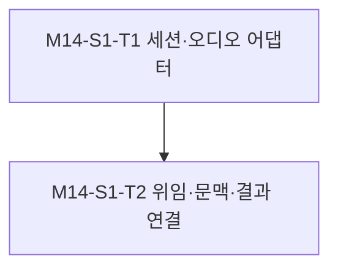

#### M14-S1-T1. 세션·오디오 어댑터

- 진행 배경: Live 전송 경계가 없다.
- 진행 목적: 공식 세션·오디오 이벤트를 처리한다.
- AS-IS: 16 kHz 내부 오디오만 있음.
- TO-BE: 24 kHz 변환·유한 큐·페이싱·오류 정리.
- 작업 종료조건: 가짜 서버 이벤트로 접속 지연/거절/단절·깨진 청크·취소를 검증; 출력 대기 중 입력 진행을 결정론적으로 증명.

#### M14-S1-T2. 위임·문맥·결과 연결

- 진행 배경: 위임 이벤트 자체는 작업 텍스트가 아니다.
- 진행 목적: 전사 상태로 기존 작업 API 요청을 구성한다.
- AS-IS: 최종 전사 순차 호출.
- TO-BE: 부분성 표시·위임 ID·문맥 제한·결과 검증 및 Live 반환.
- 작업 종료조건: 중복 위임 1회 실행, 전사 지연/수정·실패·늦은 결과 폐기·통화간 격리 시험 통과.

### M14-S2. 채널·보존 통합

- 진행 배경: 전화 턴 게이트와 녹음 구조가 연속 흐름을 막는다.
- 진행 목적: 동시 송수신과 기록을 제공한다.
- AS-IS: 유한 턴 처리와 턴별 기록.
- TO-BE: provider별 채널 동작 및 세그먼트 기록.
- 작업 종료조건: 전화/웹/보존 단위 및 기존 조회 호환 검증 통과.

#### Task 진행 순서

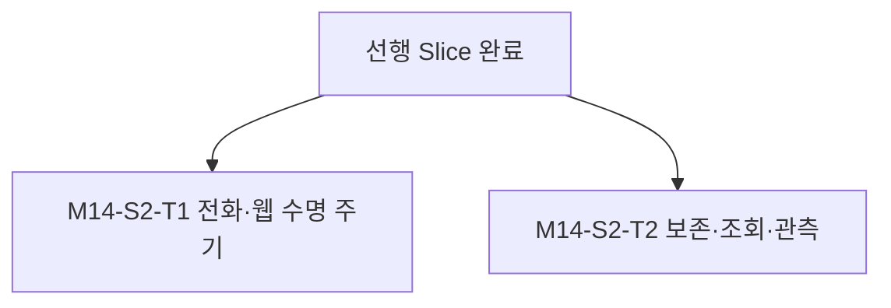

#### M14-S2-T1. 전화·웹 수명 주기

- 진행 배경: 재생 중 수신이 버려진다.
- 진행 목적: Live 수신을 계속하고 통화 종료를 보존한다.
- AS-IS: ready 게이트 및 웹 단일 입력 종료.
- TO-BE: 입출력 작업 분리·web end drain·BYE/cancel 우선 종료.
- 작업 종료조건: 동시 입력/출력 순서, DTMF, 단일 점유, overflow, timeout, 원격 종료 후 포트·작업·큐 정리 회귀 통과.

#### M14-S2-T2. 보존·조회·관측

- 진행 배경: Live에는 기존 턴 종료가 없다.
- 진행 목적: 유한 메모리와 사실에 맞는 기록을 만든다.
- AS-IS: 최종 전사/답변 쌍만 저장.
- TO-BE: 10초 이하 방향별 녹음과 시간 기반 전사·불완전 표시, 제공자 지표.
- 작업 종료조건: 구형 기록 읽기·Live 시간순 조회·부분 종료·30일 삭제·보존 실패 차단·비밀 로그 부재 시험 통과.

## M15. 제공자별 배포와 실제 경계 인수

- 진행 배경: 단위 성공만으로 실제 통화 성공을 보장하지 못한다.
- 진행 목적: 두 모드의 배포·전환·운영 가능성을 검증한다.
- AS-IS: GPU 모델 필수 Compose.
- TO-BE: env 선택과 의존성 분리, 승인된 경계 시험·원복.
- 작업 종료조건: 6절 수용 기준 전부 증거 확보; 미실행 경계는 미완료로 남김.

### Slice 진행 순서

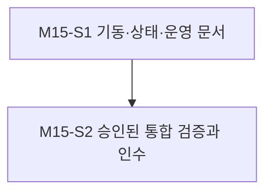

### M15-S1. 기동·상태·운영 문서

- 진행 배경: Compose가 STT/TTS를 항상 기다린다.
- 진행 목적: 선택값 하나로 필요한 스택만 기동한다.
- AS-IS: 단일 모델 의존 배포.
- TO-BE: 공통/모드별 구성과 선택 스크립트, 상태·관측 구분.
- 작업 종료조건: 구성 검증 및 선택값 일치 검증, 롤백 절차 준비.

#### Task 진행 순서

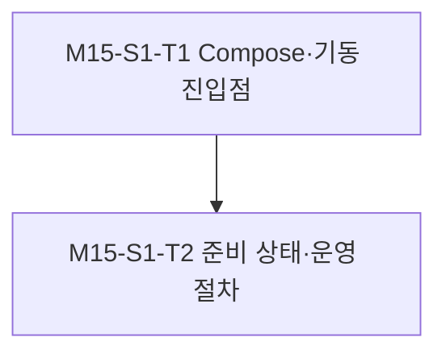

#### M15-S1-T1. Compose·기동 진입점

- 진행 배경: 프로필만 바꾸면 앱 env와 어긋날 수 있다.
- 진행 목적: 단일 env에서 배포 조합을 결정한다.
- AS-IS: backend depends_on이 항상 모델을 요구.
- TO-BE: onprem 모델 스택과 Live secret 구성을 명시 분리.
- 작업 종료조건: 두 모드 렌더 검증; Live에 모델/GPU/모델 secret 의존 없음, onprem에 Live secret 의존 없음; 기존 직접 실행 호환 문서화.

#### M15-S1-T2. 준비 상태·운영 절차

- 진행 배경: health가 원격 접속 검증과 혼동될 수 있다.
- 진행 목적: 의존성·오류·전환을 명확히 표시한다.
- AS-IS: 모델 readiness 중심.
- TO-BE: 선택 provider 및 최근 연결 상태·세션 사용량·큐 지연 계측.
- 작업 종료조건: README/guides 갱신; 키 없는 health 반복 호출 시 과금 API 접속 0; drain→재기동→확인→원복 절차 점검.

### M15-S2. 승인된 통합 검증과 인수

- 진행 배경: 한국어·에코·실제 네트워크는 fake로 검증 불가.
- 진행 목적: 2모드×웹/전화 경계와 롤백을 입증한다.
- AS-IS: Live 실제 호출 증거 없음.
- TO-BE: Gate 1/2 범위 내 실제 결과·자원·비용 기록.
- 작업 종료조건: 필수 시나리오 통과 및 로그·인수 결과 확정.

#### Task 진행 순서

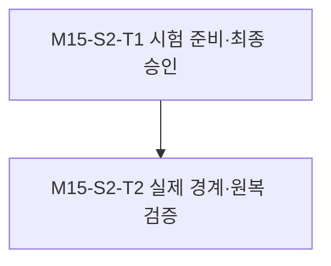

#### M15-S2-T1. 시험 준비·최종 승인

- 진행 배경: 새 외부 전송과 실제 회선 영향이 있다.
- 진행 목적: 구체 시험표와 복구 범위를 검토받는다.
- AS-IS: Gate 1/2 미승인.
- TO-BE: PRD/SRS 매핑·샘플·회수·키·예산·번호·시각 명시.
- 작업 종료조건: Gate 1 기록 후 생성/실행 직전 Gate 2 취득; 승인이 없으면 실제 시험 코드 생성/실행 보류.

#### M15-S2-T2. 실제 경계·원복 검증

- 진행 배경: 두 경로의 운영 성공을 각각 확인해야 한다.
- 진행 목적: 6절 행렬과 수용 기준을 실측한다.
- AS-IS: 실측 미완료.
- TO-BE: 실브라우저·HT813·모델/API·보존·전환 검증 증거.
- 작업 종료조건: 요구별 PASS/FAIL·지연/사용량·정리 증거 기록; 미실행을 PASS로 간주하지 않으며 전체 통과 때만 executed.

---

# 4. 의존성

## A. 내부 의존성

ADR-003/005/007/008/009/011/012와 현재 기준 PRD/SRS 0.1.0을 읽었다. Live의 연속 입력·클라우드 음성 전송·부분 전사 문맥·세그먼트 보존·선택형 readiness는 ADR-014 승인 결정으로 기존 계약의 적용 범위를 명시한다. 사용자 승인에 따라 ADR-014가 accepted가 되었으며 ADR-007/008/011은 계승 조항까지 포함하여 상호 링크하고 superseded로 전환했다. ADR-003/005/009/012의 세션 수·웹 전송·SIP 접근·조회 보호는 유지한다.

OPS-008의 M9~M12는 별도 승인 작업이며 이번 계획이 완료를 대신 선언하지 않는다. 현재 checkout은 관리 브랜치의 과거 기준이다. 실행 전 실제 대상 SHA와 병합 결과를 확인하며 조회·종료 보완이 빠졌으면 해당 담당 결과를 통합한 뒤 회귀 기준을 확정한다. 별도 요구 없는 새 채팅 생성·병행 작업 재개는 하지 않는다.

## B. 외부 의존성

OpenAI 프로젝트의 Live 접근 권한·API 키·사용 한도·TLS 통신, 실제 HT813/전화선, 온프레미스 GPU 모델 환경, 브라우저 마이크/재생 환경이 필요하다. 외부 가용성·한국어 품질·성능은 미검증이다. 기존 Python 3.11과 사용 중인 비동기 클라이언트를 먼저 검토하고 추가 의존성은 API 호환 버전을 고정한다.

---

# 5. 리스크 및 대응

|리스크|영향|대응 방안|
|---|---|---|
|Live와 Realtime 이벤트 혼용|세션/취소/출력 오동작|Live 공식 스키마와 실제 이벤트를 대조하고 contract fixture 고정|
|출력 완료 이벤트·타임스탬프 부재|재생 끝/기록 오판|로컬 샘플 카운터·큐 drain·종료 상한 사용; 전사 시각을 오디오 재생 완료로 간주하지 않음|
|에코·겹말·송출 큐 적체|자기 응답·지연|작은 프레임·유한 큐·실전화 청취; 실패 시 운영 전환 보류 및 에코 대책 별도 검토|
|외부 원본 음성 전송|기존 데이터 경계 변경|Live 선택과 ADR에서 대상을 명시; 키는 서버 비밀, 타 통화 문맥 전송 금지|
|Live 전사 조각의 누락·수정|작업 오인·중복 실행|위임 시점 문맥·부분성·위임 ID 관리; 불확실한 작업은 추가 확인, 자동 재시도 없음|
|생성 텍스트와 실제 송출 차이|조회 기록의 오해|생성·송출 상태 분리; 오디오와 전사 정확 매핑 불가 부분은 불완전 표시|
|API 중단/한도/인증 오류|통화 중단|오류 비식별화, 로컬 세션·회선 회수; 자동 onprem 전환 없음|
|장시간 세션·세그먼트 증가|메모리/디스크·비용 증가|유한 큐·문맥 제한·세그먼트 만료·사용량 기록; API expires_at 관측 및 만료 전 종료 처리|
|구형 조회·녹음 회귀|이력 접근 실패|형식 버전과 호환 리더, rollback 전후 구형/신형 조회 시험|
|기준 브랜치/동시 작업 불일치|기존 수정 유실|M13에서 SHA 고정 및 관련 결과 통합, 무관 파일 수정 금지|

---

# 6. 검증 전략

## A. 단위 테스트 (tests/units/)

기존 pytest 및 `*.test.py` 규칙을 유지한다. VOIC-FEAT-010 및 M/S/T를 추적하고 fake API·clock·media로 결정론적 검증한다. 설정/조립, provider 계약, Live 변환·이벤트·위임, 전화/웹 종료, 녹음/조회·관측을 해당 소스 경로에 대응시킨다. 시험마다 표준 run log를 남긴다.

필수 기준: provider 미지정 기존 동작, 잘못된 선택값 기동 실패, 미선택 의존성 생성·접속 0, Live 출력 중 입력 전달, 큐 상한 준수, 위임 중복 1회 처리, 통화별 문맥 격리, BYE/cancel/장애 후 활성 작업·큐·슬롯 누수 0, 로그의 키·음성·전사 원문 노출 0. 실제 포트·API·파일 경계를 쓰는 시험은 단위로 위장하지 않는다.

## B. 통합 테스트 (tests/integrations/)

- 통합 테스트 필요 여부 검토 결과: 필요.
- 검토 사유: 새 OpenAI 외부 API, SIP/RTP·브라우저, 모델 서비스, 파일 보존 및 Compose 경계를 변경한다.
- 사전승인 (Gate 1): 승인. 사용자 “승인하빈다”; 2026-10-31 12:34:44 KST 기록. 아래 시나리오에 대한 사전승인이며 Gate 2는 별도다.
- 최종승인 (Gate 2): 미승인. 테스트 생성/실행 직전 구체 환경·비용 상한·시간·번호·데이터·복구안을 제시하고 승인을 받는다. 이전 계획의 승인을 재사용하지 않는다. 실제 발신은 매번 직전 명시 응답을 받는다.
- PRD/SRS: M13에서 새 요구 ID를 실제 개발 버전 문서에 추가하고 아래 시험 ID와 연결한다. 통합 테스트 생성 전에 해당 버전과 요구를 읽는다.

|시험 ID|시나리오|수용 기준|
|---|---|---|
|I01|onprem 웹·전화 착신·발신|기존 한국어 요청/응답·전화 2턴 이상·작업 문맥·종료 성공; OpenAI 연결 0|
|I02|Live 웹|end 전 음성 송수신, 겹말 중 입력 전달, cancel·end drain·연결 해제 후 자원 정리|
|I03|Live 전화 착신·발신|양쪽 모두 2턴 이상 대화; 출력 RTP와 입력 전달이 1초 이상 겹치는 구간 3회 증거; 겹말 뒤 정정 내용을 반영; 에코에 의한 반복 응답 없음|
|I04|기존 작업 API 위임|동일 작업 시나리오 성공, 정정 문맥 반영, 중복 실행 없음, 실패를 성공으로 안내하지 않음|
|I05|API·모델·네트워크 장애|인증 거절·한도·타임아웃·단절별 공개 오류, 보존 마무리와 회선/슬롯 회수, 다음 세션 재수락; 자동 재발신 없음|
|I06|암호화·조회·만료|양 모드 녹음/텍스트 조회, 구형 기록 호환, 불완전 표시, 시험 시계 기준 30일 경계 삭제, 보존 장애 차단|
|I07|배포·전환·원복|Live는 모델/GPU 부재에서도 기동, onprem은 OpenAI 키 부재에서도 기동; 새 세션 차단→기존 세션 종료→env 전환→재기동→재수락 및 역전환 성공|
|I08|지연·연속성·사용량|동일 한국어 샘플 최소 10회씩 입력 수신→API 송신/출력 수신→RTP 송신 및 발화 종료→유효 답변 지연의 p50/p95 기록; 음성 끊김·큐 overflow 0|

수치 목표 제안: 정상 시험에서 애플리케이션 내부 각 미디어 전달 구간 p95 ≤ 200 ms, 출력 큐 ≤ 설정 500 ms, 취소/BYE 이후 로컬 작업·큐·슬롯 정리 ≤ 2초. 측정 지점·단조 시계·표본 수를 기록하며 이 수치는 모델 답변 지연 보장이 아니다. 온프레미스는 동일 환경 기준 대비 응답 지연 p95 악화 10% 이내를 목표로 한다. 전화 회선 실제 Idle 복귀는 장비 관측으로 별도 기록한다. 한국어 의미·청취·에코 평가는 사전 시험 문장별 PASS/FAIL로 남기고 기대값을 실행 후 완화하지 않는다.

실제 시험은 합성/시험 음성과 준비된 참여자로 제한한다. API 세션 시간 및 작업 API 사용량을 각각 기록한다. 비용 상한·실번호·시험 창은 Gate 2에서 정할 운영 입력이며, 지금 임의 비용이나 전화번호를 만들지 않는다. 미실행·환경 차단은 해당 시험 미완료로 표시한다.

---

# 7. 롤아웃 / 마이그레이션

1. 현 onprem 설정·이미지·보존 키·조회 형식과 복구 경로를 확보한다. 신규 env 미지정 시 기존 모드로 기동한다.
2. 비운영 환경에서 M13/M14 단위 회귀와 M15 구성 검증을 완료한다. 새 마일스톤은 새 실행 대화에서 진행하고 인계문을 남긴다.
3. Gate 1/2 범위 내 웹 Live부터 확인한 뒤 전화 착신·발신을 확인한다. Live 테스트만으로 온프레미스 시험을 생략하지 않는다.
4. 운영 전환은 신규 세션 수락을 중지하고 기존 통화를 마친 뒤 env와 Compose 선택을 일치시켜 재기동한다. 키·보존 경로·SIP/RTP 주소는 유지한다.
5. 문제가 발생하면 신규 수락 중지·통화 정리 후 `onprem`으로 되돌려 모델 readiness를 확인하고 수락을 재개한다. 실행 중 통화를 다른 제공자로 자동 이전하지 않는다.
6. 이번 변경으로 쓴 보존 형식을 읽는 호환 버전을 롤백 대상으로 확보한다. 과거 바이너리로만 되돌려 Live 이력을 읽지 못하는 상태를 정상 롤백으로 간주하지 않는다.

---

# 8. 완료 게이트

- [x] 사용자 계획 실행 승인, ADR-014 승인 및 통합시험 Gate 1 기록
- [ ] PRD/SRS 독립 커밋 및 요구사항→시험 추적
- [ ] M13~M15 종료조건 충족, 선택값 하나로 두 경로 기동
- [ ] Live 동시 입출력과 onprem 기존 흐름 각각 검증
- [ ] Gate 2 뒤 필요한 실제 경계 시험 통과, 미실행/실패를 PASS 처리하지 않음
- [ ] 암호화·30일 만료·구형/신형 조회 및 장애/취소/원복 검증
- [ ] 실행 로그·단위 시험 로그·지연·사용량 기록
- [ ] README/guides/.env.example 및 세션 상태 갱신

---

# 9. 참고자료

- [원본 이슈](../0_issues/VOIC-FEAT-010.md)
- [ADR-014 승인 결정](../3_decisions/ADR-014-selectable-voice-provider.md)
- [운영 준비 계획](VOIC-OPS-008-plan.md)
- [기존 다중 턴 결정](../3_decisions/ADR-007-ht813-multiturn-call-lifecycle.md)
- [기존 보존 결정](../3_decisions/ADR-008-local-encrypted-retention.md)
- [모델 상주 결정](../3_decisions/ADR-011-warm-model-services-observability.md)
- [조회 결정](../3_decisions/ADR-012-encrypted-call-index-for-history.md)
- [최근 실제 발신 증거](../2_logs/VOIC-FEAT-001-log-58.md)
- [운영 작업 승인 방식 정정](../2_logs/VOIC-OPS-008-log-08.md)
- [Live 안내](https://developers.openai.com/api/docs/guides/live)
- [Live WebSocket](https://developers.openai.com/api/docs/guides/voice-websockets)
- [Live 작업 위임](https://developers.openai.com/api/docs/guides/live-delegation)

공식 자료 확인일: 2026-10-31 KST. API 능력은 문서 근거이고, 본 프로젝트에서 실제 구현·품질·접속이 검증됐다는 뜻은 아니다.

## 승인 및 기준선 확인 — 2026-10-31

사용자가 계획 실행·설계 결정·Gate 1 묶음을 승인했다. 계획 작성 때의 로컬 번호 009/ADR-013은 병행 M10의 VOIC-BUG-009 및 M9의 ADR-013-secret-recovery-and-backup과 충돌하여 010/ADR-014로 정정했다. 내용과 M13~M15 번호는 유지한다. [승인 기록](../2_logs/VOIC-FEAT-010-log-02.md) 참조.

GitHub PR #4를 조회한 결과 draft/open/미병합이며 base f1c2088, head dcdfdd83이다. 본 관리 checkout 133c2ad에는 M9의 조회 구현 일부가 없으므로 현재 소스를 그대로 M13 구현 기준으로 쓰지 않는다. M13 착수 시 f1c2088 이상의 실제 개발 기준에서 승인 문서를 이관하고 진행 중 M10과의 충돌을 관리한다. M10 미완료를 이번 계획 미승인으로 해석하거나 모든 독립 작업의 선행 병합 조건으로 확대하지 않는다.
