# 0. 계획 정보

|key|value|
|---|---|
|계획 ID|VOIC-OPS-008-plan|
|원본 이슈|[VOIC-OPS-008](../0_issues/VOIC-OPS-008.md)|
|상태|approved|
|작성 시간|2026-10-16 00:00:47 KST|
|작성 에이전트|Codex|
|승인자|사용자 — “네, 승인합니다” 및 독립 세션·MR 병합 승인 지시|
|승인 일시|2026-10-16 KST 사용자 메시지; 기록 2026-10-16 00:11:04 KST|
|개시 범위 확인|2026-10-15 사용자: 전화 서비스 우선 — 착신·허용 번호 발신·통화내역 조회|
|조사 기준|로컬 ec5f5dc, 원격 추적 080f5d3 및 GitHub PR #1/#2 현재 병합 상태|

---

# 1. 개요

## A. 목표

**현재는 실제 전화 대화에 성공한 개발·실증 단계이며, 상시 서비스 개시 조건은 충족됐다고 판정할 수 없다.** 남은 중심 작업은 새 음성 코어 개발이 아니라 실제 발신 품질, 조회 기능의 운영 배포, 재부팅·장애·보존 복구, 반복 운영 검증이다. 개발자의 일시 기동 없이 착신에 응답하고, 운영자가 정확한 허용 번호에 발신하며, 통화 종료 후 내역과 대화를 조회할 수 있는 전화 우선 서비스를 만든다.

이번 문서는 현황 조사에 근거한 승인된 실행 계획이다. 단계별 검토·진행 승인은 아래 사용자 지정 MR 병합 게이트를 따른다. 문서 작성 완료와 서비스 개시 완료를 구분한다. 진행률 퍼센트는 산정하지 않는다. 구현·실장·배포·안정성의 분모가 다르기 때문이다.

### 현황 판정표

|영역|확인된 상태와 근거|남은 공백|판정|
|---|---|---|---|
|공통 코어·전화 채널|STT→작업 API→TTS, 다중 턴, 단일 점유, 취소·시간 제한 코드 및 M4/M5 기록 존재|운영 커밋에서 회귀·실장 결과 재결합|구현됨|
|착신|10월 9일 실제 2통화, 두 번째 2턴 답변, HT813 BYE·RTP 해제·FXO Idle 확인([log-55 — 비공개 원문 대신 공개 요약](../../guides/service-readiness-baseline.md))|정밀 종료 지연, 장시간 종료 톤 오검출, 발신자 변형·점유 충돌|실장 부분 검증|
|발신|10월 11일 실제 벨·연결·상대 종료 1회 성공([log-58 — 비공개 원문 대신 공개 요약](../../guides/service-readiness-baseline.md))|두 턴 음성·DTMF 미실행, 이전 미수신 원인 미확정([BUG-003](../0_issues/VOIC-BUG-003.md))|실장 부분 검증|
|착신·대화 조회|PR #1/#2 병합. 원격 M7/M8 계획 executed. PR #2에 병합 조합 122건 통과 기록; 원격 operator.py에서 두 API 확인|실제 Caller ID 설정·실전화→파일→조회, 운영 배포|구현·합성 검증 완료, 운영 미검증|
|모델 서비스|STT/TTS 독립 상주, TTS 준비 전 워밍업, GPU 실기동. 합성 문장 TTS 0.327초([log-49 — 비공개 원문 대신 공개 요약](../../guides/service-readiness-baseline.md))|실전화 전체 응답 지연·반복 RAM/swap 안정성|기반 검증, 서비스 성능 미확정|
|보존|AES-GCM·30일 만료·권한·삭제 실패 처리. 기존 실제 파일 경계 5건 통과|재부팅 후 같은 키 재주입, 복구·용량·조회 포함 운영 수명|구현·격리 검증, 운영 복구 미완료|
|관측|Tempo/Prometheus/Grafana·GPU exporter 실기동 기록|현재 저장소 Prometheus 설정에 경보 규칙/전달 설정 없음; 담당자 대응 체계 필요|가시화 기반 존재|
|상시 배포|Compose·healthcheck·restart 정책 존재|최신 현장 기록은 임시 백엔드 정리 상태. 무인 비밀 복구·재부팅 검증·릴리스/롤백 패키지 없음|개시 차단|
|웹·FXS|웹 합성 PCM Chrome 왕복 기록. FXS 현장 준비 정보는 시점별 상이|실제 마이크 UI·FXS 독립 발신 검증|전화 우선 개시의 후속 범위|
|문서·기준 브랜치|로컬 dev/v0.0.1은 조회 기능 이전. 원격 dev/v0.0.1에는 두 기능 존재. root README 개요 미작성|공개 원격에 과거 로그·세션 없음, 일부 참조 깨짐 및 오래된 설명|기준·증거 정리 필요|

**증거의 한계:** 122건은 PR에 기록된 과거 결과이며 이번 조사에서 재실행하지 않았다. 0.327초는 합성 문장 TTS 단독 측정으로 전화 전체 지연이 아니다. 운영 VM/HT813의 10월 15일 실시간 가동 상태는 조회하지 않았다. 마지막 현장 기록의 백엔드 중지를 오늘의 실시간 상태라고 단정하지 않는다. 상세 조사 근거는 [조사 로그](../2_logs/VOIC-OPS-008-log-01.md)에 남긴다.

## B. 범위

- 첫 서비스: 전체 FXO 착신→에이전트, 정확한 허용 번호 발신, 같은 통화의 연속 대화·상대 종료, 착신 목록·발착신 대화 조회.
- 초기 용량: 웹·전화를 합쳐 동시 활성 세션 1개, PSTN 회선 1개. Caller ID는 표시 정보이며 접근 인증 수단으로 쓰지 않는다.
- 운영자 사용: 기존 localhost Bearer API를 유지한다. 운영 호스트 또는 인증된 SSH 터널을 통해 발신·취소·착신 목록·대화 조회를 수행할 절차와 명령 예제를 제공한다. 토큰을 명령 이력·출력에 남기지 않는다.
- 배포 기준·키/데이터 복구·모델 캐시·장애 알림·품질 목표·릴리스 패키지·72시간 제한 운영까지 포함한다.
- root/component README, PRD/SRS, 운영 가이드, 실행 증거와 세션 정리도 WBS에 포함한다. PRD/SRS 수정은 문서별 독립 커밋으로 처리한다.
- 기존 M6 잔여 항목을 이 계획의 개시 게이트에 매핑한다. M7/M8 기능을 재구현하지 않으며 기존 계획을 임의로 대체·완료 처리하지 않는다. 각 구현 세션은 마일스톤 하나만 맡는다.

## C. 제외 범위 (Non-goals)

웹 사용자 화면, 공개 운영 API·외부 고객 계정/관리 UI, 다중 회선·다중 세션, 통화 전환, 녹음 다운로드, FXS 독립 발신, Asterisk/DB 도입, 신규 모델 학습은 첫 개시 범위에서 제외한다. FXS 진단 전화는 BUG-003 원인 분리에 필요한 경우 별도 범위로 다룬다. 물리 FXS가 회선을 공유한다면 사용 중 점유 충돌 자체는 첫 개시 전에 확인하거나 운영 중 동시 사용을 제한한다.

현재 작업 어댑터는 외부 chat completion 응답 텍스트를 받는다. 예약·주문·다른 시스템 변경 같은 업무 수행 성공이 구현됐다고 주장하지 않는다. 그러한 서비스 목적이 추가되면 별도 요구사항·도구 실행 계약·검증이 필요하다.

### 우선순위·담당 역할·공수 제안

|단계|우선순위|담당 역할|산출물|순수 작업량 초안|
|---|---|---|---|---|
|M9 기준 확정|P0|개발 담당 + 운영자|정합된 기준 커밋, 요구사항·품질표, 키 복구 결정|1~2 인일|
|M10 전화·조회 실장|P0|개발/시험 담당 + 현장 통화 담당|F01~F05/조회·실패 경계 결과, 결함 처리|2~4 인일|
|M11 상시 운영 준비|P0|개발/배포 담당 + 운영자|반복 가능한 배포·복구, 경보, 성능 판정|3~5 인일|
|M12 제한 운영·인수|P0|운영자 + 시험 담당|72시간 관찰, 개시/보류 판정, 인수 문서|1~2 인일 + 관찰 시간|

총 7~13 인일은 현장/GPU 접근과 키 관리 방식 확정, 중대 결함 부재를 가정한 추정이다. 72시간 관찰·승인 대기·하드웨어 보완 시간은 별도다. 일정 약속이 아니며 M9에서 실제 환경을 확인해 다시 산정한다. 담당 역할의 실제 인명·운영 시간·연락 경로도 M9에서 정한다.

## D. 독립 세션·MR 승인·본 세션 관리 규칙 (2026-10-16 사용자 지정)

1. 본 채팅은 전체 계획 관리·단계 상태 취합·MR 병합 확인·후속 배정만 맡는다. M9~M12 구현·현장 검증을 직접 수행하지 않는다.
2. 마일스톤마다 사용자가 직접 리뷰 질문을 할 수 있는 독립 Codex 채팅 하나를 사용하고 그 채팅과 `.agents/sessions/<session-id>/STATUS.md`를 1:1로 연결한다. 디렉터리만 만들거나 내부 서브에이전트를 띄운 것을 독립 채팅 생성으로 간주하지 않는다.
3. 최초 M9 착수는 이번 명시 승인으로 허용한다. 다음 마일스톤은 선행 단계 결과 MR이 사용자에 의해 병합된 사실을 본 세션이 확인한 뒤 착수한다. MR은 현재 GitHub 저장소의 Pull Request를 뜻한다. 기본 대상은 기존 개발 기준 `dev/v0.0.1`이며 변경 시 명시한다. 에이전트는 직접 병합하거나 자동 병합을 설정하지 않는다.
4. 각 단계 담당자는 MR에 WBS별 완료 결과·검증 명령과 결과·미검증/잔여 위험·ADR/수용 기준·다음 실행 범위를 적는다. `MR 제출/리뷰 대기`, `검증 완료`, `사용자 병합 인수`를 서로 다른 상태로 관리한다. 미결정 설계는 제안 상태로 리뷰받고 사용자 병합으로 결정이 확인된 뒤 accepted로 추적한다.
5. 각 담당 세션에서 문서 조사·요구사항 대조·시험 설계·독립 코드 검토 등 서로 의존하지 않는 작업을 서브에이전트로 병렬화한다. 위임 전 표준 STATUS를 만들고 파일 소유권을 나눈다. 공용 파일·Git index·장비/키 조작·실전화는 담당자가 직렬 통합한다. WBS 선행조건을 병렬화 때문에 건너뛰지 않는다.
6. 단계 결과는 본 세션에 `단계/담당 채팅 ID/작업 브랜치/기준·결과 SHA/MR URL/검증/잔여 위험/사용자 필요 조치/다음 단계 조건`으로 회신한다. MR 병합 후 merge SHA·병합 주체·시각·검증 대상과 병합 head의 일치를 확인한다. 단순 PR close·리뷰 코멘트·approved review는 merge와 같지 않다.
7. 채팅 전달 도구가 있으면 담당 세션이 본 채팅으로 직접 보고한다. 없으면 담당 세션의 STATUS·영속 로그와 최종 응답에 같은 보고를 남기고, 본 세션은 사용자가 알려준 채팅 ID/MR을 조회해 취합한다. 자동 통지나 자동 후속 착수를 지원하지 않는 환경에서 이를 예약했다고 주장하지 않는다.
8. 현재 노출된 앱 도구에는 `create_thread`·`send_message_to_thread`가 없다. 부모는 인계 프롬프트를 준비했으며, 사용자가 2026-10-16 실제 M9 독립 채팅을 열었다. 현재 M9 thread는 `01a14026-e634-7fa3-b392-958f75b2b8e0`이다. 이 도구 제약은 실행 승인 부족과 다르다.
9. 사용자 최신 지시에 따라 워크플로의 에이전트 직접 main 병합 규칙 대신 사용자 MR 병합을 적용한다. 구현 세션은 단계 완료 시 다음 단계 인계 프롬프트를 남기되 후속 단계를 스스로 시작하지 않는다.

|단계|담당 세션 ID(예정)|착수 조건|현재 상태|
|---|---|---|---|
|M9|20261016-service-readiness-m9|현재 사용자 명시 승인|독립 채팅 착수, M9 문서 작성·검증 중; 사용자 MR 병합 대기|
|M10|착수 날짜-service-readiness-m10|M9 결과 MR 사용자 병합|미착수|
|M11|착수 날짜-service-readiness-m11|M10 결과 MR 사용자 병합|미착수|
|M12|착수 날짜-service-readiness-m12|M11 결과 MR 사용자 병합|미착수|

예정 ID는 실행 세션이 실제 생성됐다는 뜻이 아니다. 착수 날짜가 바뀌면 담당 독립 채팅에서 실제 날짜로 정한다.

---

## E. M9 사용자 운영 입력 (2026-10-16 KST)

운영 담당자는 김화균이다. 사용자는 “전화는 발신 직전 제게 먼저 요청하세요”라고 지시했다. 실행안 MR의 Gate 2 승인과 별개로 **매 실전화 발신 직전 김화균에게 요청하고 명시 응답 전에는 발신하지 않는다**. 실패 후 재시도도 새 발신이다. 운영 시간·장애 연락 경로·시험 시간대는 미정이며 [운영 계약](../../guides/service-readiness-contract.md)에서 제안과 확정 입력을 구분한다.

# 2. 영향 컴포넌트

- [ ] apps/orchestrator — 전화·조회·오류·준비 상태 및 운영 검증에서 확인된 결함
- [ ] apps/model-serving — 반복 추론·취소·캐시·준비 상태 보완 필요 시
- [ ] deploy/ — 상시 비밀 주입·기동·관측·릴리스 구성
- [ ] tests/ — 단위 회귀 및 승인된 전화/파일/복구 경계

`scripts/`의 배포·사전점검·설정 생성 보완과 문서 갱신은 아래 WBS가 관리한다. 생성 산출물은 생성 스크립트로 갱신한다.

---

# 3. 작업 분해 구조 (Milestone / Slice / Task)

기존 최대 번호 M8 다음인 M9~M12를 할당했다. 2026-10-16 사용자 지시에 따라 각 마일스톤은 별도 독립 채팅에서 수행하며, 각 단계 내부의 독립 작업은 서브에이전트로 적극 병렬화한다. 단계 간 진행은 사용자 MR 병합 확인 후 순차적으로 한다. 이는 기존 M10/M11 준비 병행 제안보다 우선한다.

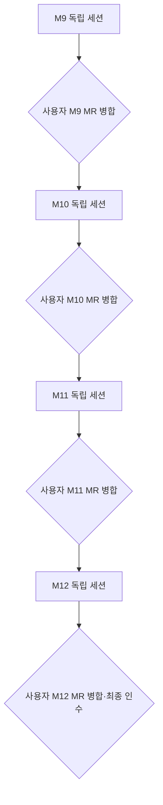
## M9. 기준 버전·운영 계약 확정

- 진행 배경: 로컬 기록과 원격 구현·검증 범위가 다르다.
- 진행 목적: 릴리스와 판정에 사용할 한 기준을 만든다.
- AS-IS: 오래된 세션과 병합된 코드가 혼재한다.
- TO-BE: 기준 SHA·서비스 범위·품질 목표·운영 책임이 명시된다.
- 작업 종료조건: 두 조회 API가 있는 기준을 고정하고 범위·품질표·비밀 복구 설계를 검토 가능한 문서로 확정한다.

### Slice 진행 순서

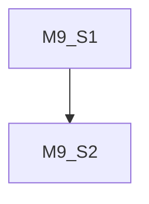

### M9-S1. 소스·증거 기준 정리

- 진행 배경: 공개 원격은 과거 로그를 포함하지 않는다.
- 진행 목적: 잘못된 구버전 배포와 증거 유실을 방지한다.
- AS-IS: 로컬 ec5f5dc와 원격 080f5d3가 다르다.
- TO-BE: 공개 안전화 기준의 작업 브랜치와 유효한 증거 요약이 있다.
- 작업 종료조건: 차이 목록·두 API·요구사항·안전한 증거 참조가 일치한다.

#### Task 진행 순서

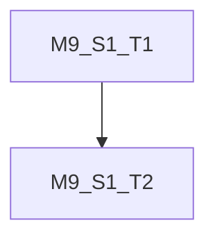

#### M9-S1-T1. 릴리스 후보 소스 확정

- 진행 배경: 현재 작업 폴더에는 M7/M8 구현이 없다.
- 진행 목적: 병합 버전을 실제 작업 기준으로 삼는다.
- AS-IS: 로컬 브랜치가 뒤처져 있다.
- TO-BE: 원격 최신 SHA를 재확인하고 독립 codex/ 브랜치 또는 체크아웃을 준비한다.
- 작업 종료조건: 기존 미추적 파일과 로컬 과거 이력을 보존하고 operator.py·retention·배포의 두 조회 기능을 확인한다. 과거 이력을 통째로 공개하지 않는다.

#### M9-S1-T2. 문서·기존 결과 정합화

- 진행 배경: root README는 개요 미작성이고 일부 컴포넌트 설명은 실장 전 시점이다.
- 진행 목적: 신규 담당자가 기준을 오해하지 않게 한다.
- AS-IS: 계획·세션·로그와 코드 상태가 다르다.
- TO-BE: root/component README를 먼저 보완하고 공개 가능한 과거 결과 요약 및 요구사항 추적표를 만든다.
- 작업 종료조건: 코드 수정 전 관련 README를 별도 커밋하며 M6 부분 완료/M7·M8 구현 완료/운영 미검증을 구분한다. PRD/SRS는 원격 최신판 기준으로 각각 독립 커밋한다.

### M9-S2. 개시 계약·비밀 복구 설계

- 진행 배경: 임시 키 주입과 불명확한 품질 목표로 상시 개시를 판정할 수 없다.
- 진행 목적: 실행 전 필요한 결정을 모은다.
- AS-IS: 재부팅 후 키 복구·서비스 시간·수치 목표가 미정이다.
- TO-BE: 담당자·정량 목표·비밀 주입/복구·장애 시 동작이 명확하다.
- 작업 종료조건: 6절 목표값을 확정하고 변경되는 아키텍처 결정은 ADR로 남기며 관련 승인 범위를 기록한다.

#### Task 진행 순서

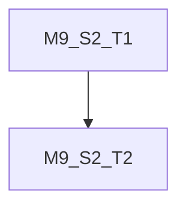

#### M9-S2-T1. 서비스·품질·시험 범위 합의

- 진행 배경: 전화 우선 범위는 확인됐지만 품질 수치는 승인되지 않았다.
- 진행 목적: 성공 기준과 시험 영향을 고정한다.
- AS-IS: 속도·복구 목표와 시험 시간대가 없다.
- TO-BE: 전화 우선 제공 기능·후속 범위·시험 번호/회선·통화 수·운영 시간·담당자를 정한다.
- 작업 종료조건: 이미 승인된 Gate 1 범위를 기록하고 6절 수치·현장 조건을 확정해 PRD/SRS에 추적한다. 상시 운영 요청과 시험 승인 범위를 따로 명시한다.

#### M9-S2-T2. 키·보존·장애 회수 방식 결정

- 진행 배경: tmpfs 비밀은 재부팅으로 사라지고 현재 서비스는 외부 착신 전체를 맡는다.
- 진행 목적: 재부팅 및 운영 중단에도 예측 가능하게 복구한다.
- AS-IS: 키 재주입 수단과 운영 중 장애 대응 책임이 없다.
- TO-BE: 관리자 수동 재주입, 보호된 호스트 비밀 저장, 외부 비밀 저장소/부팅 주입 대안을 복구시간·접근권한·가용성으로 비교한다.
- 작업 종료조건: 기존 보존 키 유지·백업/복구 위치·접근자·재주입 순서를 문서화하고 선택안을 ADR 제안/승인한다. 무인 복구가 안 되는 안이면 무인 상시 서비스 합격으로 처리하지 않는다. 장애 시 FXS 자동 우회를 가정하지 않는다.

## M10. 실제 전화·조회 사용 흐름 완결

- 진행 배경: 현재 발신 성공 1회는 다중 턴이나 반복 신뢰성을 증명하지 않는다.
- 진행 목적: 전화 우선 기능의 사용자 결과를 검증한다.
- AS-IS: F02 일부·F03/F04 및 조회 실장이 남았다.
- TO-BE: 발착신·종료·조회·점유·오류 결과가 동일 후보에서 확인된다.
- 작업 종료조건: 필수 전화/조회 시나리오가 통과하고 BUG-003의 원인 또는 재현되지 않는 조건·잔여 위험을 명시적으로 판정한다.

### Slice 진행 순서

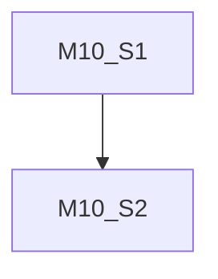

### M10-S1. 발신·착신·회선 수명 검증

- 진행 배경: 실제 연결과 내부 SIP 상태는 서로 다르다.
- 진행 목적: 통화 시작부터 상대 종료까지 확인한다.
- AS-IS: 착신 2턴 성공은 있으나 발신 2턴과 DTMF가 없다.
- TO-BE: F01~F03·필요한 D01~D03을 실행하고 종료 지연을 계측한다.
- 작업 종료조건: 실제 두 방향에서 최소 2턴·문맥·DTMF·상대 종료·회선 회수 증거가 있다.

#### Task 진행 순서

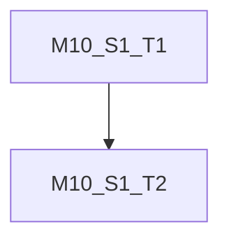

#### M10-S1-T1. 사전 점검·발신 결함 진단

- 진행 배경: 이전 미수신 원인이 미확정이다.
- 진행 목적: 실패를 재현 가능한 조건으로 좁힌다.
- AS-IS: 장비 설정과 실제 회선 상태가 최신인지 불명확하다.
- TO-BE: P0/D01, 필요한 D02와 별도 D03, F01을 기존 실행서 순서로 준비한다.
- 작업 종료조건: FXO Idle·모델 준비·정확한 허용 목록·백업/복구·수신 준비를 확인한다. 미허용/기능 코드 INVITE 0건. FXS 미준비면 진단 제한을 기록하고 예외를 별도 승인받는다.

#### M10-S1-T2. 발착신 연속 대화·종료 계측

- 진행 배경: 음성 두 턴과 시간 수치가 미완료다.
- 진행 목적: F02/F03 사용자 결과를 완결한다.
- AS-IS: 실발신 음성 미검증, 종료 버튼 시각 미수집이다.
- TO-BE: 허용 발신·착신 각각 같은 통화 2턴 이상, DTMF 수신, 사용자 종료 시각과 BYE/Idle을 함께 기록한다.
- 작업 종료조건: 두 방향의 청취·문맥·종료·다음 통화 수락 통과. DTMF는 별도 판정하며 실패를 통화 성공에 묻지 않는다. 미수신 반복 시 자동 재발신 없이 BUG-003 재현 증거를 남긴다.

### M10-S2. 실전화 내역·충돌·실패 검증

- 진행 배경: 조회 API는 합성 데이터로만 확인됐다.
- 진행 목적: 운영자의 실제 사용과 실패 후 재사용을 확인한다.
- AS-IS: 장비 Caller ID와 통화 파일의 실제 매칭이 미검증이다.
- TO-BE: 실제 새 통화가 목록·대화 조회로 이어지고 busy/취소 후 회복한다.
- 작업 종료조건: 실제 기록·인증·부분 데이터·회선/세션 회수의 통과 증거가 있다.

#### Task 진행 순서

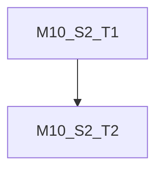

#### M10-S2-T1. Caller ID·착신 목록·대화 조회

- 진행 배경: 번호 헤더 설정 오류는 번호 누락/오인으로 이어질 수 있다.
- 진행 목적: M7/M8을 실제 전화 배포와 결합한다.
- AS-IS: 원격 API는 있지만 현장 적용이 없다.
- TO-BE: 장비 Caller ID Transport Type과 설정을 맞추고 발착신 통화 ID로 조회한다.
- 작업 종료조건: 착신 목록의 전체 번호/미표시 null·시각·상태, 발착신 대화 순서·같은 ID·다른 통화 격리 확인. 원문과 번호는 공유 로그에 남기지 않고 합격 여부만 기록한다. 발신 ID는 발신 API 응답에서 확보한다.

#### M10-S2-T2. 점유 충돌·중단·부분 기록

- 진행 배경: 정상 통화만으로 운영 실패를 판단할 수 없다.
- 진행 목적: F04/F05 및 오류 후 회수를 확인한다.
- AS-IS: 실제 busy·처리 중 종료·부분 기록의 결합 증거가 부족하다.
- TO-BE: 웹 시험 클라이언트 점유↔전화 busy, 처리/재생 중 종료·운영자 취소·새 통화 수락을 검증한다.
- 작업 종료조건: 활성 세션 최대 1개, 미인증/원격 조회 거부, 무발화·부분 턴·종료 누락 의미 확인. Caller ID 변형은 합성과 현장 증거를 구분한다. 실장 불가 변형은 미확인으로 남겨 인수 때 예외 판정한다.

## M11. 상시 배포·성능·복구 준비

- 진행 배경: 컨테이너 존재와 일회성 시험만으로 운영 재현성이 없다.
- 진행 목적: 사람의 임시 기동에 의존하지 않는 운영을 만든다.
- AS-IS: 키·캐시·재부팅·경보·롤백이 미완료다.
- TO-BE: 고정된 릴리스와 비밀 복구, 관측·회수 절차가 있다.
- 작업 종료조건: M10 통과 후보로 성능·장애·재부팅·데이터 복구를 확인하고 운영자가 절차를 재현한다.

### Slice 진행 순서

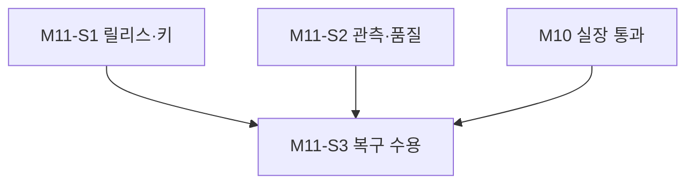

### M11-S1. 릴리스·키·기동 패키지

- 진행 배경: 모델 캐시는 컨테이너 교체 시 재사용 보장이 없다.
- 진행 목적: 설치·교체·기동을 반복 가능하게 한다.
- AS-IS: Compose와 일부 버전 고정만 있고 release manifest가 없다.
- TO-BE: 소스 SHA·이미지 digest·모델/사전 revision·설정 스키마·키 참조를 묶는다.
- 작업 종료조건: 기존 데이터/키를 유지한 배포·재부팅·롤백 절차가 있다.

#### Task 진행 순서

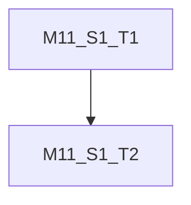

#### M11-S1-T1. 재현 가능한 배포·캐시

- 진행 배경: 재다운로드나 유동 의존성이 장애 복구를 지연시킬 수 있다.
- 진행 목적: 검증된 조합을 재배포한다.
- AS-IS: 모델 의존성 일부는 범위 지정이며 캐시 영속성이 보장되지 않는다.
- TO-BE: 이미지·가중치 체크섬/캐시·설정 사전점검·기동/중지/롤백 스크립트를 준비한다.
- 작업 종료조건: 비밀 없는 release manifest와 deploy/package/<확정 버전>/PATCHNOTE.md, 설치·롤백 명령이 있고 생성 설정은 scripts/로 재현된다.

#### M11-S1-T2. 비밀·데이터 영속성·부팅 순서 구현

- 진행 배경: restart 정책만으로 tmpfs 키와 준비 순서를 복구할 수 없다.
- 진행 목적: M9에서 선택한 설계를 운영에 적용한다.
- AS-IS: 일시 백엔드가 정리된 상태로 기록돼 있다.
- TO-BE: STT ready→30초→TTS 워밍업 ready→단일 worker 백엔드, 키/데이터 권한과 지속 경로를 검증한다.
- 작업 종료조건: 기존 암호문을 같은 키로 조회하고 비밀 누락/잘못된 권한에는 fail closed한다. 전화 NIC/방화벽·Caller ID·calls 경로를 포함하며 원문/키를 일반 로그에 노출하지 않는다.

### M11-S2. 관측·품질·용량

- 진행 배경: GPU 상주 성공은 실제 응답시간과 장기 자원을 보장하지 않는다.
- 진행 목적: 이용 가능한 품질과 조기 장애 발견을 확보한다.
- AS-IS: Grafana는 있으나 알림 전달과 품질 합격선이 없다.
- TO-BE: 단계별/전체 지연·준비 상태·자원·저장 용량·경보를 운영한다.
- 작업 종료조건: 합의한 지연·품질 목표 충족, 경보 발생/복구 전달과 30일 용량 근거가 있다.

#### Task 진행 순서

#### M11-S2-T1. 운영 알림·담당자 대응

- 진행 배경: 대시보드를 보지 않으면 장애를 놓친다.
- 진행 목적: 장애를 담당자가 알 수 있게 한다.
- AS-IS: Prometheus에 scrape 설정만 확인된다.
- TO-BE: 모델/backend unavailable, 보존 실패, 디스크 임계, 회선 잔류·비정상 통화 지속, OOM·추론 지연에 경보와 대응 절차를 둔다.
- 작업 종료조건: 시험 경보·복구 메시지를 지정 수신자가 확인하고 중복 억제·점검 모드·대응자·시한을 기록한다. 경보는 본문·번호·키를 담지 않는다. 실제 알림 발송은 지정 수신처 승인을 따른다.

#### M11-S2-T2. Q01 성능·장기 문맥·저장량 측정

- 진행 배경: 기존 0.327초는 전체 턴 지연이 아니며 코어 문맥은 턴마다 누적된다.
- 진행 목적: 대표 통화에서 자원·응답 품질을 판정한다.
- AS-IS: 대표 문장·장기 통화·30일 파일 스캔 비용이 미확정이다.
- TO-BE: 대표 질문과 5분 이상 통화·후속 통화에서 단계별 지연/첫 청취·RAM/swap/VRAM·API 문맥·조회 비용을 측정한다.
- 작업 종료조건: 6절 목표 충족, OOM/지속적 메모리 증가/조기 종료 없음. 30일 예상 음성량+메타데이터+감사·관측 로그를 산정한다. 부족 시 모델/메모리/문맥 제한 대안을 비교하고 의미 변경은 요구사항·ADR을 갱신한다.

### M11-S3. 장애·재부팅·롤백 수용

- 진행 배경: 상시 서비스는 정상 상태뿐 아니라 복구 결과가 중요하다.
- 진행 목적: Q02/Q03 및 운영 복구를 실제로 증명한다.
- AS-IS: 격리 모델 중지/복구만 일부 확인했다.
- TO-BE: 운영 후보가 장애 뒤 키·데이터·전화 포트를 일관되게 회복한다.
- 작업 종료조건: 통제된 장애·재부팅·롤백 후 신규 통화와 기존 기록 조회가 성공한다.

#### Task 진행 순서

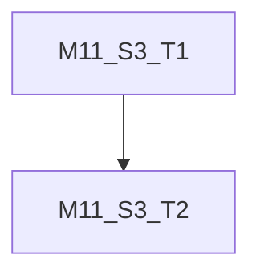

#### M11-S3-T1. 모델·작업 API·보존 장애 회수

- 진행 배경: 작업 API 정상 여부는 /health가 보장하지 않는다.
- 진행 목적: 정상 health와 실제 통화 성공을 구분한다.
- AS-IS: 실제 운영 장애 결합 결과가 없다.
- TO-BE: 모델 중지/복구, API timeout/인증 실패, 저장 실패·손상·삭제 실패를 격리 환경부터 검증한다.
- 작업 종료조건: 준비 상태·오류·알림·신규 요청 차단·회선/세션 회수와 복구 후 통화가 확인된다. 파일 장애는 시험 경로에서만 주입한다. 망 장애 실장은 승인된 점검 시간에만 한다.

#### M11-S3-T2. 재부팅·키/파일 복구·이전 릴리스 복원

- 진행 배경: 상시 운영 중단 뒤 복구 증거가 없다.
- 진행 목적: 릴리스 교체와 호스트 재시작에 대비한다.
- AS-IS: 재부팅 시 tmpfs 키 소실과 캐시 재다운로드 위험이 있다.
- TO-BE: FXO Idle 상태에서 GPU VM 재부팅·동일 키 복구·이전 릴리스 롤백을 수행한다.
- 작업 종료조건: 기동 순서·모델 ready·통화·기존 조회·30일 삭제·경보가 회복된다. 복구시간/손실 범위를 기록하고 기존 기록과 키를 지우지 않는다. 보존 백업을 도입하면 백업에도 30일 만료 정책을 적용한다.

## M12. 제한 운영·서비스 인수

- 진행 배경: 개별 시험 통과는 연속 운영 결과와 다르다.
- 진행 목적: 개시 여부를 실제 사용과 운영자 인수로 판정한다.
- AS-IS: 실행 때마다 개발자 지원이 필요하다.
- TO-BE: 운영자가 정해진 시간에 전화·조회·복구를 수행할 수 있다.
- 작업 종료조건: 합의한 관찰 기간·통화 표본·품질/운영 게이트를 통과하고 사용자가 개시를 확인한다.

### Slice 진행 순서

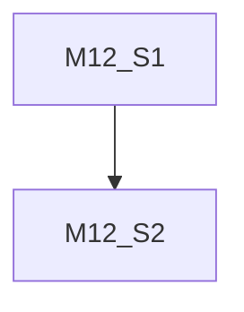

### M12-S1. 72시간 제한 운영

- 진행 배경: 단기 성공 뒤 자원 증가나 간헐적 미수신이 남을 수 있다.
- 진행 목적: 누적 안정성과 운영 부담을 확인한다.
- AS-IS: 장기 관찰 기록이 없다.
- TO-BE: 승인된 운영 시간·번호 범위에서 릴리스 후보를 지속 관찰한다.
- 작업 종료조건: 72시간·통화 표본·장애 대응 결과가 누락 없이 기록된다.

#### Task 진행 순서

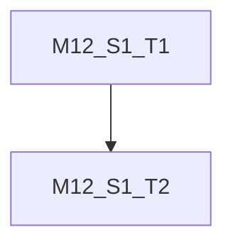

#### M12-S1-T1. 운영 시작·실제 반복 통화

- 진행 배경: 한 회선은 시험과 실제 이용이 충돌할 수 있다.
- 진행 목적: 정해진 범위에서 첫 서비스를 제공한다.
- AS-IS: 정식 운영 시작 시점이 없다.
- TO-BE: 시작 전 키/모델/회선/조회/경보 점검 후 제한 운영을 개시한다.
- 작업 종료조건: 운영자·중지 조건·연락처 확정. 발착신 합계 30통 이상(각 10통 이상), 합계 60턴 이상을 72시간에 분산해 관찰한다. 무인 시험 발신을 하지 않는다.

#### M12-S1-T2. 장애·품질·용량 결과 판정

- 진행 배경: 표본 부족이나 실패 누락은 과도한 확신을 만든다.
- 진행 목적: 개시 또는 보류를 증거로 판정한다.
- AS-IS: 성공률·지연 분포·비정상 회선 점유의 집계가 없다.
- TO-BE: 시도/성공/실패/원인/표본 수와 p50/p95·자원 추세를 보고한다.
- 작업 종료조건: 미수신 재발·회선 잔류·비밀 노출·데이터 손상 등 개시 차단 결함 0건. 기준 미달 시 보완 후 영향 범위 재시험·관찰 재시작을 결정한다. 적은 표본으로 장기 SLA를 주장하지 않는다.

### M12-S2. 운영 인수·후속 정리

- 진행 배경: 개발자만 사용할 수 있으면 서비스 운영이 완결되지 않는다.
- 진행 목적: 운영자에게 사용·중지·복구 수단을 넘긴다.
- AS-IS: 명령과 상태 해석이 여러 문서에 흩어져 있다.
- TO-BE: 일상 운영 안내와 릴리스/결함 상태가 연결된다.
- 작업 종료조건: 운영자가 핵심 절차를 직접 재현하고 개시 판단과 후속 작업을 기록한다.

#### Task 진행 순서

#### M12-S2-T1. 운영 매뉴얼·사용자 안내 인수

- 진행 배경: 운영 API와 오류 의미를 설명해야 한다.
- 진행 목적: 전화와 조회를 일상적으로 사용하게 한다.
- AS-IS: 운영 가이드 일부와 조회 API 문서만 있다.
- TO-BE: 시작·상태·허용 발신·취소·착신 목록·발신 ID 보관·대화 조회·장애 회수·키 복구 명령을 묶는다.
- 작업 종료조건: 운영자가 절차대로 수행. 번호 미표시 null, 텍스트 없음 404, 손상 503, incomplete 의미와 백엔드 중지 중 부재중 기록 미지원·동시 1세션을 이해한다. 서비스/보존/외부 처리 안내와 문의 경로를 확정한다.

#### M12-S2-T2. 개시 판정·기존 작업 정산

- 진행 배경: 새 릴리스 완료가 기존 PRD 전체 완료를 뜻하지 않는다.
- 진행 목적: 전화 우선 서비스의 정확한 완료 범위를 남긴다.
- AS-IS: 기존 M6와 후속 웹/FXS 상태가 혼재한다.
- TO-BE: 패치노트·로그·세션·원 이슈/계획에 실제 결과를 연결한다.
- 작업 종료조건: 8절 게이트 통과 뒤 사용자 개시 확인을 기록한다. 웹/FXS·DTMF 등 미완료가 있다면 명시적 범위 변경 없이는 성공으로 바꾸지 않는다. 기존 계획의 미완료 항목을 보존한다.

---

# 4. 의존성

## A. 내부 의존성

- M9는 모든 실행의 선행조건이다. 사용자 최신 지시에 따라 M9 MR 병합→M10 MR 병합→M11 MR 병합→M12 순으로 진행한다. 단계 내부 독립 작업만 병렬화하며 같은 전화 포트·회선·운영 키에 대한 변경은 직렬화한다.
- M6의 F01~F05/Q01~Q03은 기존 [실행서](../../guides/m6-remaining-test-runbook.md)를 재사용한다. 이번 계획의 M10/M11 로그에서 원 요구사항과 기존 M6 작업을 함께 참조한다.
- M7/M8은 원격에서 executed다. 재작성하지 않고 신규 운영 검증만 추가한다. 별도 발신 목록은 현재 없으므로 발신 API가 돌려준 session_id로 대화를 조회한다.
- ADR-003·005·007·008·011·012와 ADR-011이 계승한 직접 LAN/전체 착신 정책을 유지한다. 신규 비밀 관리·문맥 처리·배치 변경은 선택 시 ADR을 기록하고 승인한다. 이 계획에서 새로운 아키텍처를 수락된 것으로 선언하지 않는다.

## B. 외부 의존성

현장 담당자의 HT813 설정/FXO 상태 확인, 발화·수신 가능한 시험 시간, GPU/관측 VM 읽기·배포 권한, 기존 보존 키의 관리자가 필요하다. 비밀값·실제 번호를 문서나 채팅으로 수집하지 않는다. 테스트 대상과 운영 값은 추적되지 않는 설정으로 관리한다. RAM 증설·회선 변경은 측정 결과에 따라 별도로 결정한다.

---

# 5. 리스크 및 대응

|리스크|영향|대응 방안|
|---|---|---|
|구버전 소스/과거 비공개 이력 혼합|조회 기능 누락·민감 운영 자료 재공개|M9에서 안전화 원격 SHA 기준 작업, 기존 로그 원문 대신 검토한 요약만 이관|
|발신 미수신 재발|서비스 핵심 기능 실패|BUG-003 유지, D01~D03 원인 분리·연속 통화 표본으로 재판정|
|종료 톤 오검출/잔류 회선|중간 끊김·다음 통화 불가|장시간 Q01, 종료시각 측정·Idle 확인·운영 중지/회수 절차|
|3.8 GiB RAM·swap와 문맥 누적|장기 지연/OOM/API 문맥 제한|대표 부하·장기 통화 측정, 필요 시 RAM·문맥/응답 한도 설계. 무음만으로 정상 통화를 끊는 정책을 임의 도입하지 않음|
|키 소실·잘못된 키 교체|기존 기록 영구 접근 불가|M9 설계, 같은 키 유지·접근 통제·복구 훈련·실패 시 준비 차단|
|음성·메타데이터·로그 증가|보존 실패·서비스 차단|예상 30일 용량과 경보. PCM16/16kHz mono는 방향별 32,000 bytes/s: 하루 입력초+출력초에 곱해 30일 산정하고 여유·부가 로그를 추가|
|작업 API/관측 VM 장애|응답 실패·장애 가시성 상실|의존성별 상태와 외부 작업 실패 메트릭, 관측 경로 중단 경보 및 수동 점검 절차|
|공개 착신·발신 운영 API 오용|회선 독점·오발신|전체 착신 정책과 단일 세션 유지, 로컬 인증·정확 번호 제한·운영 취소·사용량 감시. Caller ID를 인증으로 바꾸지 않음|
|서비스 범위 과장|업무 수행/웹/고가용성 제공 오해|초기 서비스 기능·1세션·장애 시 이용 불가·부재중 조회 제한을 안내|

---

# 6. 검증 전략

## A. 단위 테스트 (tests/units/)

릴리스 후보의 orchestrator/model-serving 기존 시험을 재실행하고 새 변경의 계약·취소·준비 상태·키 누락·보존 실패·조회 정렬/인증 회귀를 추가한다. 결함은 재현 실패→수정 후 통과 증거를 남긴다. 시험은 각 컴포넌트 README의 pytest 설정을 사용하고 가짜 피어/모델/API로 분리한다. PR의 122건을 새 버전의 통과 수로 재사용하지 않는다.

## B. 통합 테스트 (tests/integrations/)

- 통합 테스트 필요 여부 검토 결과: **필요**. 전화↔RTP↔모델/API↔암호화 파일↔조회 및 배포/재부팅은 단위 시험으로 대체할 수 없다.
- 사전승인 (Gate 1): **승인**. 2026-10-16 사용자 “네, 승인합니다”로 본 계획의 전화/조회·성능·복구·제한 운영 묶음 사전승인을 받았다. 단계 착수·완료 인수는 별도 MR 병합 게이트를 따른다. 기존 다른 계획의 승인을 재사용한 것이 아니다.
- 실행 직전 승인 (Gate 2): **실행 묶음별 미승인**. 명령·시간·전화 수·키/파일 경계·장비 영향·원복안을 담당 세션의 실행안 MR에 명시하고 통합 테스트 생성·실행 전에 사용자 병합으로 해당 묶음을 승인받는다. 결과 MR로 사후 소급 승인하지 않는다. 단계 완료 MR 병합만으로 내용 없는 후속 실전화·배포를 포괄 승인한 것으로 보지 않는다. 이미 병합된 실행안이 정확히 해당 범위를 승인하고 조건이 유지되면 같은 승인을 다시 요청하지 않는다. FXO Idle·수신 준비 같은 현장 사실 확인은 별도로 수행한다.
- 대상 시나리오: 아래 표. 테스트 생성/수정은 `.agents/workflows/create-testcase.md`를 따르고 실제 실행은 `.agents/workflows/how-to-work.md`를 따른다. 새 운영 요구사항은 먼저 PRD/SRS에 기록한다.

|묶음|추적 요구사항|검증·증거|통과 기준|
|---|---|---|---|
|전화 기본/F01~F03|PRD-02/03/05, SRS-T01~T06·I01~I03|실제 벨·2턴 이상 음성·문맥·DTMF·BYE/RTP/Idle|허용 번호만 발신, 양방향 대화·상대 종료·다음 통화 수락|
|충돌/F04/F05|SRS-C03·T04·I01/I04/I05|점유 중 전화/웹 요청, 타 피어·Caller ID 변형|중복 활성 0, 타 피어 호출 0, 표시 번호로 접근 필터링하지 않음|
|전화→내역|PRD-07/08, SRS-I06·O04|실제 통화와 동일 ID로 착신/대화 조회, 무발화·부분/손상·권한|번호 헤더 일치/null·시간·상태·순서, 401/403/404/422/503 계약 일치|
|보존·복구|PRD-06, SRS-O01/C05|합성 파일 30일 경계·삭제 감사·권한, 같은 키 복구|평문/키 비노출, 손상/삭제 실패 처리, 기존 파일 접근 연속성|
|품질/Q01|PRD-05, SRS-O02/O03 및 M9 보완 요구|대표 문장·전화 부하·장기 문맥·자원/단계별 지연|아래 제안값을 M9에서 합의한 기준으로 판정|
|장애/Q02/Q03|PRD-06 및 M9 보완 요구|모델/API/파일 오류·재부팅/롤백 후 신규 통화·조회|회선/점유 회수·경보·키/데이터 보존·복구 목표 충족|

### 첫 개시 수용 수치 초안 — 아직 승인된 요구사항이 아님

|항목|제안 기준|측정·유의사항|
|---|---|---|
|응답 지연|발화 종료→첫 응답 음성 p95 ≤8초, 개별 턴 15초 초과는 원인 분석/개시 재판정|최소 60턴의 실제 시각. TTS 추론 시간·전체 답변 재생 길이와 구분. M9에서 현실적 목표 확정|
|한국어 사용성|대표 요청 20개 중 18개 이상 의도 이해와 청취 가능한 응답, 수치/고유명사 실패 별도 보고|운영자가 기대 결과를 사전 작성. 음질·정확도·업무 수행을 혼동하지 않음|
|정상 종료|종료 버튼 시각부터 10초 이내 FXO Idle·RTP/세션 해제|동일 시계/사용자 시각 근거 확보. 근거 없으면 수치 통과 처리 금지|
|안정성|72시간, 30통 이상(발착신 각각 10통 이상), 60턴 이상, 최소 5분 통화 포함|오발신·잔류 회선·OOM·데이터 손상·비밀 노출·비정상 중단 0. 작은 표본으로 SLA 확정 금지|
|복구/경보|장애 감지·운영자 알림 ≤2분, 재부팅 후 준비/통화 복구 ≤10분 목표|GPU 워밍업·비밀 주입·실전화 시간을 포함. 목표 미달이면 변경안/운영 제약을 합의|
|저장·조회|예상 30일 파일량에서 목록/대화 조회 p95 ≤2초, 저장공간 30일 예상량+30% 여유|합성 파일로 용량·파일 스캔 비용 측정. 기존 모델·관측/감사 로그 공간 별도 반영|

이 수치는 서비스 개시를 판단하기 위한 제안이며 현재 성능이나 보장치가 아니다. 목표 미달을 이유로 시험 후 기준을 조용히 완화하지 않는다. 변경 근거와 승인 기록을 남긴다.

---

# 7. 롤아웃 / 마이그레이션

1. 안전화 원격 최신 커밋을 기준으로 후보를 고정하고 새 문서·단위 회귀 및 필요한 합성 경계를 검증한다. 기존 로컬 이력/비밀은 공개하지 않는다.
2. 운영 중 전화 없음·FXO Idle을 확인한 점검 시간에 설정과 데이터 경로·동일 암호화 키 참조를 보존한다. 키 값을 릴리스 패키지에 넣지 않는다. 새 calls 경로·Caller ID 환경변수 매핑도 확인한다.
3. 모델 캐시·이미지·비밀 주입 준비 후 STT→TTS→backend 순으로 기동한다. 단일 worker와 포트 충돌·관리망 제한을 확인한다.
4. M10 실전화와 M11 성능/복구를 후보 버전에서 수행한다. 패키지나 앱이 바뀌면 영향받는 통화·조회 경계를 다시 확인한 후 M12에 진입한다.
5. 개시 차단 실패가 생기면 새 시험/발신을 중단하고 활성 통화를 정상 BYE로 정리해 FXO Idle을 확인한다. 이전 검증 이미지·설정을 복원하고 같은 키·데이터를 유지한다. DB 마이그레이션은 없지만 새 메타데이터와 구버전 삭제기의 호환성·고아 파일을 검증한다.
6. 이전 버전도 안전하게 통화할 수 없으면 서비스 중단을 유지하고 운영자에게 알린다. 검증되지 않은 FXS 자동 전환을 켜지 않는다. 데이터 볼륨 삭제·기존 키 교체는 롤백 수단으로 사용하지 않는다.
7. 72시간 제한 운영 후 사용자와 개시 여부를 판정하고 릴리스 버전/패치노트를 확정한다. 현재 dev/v0.0.1과 PRD/SRS 0.1.0의 버전명 차이도 M9에서 정리한다.

---

# 8. 완료 게이트

- [ ] M9 기준 SHA·문서·요구사항·품질 목표·담당자·비밀 복구 방식 확정
- [x] 계획 실행 승인과 통합 시험 Gate 1 기록 — 2026-10-16 사용자 승인
- [ ] 각 단계 결과 MR의 사용자 병합 및 실행 묶음별 Gate 2 기록
- [ ] 실제 발신/착신 각각 2턴 이상·문맥·DTMF·종료·다음 통화 수락
- [ ] 오발신 차단·busy·취소·오류 후 회선/세션 회수
- [ ] 실제 Caller ID/null·착신 기록·발착신 대화·인증 및 오류 계약 확인
- [ ] 같은 키·30일 정책·권한·저장/삭제 장애·백업 도입 시 백업 만료 검증
- [ ] 대표 품질·전체 지연·RAM/swap/VRAM·30일 용량/조회 비용 목표 통과
- [ ] 재부팅·장애·이전 릴리스 복구 후 통화와 기존 내역 조회 성공
- [ ] 장애/복구 경보가 담당자에게 도달하고 운영 절차 재현
- [ ] 72시간 제한 운영 및 통화 표본 기준 통과, 개시 차단 결함 없음
- [ ] 실행 로그·단위/통합 시험 로그·패치노트·README/guides·세션 갱신
- [ ] 사용자 전화 우선 서비스 개시 확인. 웹/FXS 미완료는 후속으로 명시

기존 BUG-003은 한 번 성공했다고 닫지 않는다. 원인을 확인해 수정했거나, 반복 수용 시험 결과와 원인 미확정 위험을 사용자가 검토해 개시 가능하다고 판정한 근거가 필요하다. 수용 시험에서 다시 미수신하면 개시를 보류한다.

---

# 9. 참고자료

- [원본 이슈](../0_issues/VOIC-OPS-008.md), [현황 조사 로그](../2_logs/VOIC-OPS-008-log-01.md)
- [M6 계획](VOIC-FEAT-001-plan-02.md), [잔여 시험 실행서](../../guides/m6-remaining-test-runbook.md)
- [모델·관측 운영](../../guides/model-serving-observability.md)
- [PR #1 — 착신내역](https://github.com/callme-waffle/lifeservice-voice-agent/pull/1), [PR #2 — 대화내역·병합 검증](https://github.com/callme-waffle/lifeservice-voice-agent/pull/2)
- [원격 PRD](https://github.com/callme-waffle/lifeservice-voice-agent/blob/080f5d3472d58d6bfdbbb3a2b5fa4b922bcec244/docs/ideas/prd/0.1.0.md), [원격 SRS](https://github.com/callme-waffle/lifeservice-voice-agent/blob/080f5d3472d58d6bfdbbb3a2b5fa4b922bcec244/docs/ideas/srs/0.1.0.md)
- [ADR-003 운영 제약](../3_decisions/ADR-003-initial-task-backend-and-operating-constraints.md), [ADR-005 웹 계약](../3_decisions/ADR-005-web-voice-transport-and-access.md)
- [ADR-007 다중 턴](../3_decisions/ADR-007-ht813-multiturn-call-lifecycle.md), [ADR-008 암호화 보존](../3_decisions/ADR-008-local-encrypted-retention.md)
- [ADR-011 모델 상주·관측](../3_decisions/ADR-011-warm-model-services-observability.md), [ADR-012 통화 이력](../3_decisions/ADR-012-encrypted-call-index-for-history.md)

## M9 검토 산출물

- [기준·증거 요약](../../guides/service-readiness-baseline.md)
- [전화 우선 운영 계약·수용 기준 제안](../../guides/service-readiness-contract.md)
- [ADR-013 비밀·백업 복구 제안](../3_decisions/ADR-013-secret-recovery-and-backup.md)
- [M9 실행 로그](../2_logs/VOIC-OPS-008-log-03.md)

계획은 approved를 유지한다. M9 결과 MR 제출은 사용자 병합 인수 또는 전체 계획 executed가 아니다.
